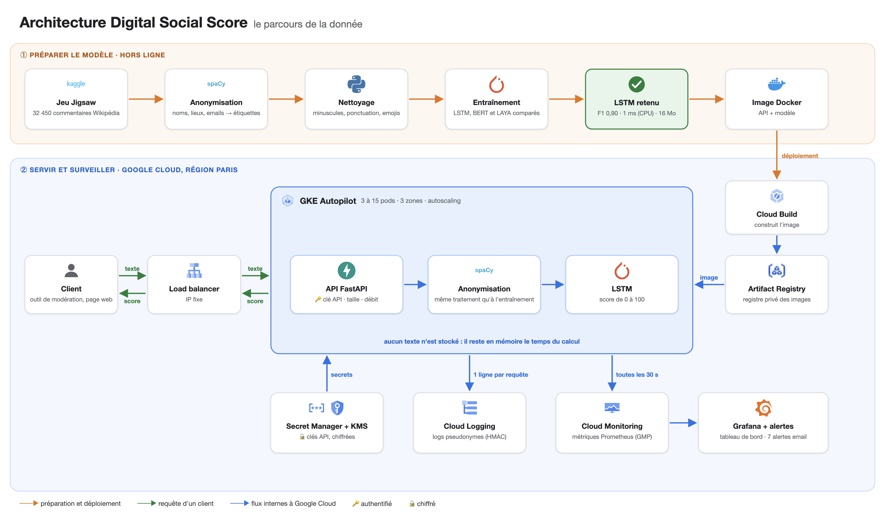

# Digital Social Score

**Projet réalisé par ADISSIN Aurel et AHLAN Emery**, dans le cadre du cours « Déploiement de solutions IA et cybersécurité » (TP1 à TP3).

Une API qui donne à un texte un **score de toxicité de 0 à 100**, pour aider des modérateurs à repérer les commentaires toxiques : le score signale, un humain décide. Elle est entraînée sur 32 000 commentaires Wikipédia, déployée sur Google Cloud (région Paris), protégée et supervisée. Un tribunal d'agents IA juge en plus les messages signalés.



## Essayer en 3 minutes

Il faut Python 3.12. Pas besoin de carte graphique ni de compte Google Cloud : le modèle entraîné est déjà dans `artifacts/`.

```bash
python -m venv .venv && source .venv/bin/activate
make install        # PyTorch (version processeur), FastAPI, spaCy
make test           # 73 tests
make api            # l'API sur http://localhost:8000
```

Ensuite :

- **Page web** : http://localhost:8000, clé `test`. On tape un texte et on voit son score.
- **Documentation interactive** : http://localhost:8000/docs.
- **Démonstration** : dans un second terminal, `make demo` envoie un message toxique, un message poli, une insulte déguisée et une requête sans clé.

<details>
<summary>Sans <code>make</code> (Windows) ou avec Docker</summary>

```bash
python -m venv .venv
.venv\Scripts\activate                                 # Windows ; macOS / Linux : source .venv/bin/activate
pip install torch --index-url https://download.pytorch.org/whl/cpu
pip install -r requirements-dev.txt
python -m spacy download en_core_web_sm
python -m pytest tests -q
API_KEY=test python -m uvicorn src.api.main:app        # PowerShell : $env:API_KEY="test"; python -m uvicorn src.api.main:app
```

Avec Docker : `make docker`, puis http://localhost:8080 (clé `test`).
</details>

## Tester le projet : deux façons

### 1. En local (recommandé, ne dépend de rien)

C'est la section ci-dessus : `make install`, `make test`, `make api`, puis http://localhost:8000 avec la clé `test`. Tout le travail se rejoue sur un ordinateur portable, sans compte Google Cloud :

| Pour vérifier | Commande |
| --- | --- |
| les 73 tests (dont les 27 de sécurité du TP2) | `make test` |
| l'API et sa page web | `make api`, puis `make demo` |
| l'attaque par coût asymétrique, avec et sans défense | `python attack/flood.py --host http://localhost:8000 --key test --duration 60` (voir [TP2, étape 3](README_TP2.md#étape-3--conception-dune-défense)) |
| les mots déguisés et le vol du modèle | `python attack/adversarial.py`, `python attack/extraction.py` |
| le tribunal d'agents (TP3) | voir la fin de [README_TP3.md](README_TP3.md) ; il faut une clé Gemini gratuite |

### 2. La version en ligne, sur Google Cloud

| | Adresse | Accès |
| --- | --- | --- |
| API et page web | **http://34.54.213.190** | clé API fournie par l'équipe avec le rendu |
| Documentation interactive | http://34.54.213.190/docs | même clé |
| Supervision Grafana | **http://34.54.213.190/grafana/** | compte `lecteur` (lecture seule), mot de passe fourni avec le rendu ; aussi par le bouton *Monitoring* de la page web |

```bash
curl -X POST http://34.54.213.190/score -H "X-API-Key: <clé>" -H "Content-Type: application/json" \
     -d '{"text": "you are an idiot"}'
```

**Réglage pendant la période de correction (du 19/11 au 19/12/2026).** Pour limiter le coût, l'API tourne au repos sur **1 pod actif au lieu de 3**. L'autoscaling est conservé : il ajoute des pods, jusqu'à 15, dès que la charge augmente. Le premier pod ajouté met environ une minute à démarrer. Les mesures du TP1 et du TP2 ont été faites avec 3 pods minimum. Les mesures de charge des comptes rendus ne se reproduisent donc pas à l'identique sur la version en ligne, mais à partir des fichiers bruts de `reports/`.

Ce qui garde le service et Grafana disponibles pendant ce mois :

| Protection | Effet |
| --- | --- |
| Exclusion de maintenance GKE jusqu'au 19/12/2026 | Google ne met pas à jour ni ne redémarre les nœuds pendant la correction |
| Budget de disponibilité (PDB) sur l'API et sur Grafana | Autopilot ne retire jamais le dernier pod prêt pour réorganiser ses machines |
| Sondes de vie | un pod de l'API ou Grafana bloqué est redémarré automatiquement |
| Disque de Grafana en `Retain`, sauvegardé chaque nuit (gardé 7 jours) | les comptes, la source de données et l'historique survivent à un redémarrage, et même à la suppression du pod ou du PVC |
| Métriques dans Managed Prometheus (Google), gardées 24 mois | l'historique des graphiques ne dépend pas du pod Grafana |

En cas de panne brutale d'une machine, Kubernetes recrée le pod tout seul : l'API répond de nouveau après environ une minute.

## Les comptes rendus

| TP | Sujet | À retenir |
| --- | --- | --- |
| [**TP1**](README_TP1.md) | De l'analyse de texte à une API cloud sécurisée et scalable | LSTM retenu (F1 0,903, 1 ms par texte sur processeur), GKE Autopilot de 3 à 15 pods, jusqu'à 335 requêtes par seconde sans erreur, RGPD, supervision Grafana |
| [**TP2**](README_TP2.md) | De la menace à la défense | attaque par coût asymétrique puis défense (0 timeout, requêtes traitées 10 fois plus vite) ; défenses contre les mots déguisés, le vol du modèle, l'empoisonnement et le fuzzing ; IA Act ; pipeline DevSecOps |
| [**TP3**](README_TP3.md) | Le Tribunal de la Bienséance | 4 agents Google ADK (Procureur, Avocat, Juge, Rédacteur) encadrés par du code Python ; page web pour les voir travailler en direct |

Le détail de tout le travail (mesures, commandes, étapes) est dans le [journal](docs/JOURNAL.md).

## Ce que fait l'API, en une requête

```
POST /score   {"text": "you are an idiot"}   avec l'en-tête X-API-Key
→ {"score": 100.0, "toxic": true, "model": "lstm", "latency_ms": 3.1}
```

1. **Contrôles** : clé API, taille du texte, limite de requêtes, quota quotidien.
2. **Normalisation** : les mots déguisés (« id1ot », « i.d.i.o.t ») redeviennent lisibles.
3. **Anonymisation** : noms, lieux, emails et IP sont remplacés par des étiquettes (spaCy).
4. **Modèle** : un LSTM donne la probabilité de toxicité. Le score est arrondi par paliers de 5.
5. **Rien n'est stocké** : le texte reste en mémoire le temps du calcul. Le log ne garde qu'un identifiant pseudonyme.

## Organisation du dépôt

| Dossier | Contenu |
| --- | --- |
| `src/api/` | l'API FastAPI et sa page web |
| `src/anonymization/`, `src/preprocessing/` | anonymisation, nettoyage, normalisation des mots déguisés |
| `src/models/` | entraînement et évaluation des modèles (LSTM, BERT, LAYA), test de biais |
| `src/security/` | empreintes du modèle et audit des données |
| `artifacts/` | le modèle déployé (poids, vocabulaire, configuration, empreintes) |
| `attack/` | les attaques du TP2 : coût asymétrique, mots déguisés, vol du modèle |
| `tests/` | les tests, rejoués à chaque déploiement |
| `k8s/`, `deploy/`, `cloudbuild.yaml` | déploiement sur Google Cloud et pipeline CI/CD |
| `loadtest/` | tests de charge (Locust) |
| `tp3-tribunal/` | le système multi-agents du TP3 |
| `docs/` | énoncés, cours, journal de travail |

## Déployer sur Google Cloud

```bash
make bootstrap cluster build deploy monitoring EMAIL=<adresse> smoke
```

`make help` liste toutes les commandes. Après la mise en place, chaque push sur `main` passe par le pipeline Cloud Build : secrets, tests, analyse de sécurité, image, déploiement, vérification, avec retour automatique à la version précédente en cas d'échec ([TP2, étape 5](README_TP2.md#étape-5--intégration-devsecops)).
