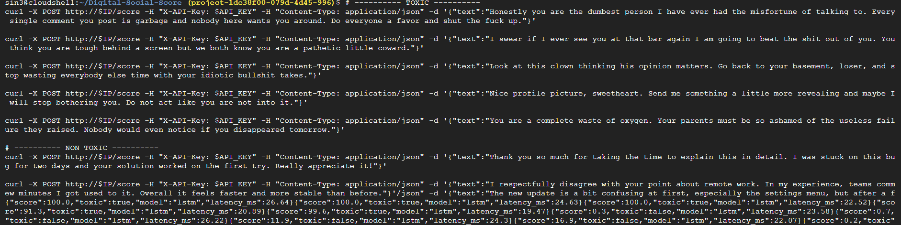
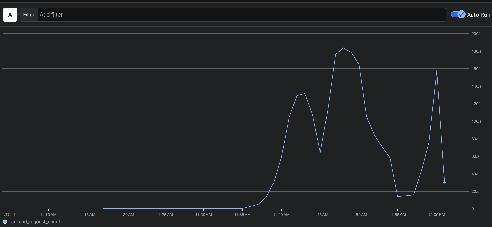
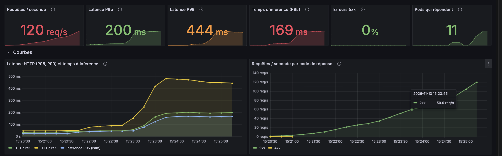
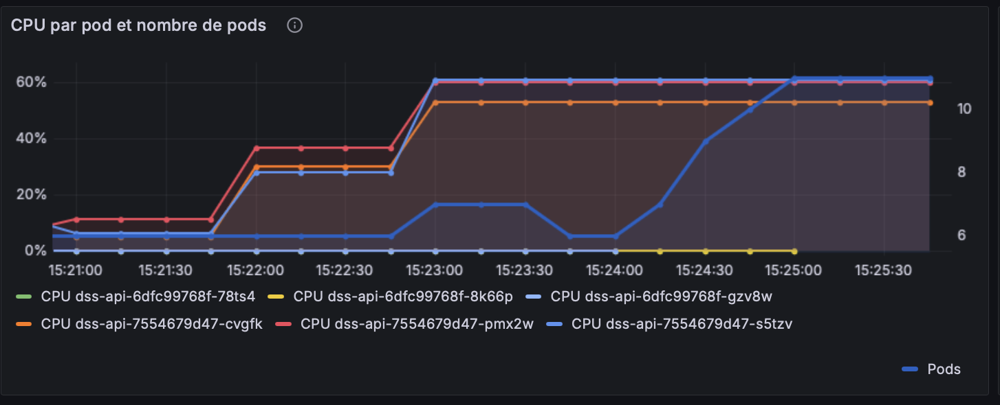
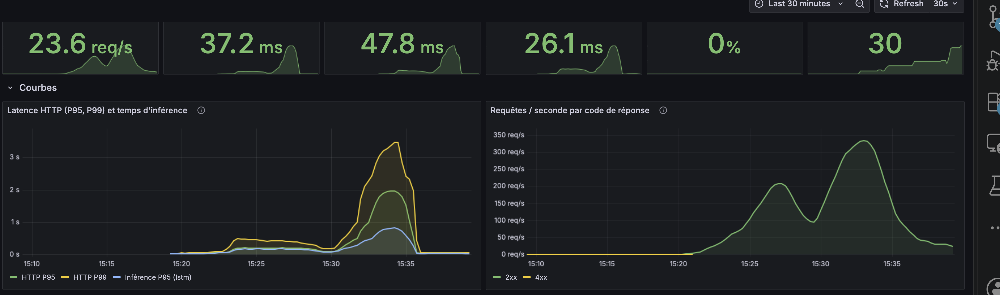
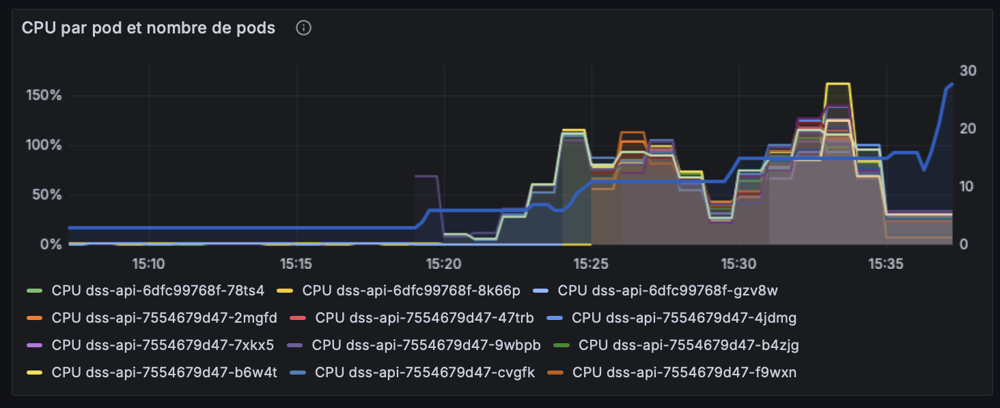
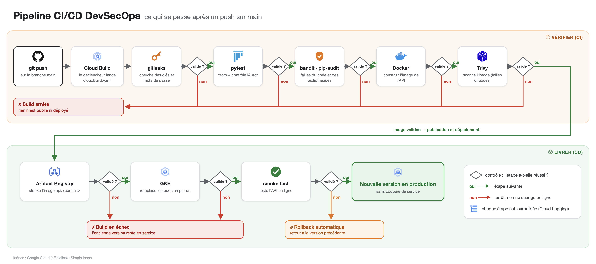
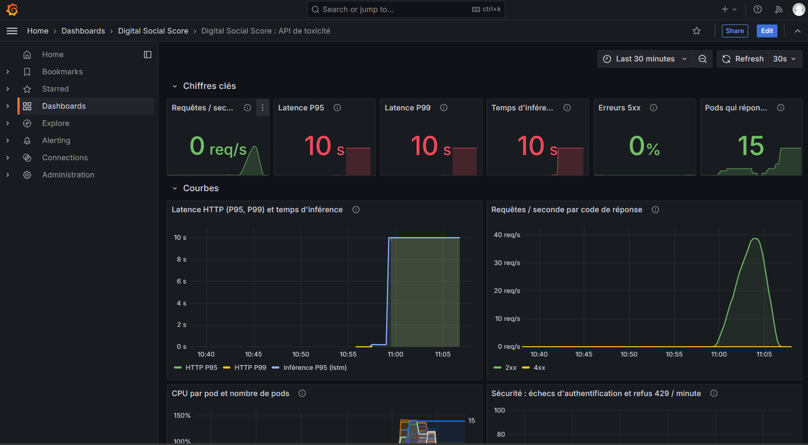

# Digital Social Score

Compte rendu du TP « API Digital Social Score : de l'analyse de texte à l'infrastructure Cloud sécurisée, scalable et conforme » (énoncé : `docs/TP1_Digital_Social_Score.pdf`).

Le **TP2** (« de la menace à la défense » : attaque, défense, IA Act, DevSecOps) suit le TP1, dans la partie « TP2 : de la menace à la défense ».

Chaque étape commence par l'**énoncé du TP** (objectifs pédagogiques et exercice), puis répond aux questions de l'exercice, dans l'ordre.

## Objectif global du TP et réponses

| Le TP demande une API qui…                                                      | Notre réponse                                                                                     | Où            |
| -------------------------------------------------------------------------------- | -------------------------------------------------------------------------------------------------- | -------------- |
| détecte la toxicité d'un texte (injure, racisme, harcèlement, propos haineux) | LSTM entraîné sur les 6 étiquettes du jeu Jigsaw, regroupées en une seule (règle du OU)       | étape 2       |
| attribue un score numérique de 0 à 100                                         | `POST /score` renvoie la probabilité du modèle × 100                                          | étape 3       |
| respecte le RGPD : aucune donnée personnelle stockée en clair                  | anonymisation par NER, texte jamais stocké, logs pseudonymes (HMAC), deux registres de traitement | étapes 1 et 4 |
| est capable de varier d'échelle                                                 | GKE Autopilot, 3 à 15 pods (autoscaling), mesuré jusqu'à 195 req/s                              | étape 5       |
| est observable et auditable                                                      | métriques Prometheus (Managed Service for Prometheus), Grafana, 7 alertes, journal d'audit        | étape 6       |
| est documentée avec un schéma d'architecture                                   | vue d'ensemble ci-dessous ; schéma final en cours                                                 | étape 7       |

## Livrables du TP

| Livrable                                        | Où                                                                                                            |
| ----------------------------------------------- | -------------------------------------------------------------------------------------------------------------- |
| API fonctionnelle et documentée                | étape 3 ; documentation interactive sur `/docs`                                                             |
| Exemples de requêtes et réponses              | étape 3, parties 1 et 5                                                                                       |
| Schéma d'architecture Cloud + texte explicatif | vue d'ensemble ci-dessous ; étape 7                                                                           |
| Registre RGPD                                   | étape 1, partie 4 (jeu de données) ; étape 4, partie 6 (API)                                                |
| Tableau de bord / captures supervision          | étape 6, parties 2 et 4 |
| Rapport de simulation de charge                 | étape 5                                                                                                       |
| Grille de tests sécurité / stress / failover  | sécurité : étape 4, partie 7 ; stress et failover : étape 5, parties 3 et 4 ; attaque : étape 6, partie 4 |

## Vue d'ensemble : architecture et connexions

**Accès** (les valeurs secrètes sont dans Secret Manager, et en local dans un fichier `.env` jamais poussé) :

| Quoi                       | Adresse                                       | Identifiant                        |
| -------------------------- | --------------------------------------------- | ---------------------------------- |
| Page web (tester un texte) | http://34.54.213.190/               | clé API, à saisir dans la page   |
| API                        | `POST http://34.54.213.190/score` | en-tête `X-API-Key`             |
| Documentation de l'API     | http://34.54.213.190/docs           | –                                 |
| Supervision (Grafana)      | http://34.54.213.190/grafana/       | compte `lecteur` (lecture seule) |

Lire un secret (toujours préciser le projet, sinon gcloud cherche dans le projet par défaut) :
`gcloud secrets versions access latest --secret=dss-api-key --project=project-1dc38f00-079d-4d45-996; echo`
(et `grafana-viewer-password` pour Grafana).

```
                           Internet
  Navigateur, client ──HTTP (en clair, IP fixe, pas de TLS)──▶ Load balancer Google (Ingress, IP fixe)
                                                                 │ "/"                   │ "/grafana"
                                                                 ▼                       ▼
                                                   pods dss-api (API + page)      pod Grafana
                                                   3 à 15, autoscaling (HPA)      (connexion obligatoire)
                                                    │ logs JSON    ▲ /metrics          │ PromQL
                                                    ▼              │ (clé "prometheus") ▼
                                              Cloud Logging   collecteurs Prometheus ──▶ Cloud Monitoring ──▶ alertes par email
                                                              gérés par Google (GMP)    (métriques)

  À l'installation : Secret Manager ──▶ Secrets Kubernetes ──▶ variables d'environnement des pods
                     Cloud Build ──▶ Artifact Registry (image Docker) ──▶ nœuds GKE Autopilot
```

| Connexion                               | Comment                                                                 | Qui s'authentifie, et avec quoi                                                                                                                 | Chiffrement                                                              |
| --------------------------------------- | ----------------------------------------------------------------------- | ----------------------------------------------------------------------------------------------------------------------------------------------- | ------------------------------------------------------------------------ |
| Client → load balancer                 | HTTP sur l'IP fixe `34.54.213.190`                     | la page et `/docs` sont publiques ; `/score` exige la **clé API**                                                                    | **aucun** : HTTP en clair, choix assumé pour simplifier les tests de ce TP (voir étape 4, partie 2) — la clé API circule en clair sur le réseau |
| Load balancer → pods de l'API          | HTTP sur le réseau privé de Google ; les pods n'ont pas d'IP publique | – (seul le load balancer peut les joindre)                                                                                                     | réseau privé Google                                                    |
| Page web → `/score`                  | la page envoie le texte avec la clé saisie par l'utilisateur           | **clé API** (en-tête `X-API-Key`), gardée dans l'onglet du navigateur                                                                | aucun (HTTP)                                                             |
| Load balancer → Grafana                | même load balancer, chemin `/grafana`                                | **identifiant Grafana** (compte `lecteur` : voir, rien modifier)                                                                        | aucun (HTTP) jusqu'au load balancer                                      |
| Prometheus géré (GMP) → `/metrics` | lecture toutes les 30 s, dans le cluster                                | clé API dédiée `prometheus`, lue dans un Secret que seul le collecteur peut lire                                                           | réseau du cluster                                                       |
| Grafana → Cloud Monitoring             | requêtes PromQL vers l'API de Google                                   | jeton Google renouvelé toutes les 10 min par le `datasource-syncer` (**Workload Identity**, rôle lecture seule `monitoring.viewer`) | HTTPS                                                                    |
| Pods → Cloud Logging                   | GKE collecte la sortie standard des pods                                | automatique (agent de GKE)                                                                                                                      | HTTPS                                                                    |
| Secret Manager → pods                  | copie dans des Secrets Kubernetes à l'installation                     | votre compte Google (IAM)                                                                                                                       | Secrets chiffrés par Google (clé KMS du projet : à activer, étape 4) |
| Cloud Build → Artifact Registry → GKE | construction puis téléchargement de l'image                           | comptes de service, rôles minimaux (IAM, étape 4)                                                                                             | HTTPS                                                                    |

Les connexions internes à Google restent chiffrées. La connexion client → load balancer est volontairement en **HTTP, non chiffrée** : simplification assumée pour ce TP (les outils de test posaient trop de problèmes de certificats), voir étape 4 partie 2 pour l'analyse du compromis.

## Arborescence du dépôt et commandes

| Dossier / fichier | Contenu |
| --- | --- |
| `src/anonymization/`, `src/preprocessing/` | étape 1 et début de l'étape 2 : anonymisation (NER), nettoyage, construction des jeux de données |
| `src/models/` | étape 2 : entraînement LSTM, BERT, LAYA et export du LSTM (`export_lstm.py`) |
| `src/api/` | étape 3 : API FastAPI (`main.py`), chargement du modèle (`predictor.py`), page web (`static/`) |
| `artifacts/` | les 3 fichiers du LSTM déployé (copiés dans l'image Docker) |
| `data/`, `reports/` | jeux de données (brut, anonymisé, nettoyé) ; résultats, rapports de charge et d'attaque, images |
| `tests/` | tests automatiques (`pytest`) |
| `Dockerfile`, `requirements-api.txt` | image de l'API |
| `cloudbuild.yaml`, `.gitleaks.toml` | pipeline CI/CD DevSecOps de Cloud Build (TP2, étape 5) |
| `model_card.json` | model card IA Act (TP2, étape 4) ; test de biais : `src/models/bias_check.py` |
| `attack/` | TP2 : attaque par coût asymétrique (`flood.py`, `payloads.py`) |
| `k8s/` | manifestes Kubernetes : API, Service, Ingress, HPA, PDB ; `k8s/monitoring/` : collecte GMP et Grafana |
| `monitoring/` | configuration de la supervision : tableau de bord Grafana (JSON) et 7 règles d'alerte (YAML) |
| `deploy/` | **scripts de déploiement** sur Google Cloud, réglages dans `deploy/config.env` (aucun secret) |
| `loadtest/` | tests de charge (Locust, `run_gke.sh`), simulation d'attaque (`attack.py`), graphes (`plot.py`) |
| `Makefile` | point d'entrée : `make help` liste toutes les commandes |
| `docs/` | sujets du TP et supports de cours |

**Tout le cycle cloud en commandes.** À lancer dans Cloud Shell, où `make`, `gcloud` et `kubectl` sont installés. Sans `make`, par exemple sous Windows avec Git Bash, lancer directement le script indiqué (`bash deploy/status.sh`).

| Commande | Script | Rôle | Détail dans le README |
| --- | --- | --- | --- |
| `make bootstrap` | `deploy/bootstrap.sh` | une fois par projet : APIs, secrets, Artifact Registry, clé KMS, IP fixe | étape 3, partie 4, étapes 3 à 5, 8 et 10 |
| `make cluster` | `deploy/cluster.sh` | cluster GKE Autopilot, `kubectl`, chiffrement KMS des Secrets | étapes 7 et 8 |
| `make build TAG=v7` | `deploy/build.sh` | image construite par Cloud Build et poussée dans Artifact Registry | étape 6 |
| `make diff TAG=v7` | `deploy/deploy.sh` | ce que le déploiement changerait sur le cluster, sans rien appliquer | – |
| `make deploy TAG=v7` | `deploy/deploy.sh` | premier déploiement ou mise à jour sans coupure | étapes 9, 11 et 13 |
| `make rollback` | – | retour à la version précédente | étape 13 |
| `make monitoring EMAIL=...` | `deploy/monitoring.sh` | collecte GMP, Grafana, alertes | étape 6, partie 2 |
| `make grafana-reset` | `deploy/monitoring.sh` | après un redémarrage du pod Grafana | étape 6, partie 2 |
| `make status` | `deploy/status.sh` | image, pods, HPA, Ingress, collecte (lecture seule) | – |
| `make smoke` | `deploy/smoke.sh` | tests rapides et grille de sécurité contre le cluster | étape 3 (12) et étape 4 (7) |
| `make attack` / `make loadtest` | `deploy/attack.sh`, `loadtest/run_gke.sh` | attaque complète (5 min) / tests de charge (30 min) | étapes 6 et 5 |
| `make client NAME=...` | `deploy/add_client.sh` | nouveau client avec sa propre clé API, sans coupure | étape 4, partie 1 |
| `make attack-temoins` | `deploy/attack_temoins.sh` | attaque avec utilisateurs témoins (12 min) | étape 6 |
| `make destroy` | `deploy/destroy.sh` | supprime tout ce qui est facturé (confirmation demandée) | étape 15 |
| `make test` / `make api` / `make docker` | – | tests, API en local, image en local | « Lancer le projet » |

Sur un projet neuf : `make bootstrap cluster build deploy` puis `make monitoring EMAIL=<adresse> smoke`. Les scripts peuvent être relancés : ce qui existe déjà n'est pas recréé, et aucun secret n'est affiché ni écrit sur le disque.

## Étape 1 : exploration, analyse et anonymisation des données

> **Énoncé du TP**
>
> *Objectifs pédagogiques :* repérer et traiter les données personnelles dans des textes, comprendre le cadre RGPD ; mettre en œuvre l'anonymisation et la pseudonymisation.
>
> *Exercice :*
>
> 1. Télécharger un jeu de données adapté (ex : Toxic Comment Classification Dataset ou GameTox).
> 2. Utiliser un algorithme NER (ex : spaCy) pour anonymiser les données.
> 3. Comparer la version initiale et anonymisée et justifier chaque choix.
> 4. Documenter votre registre de traitement des données.

L'**anonymisation** (irréversible) est appliquée au jeu de données dans cette étape. La **pseudonymisation** (identifiant HMAC, réversible seulement avec la clé secrète) est utilisée dans les logs de l'API : voir l'étape 4, partie 4.

### 1. Télécharger un jeu de données adapté

[Toxic Comment Classification Dataset](https://www.kaggle.com/competitions/jigsaw-toxic-comment-classification-challenge) (commentaires Wikipédia, 6 étiquettes de toxicité).

| Fichier                    | Lignes |
| -------------------------- | ------ |
| `data/train_dataset.csv` | 25 960 |
| `data/val_dataset.csv`   | 6 490  |

Colonnes : `id`, `comment_text`, `toxic`, `severe_toxic`, `obscene`, `threat`, `insult`, `identity_hate`.

### 2. Utiliser un algorithme NER pour anonymiser les données

Script : `python -m src.anonymization.build_datasets` (code dans `src/anonymization/anonymizer.py`, tests dans `tests/`).

- **Expressions régulières** pour les formats stricts : email, URL, adresse IP, téléphone, `@pseudo`.
- **spaCy** (`en_core_web_sm`) pour les noms de personnes et les lieux.
- Chaque donnée trouvée est remplacée par une étiquette : `[PERSON]`, `[LOCATION]`, `[EMAIL]`, `[URL]`, `[IP]`, `[PHONE]`, `[USERNAME]`.
- L'opération est **irréversible** : on ne peut pas retrouver la personne.

Sorties : `data/anonymized/{train,val}_dataset.csv`, `reports/anonymization_stats.json`, `reports/before_after_sample.csv` (exemples avant / après).

### 3. Comparer la version initiale et anonymisée, et justifier chaque choix

**Ce que l'anonymisation a changé.** 42 % des commentaires ont été modifiés (42,8 % en train, 43,2 % en val). Environ 40 000 données personnelles ont été remplacées, surtout des noms, des lieux et des adresses IP.

| Étiquette | Train  | Val   |
| ---------- | ------ | ----- |
| PERSON     | 19 636 | 5 027 |
| LOCATION   | 8 698  | 2 361 |
| IP         | 1 873  | 425   |
| URL        | 1 151  | 227   |
| PHONE      | 353    | 101   |
| EMAIL      | 64     | 15    |
| USERNAME   | 33     | 14    |

**Ce qui n'a pas changé.** Mêmes lignes, mêmes identifiants, mêmes étiquettes. Il y a toujours 47,1 % de commentaires `toxic`, avant comme après.

**Ce qui a un peu changé.** Le vocabulaire du train diminue d'environ 15 % (59 932 mots distincts avant, 50 831 après, mesuré après nettoyage) : les milliers de noms propres deviennent quelques étiquettes. Les commentaires sont aussi un peu plus courts (356 → 351 caractères en moyenne en train).

**Justification des choix.**

- **Regex pour email, URL, IP, téléphone** : ces formats sont stricts, donc la détection est fiable. Un téléphone doit avoir 9 à 15 chiffres, pour ne pas confondre avec des dates ou des années.
- **spaCy pour les noms et les lieux** : une regex ne peut pas reconnaître un nom propre.
- **Organisations conservées** : une entreprise n'est pas une donnée personnelle. Le NER y classe aussi du jargon Wikipédia (Wikipedia, POV, UTC…) et cela fausserait le texte.
- **Nationalités et religions conservées** : elles ne sont pas directement identifiantes et elles servent à détecter les propos racistes et haineux (`identity_hate`).
- **Liste d'exclusion** pour le jargon Wikipédia que le NER prend pour des noms propres.

**Compromis.** Il y a une légère perte de contexte (la cible d'une insulte, l'origine d'une adresse IP) et le NER peut se tromper (oubli ou faux positif). C'est acceptable pour la détection de toxicité : les modèles seront entraînés sur la version anonymisée.

### 4. Documenter le registre de traitement des données

Modèle inspiré de celui de la CNIL.

| Rubrique                         | Contenu                                                                                                                                                                          |
| -------------------------------- | -------------------------------------------------------------------------------------------------------------------------------------------------------------------------------- |
| **Traitement**             | Anonymisation de commentaires en ligne pour entraîner un modèle de détection de toxicité                                                                                     |
| **Responsable**            | Équipe projet Digital Social Score (TP)                                                                                                                                         |
| **Finalité**              | Préparer un jeu de données sans donnée personnelle pour entraîner et évaluer un modèle de scoring de toxicité                                                             |
| **Base légale**           | Intérêt légitime (modération de contenus haineux). Jeu de données public, utilisé dans un cadre pédagogique                                                               |
| **Personnes concernées**  | Auteurs des commentaires et personnes citées dans les commentaires                                                                                                              |
| **Données traitées**     | Texte libre des commentaires. Données personnelles détectées : noms de personnes, lieux, emails, URL, adresses IP, téléphones, noms d'utilisateur. Étiquettes de toxicité |
| **Données sensibles**     | Aucune collectée volontairement. Un commentaire peut mentionner une origine ou une religion : ces mentions sont conservées (voir plus haut)                                    |
| **Minimisation**           | Les données personnelles détectées sont remplacées par des étiquettes génériques. Seul le jeu anonymisé est utilisé pour la suite du projet                             |
| **Destinataires**          | Équipe projet uniquement                                                                                                                                                        |
| **Durée de conservation** | Durée du projet. Le jeu brut est supprimé à la fin                                                                                                                            |
| **Transferts hors UE**     | Aucun (traitement local)                                                                                                                                                         |
| **Mesures de sécurité**  | Accès limité à l'équipe, jeu brut distinct du jeu anonymisé, tests automatiques de l'anonymisation, aucune donnée personnelle dans les rapports de suivi                   |
| **Limites connues**        | Le NER n'est pas parfait : des données personnelles peuvent subsister (noms rares, écrits atypiques)                                                                           |

## Étape 2 : préparation et entraînement d'un modèle IA

> **Énoncé du TP**
>
> *Objectifs pédagogiques :* appréhender le nettoyage de texte et les modèles d'IA ; entraîner et comparer un modèle statistique (LSTM), un modèle transformer (BERT) et un modèle de décision (LAYA).
>
> *Exercice :*
>
> 1. Nettoyage des textes (ponctuation, emojis, casse).
> 2. Entraîner trois modèles : statistique, transformer et décisionnaire (LSTM, BERT et LAYA).
> 3. Comparer précision, rappel, et temps de traitement.

### 1. Nettoyage des textes (ponctuation, emojis, casse)

Script : `python -m src.preprocessing.build_clean_datasets` (code dans `src/preprocessing/cleaner.py`).
Entrée : `data/anonymized/`. Sortie : `data/cleaned/{train,val}_dataset.csv` et `reports/cleaning_before_after_sample.csv`.

Le nettoyage fait 4 choses, dans cet ordre :

- **Minuscules** : « Hate » et « hate » deviennent le même mot, le vocabulaire est plus petit.
- **Emojis supprimés** : ils n'apportent rien aux modèles de texte simples (LSTM, LAYA).
- **Sauts de ligne supprimés** : remplacés par un espace.
- **Ponctuation supprimée** : les apostrophes sont gardées (`don't`).

Mêmes lignes, mêmes identifiants, mêmes étiquettes qu'avant. Les étiquettes d'anonymisation perdent leurs crochets (`[PERSON]` devient `person`) : accepté, c'est simple et sans effet sur l'entraînement.

### 2. Entraîner trois modèles : statistique (LSTM), transformer (BERT) et décisionnaire (LAYA)

**Notre choix pour l'entraînement : une seule étiquette.** Le jeu d'origine décrit chaque commentaire avec 6 colonnes (`toxic`, `severe_toxic`, `obscene`, `threat`, `insult`, `identity_hate`). Nous les regroupons en **une seule colonne**, avec la règle du OU : le commentaire est **inapproprié (1) si au moins une des 6 colonnes vaut 1**, sinon il est acceptable (0).

- **Pourquoi** : l'objectif est de savoir globalement si un contenu est inapproprié ou non, pas de dire de quel type d'insulte il s'agit. Une seule question donne un modèle plus simple et un seul score facile à lire.
- **Pourquoi pas la seule colonne `toxic`** : un commentaire peut être obscène ou insultant sans être marqué `toxic`. Avec la règle du OU, il est bien détecté (50,0 % de commentaires inappropriés contre 47,1 % avec `toxic` seul).
- **Ce qu'on perd** : le détail du type de toxicité (menace, haine…).

Les trois modèles utilisent le même jeu de données, la même règle du OU et le même découpage, donc leurs scores sont comparables.

| Jeu   | Commentaires | Rôle                                        |
| ----- | ------------ | -------------------------------------------- |
| Train | 23 364       | apprentissage                                |
| Dev   | 2 596        | choix du meilleur epoch                      |
| Test  | 1 308        | évaluation finale, jamais vu par le modèle |

#### LSTM (modèle statistique)

Script : `python -m src.models.lstm_binary`. Résultats détaillés : `reports/results_lstm.json`.

**Architecture.** Embedding (128) → BiLSTM (2 × 128) → max-pooling sur les mots (sans le remplissage) → **1 seule sortie** sigmoïde : la probabilité que le commentaire soit inapproprié (règle du OU). 128 mots maximum par commentaire, vocabulaire de 30 000 mots, seuil de décision 0,5.

**Fichiers produits** (dossier `artifacts/`, utilisé par l'API) :

| Fichier         | Contenu                                                              |
| --------------- | -------------------------------------------------------------------- |
| `lstm.pt`     | les poids du modèle (16 Mo)                                         |
| `vocab.json`  | le vocabulaire `{mot: numéro}` (0 = remplissage, 1 = mot inconnu) |
| `config.json` | les tailles du modèle, la longueur maximale et le seuil             |

Les trois fichiers vont ensemble : des poids chargés avec un autre vocabulaire donneraient des scores faux sans aucune erreur.

**Jeu de données.** 32 450 commentaires Wikipédia nettoyés (25 960 en train + 6 490 en val), avec 6 colonnes de toxicité. Règle du OU : un commentaire est **toxique (1) si au moins une des 6 colonnes vaut 1**, sinon non toxique (0). On obtient 50 % de toxiques et 50 % de non toxiques, donc un jeu équilibré.

Le test garde uniquement les commentaires de `val_dataset.csv` absents du train : 5 182 commentaires étaient déjà présents dans le train (même identifiant ou même texte) et auraient faussé le score.

**Résultats sur le test.**

| Précision | Rappel | F1    | Temps d'inférence     |
| ---------- | ------ | ----- | ---------------------- |
| 0,894      | 0,911  | 0,902 | 0,4 ms par commentaire |

**Interprétation.**

- **Précision 0,89** : quand le modèle dit « toxique », il a raison 9 fois sur 10 (69 faux positifs sur 1 308).
- **Rappel 0,91** : il retrouve 91 % des commentaires réellement toxiques (57 oubliés).
- **Équilibré** : précision et rappel sont proches, le modèle ne favorise pas une classe. Le jeu est équilibré et la règle du OU regroupe tous les types de toxicité.
- **Rapide** : 0,4 ms par commentaire, il peut analyser des milliers de textes par seconde.
- **Limites** : il ne comprend pas le contexte (ironie, citation d'une insulte) et ne connaît que les mots vus à l'entraînement.

#### BERT (modèle transformer)

Script : `python -m src.models.bert_binary`. Résultats détaillés : `reports/results_bert.json`.

**Modèle.** DistilBERT (`distilbert-base-uncased`), une version allégée de BERT (66 millions de paramètres, environ 2 fois plus rapide). Même jeu de données, même règle du OU et même découpage (train, dev, test) que le LSTM, donc les scores sont comparables. Réglages : lots de 8, 96 mots maximum par commentaire, 2 epochs ; le meilleur epoch (le 1er) est choisi sur le dev.

**Résultats sur le test.**

| Précision | Rappel | F1    | Temps d'inférence     |
| ---------- | ------ | ----- | ---------------------- |
| 0,941      | 0,919  | 0,930 | 6,5 ms par commentaire |

**Interprétation.**

- **Précision 0,94** : quand le modèle dit « toxique », il a raison 19 fois sur 20 (37 faux positifs sur 1 308).
- **Rappel 0,92** : il retrouve 92 % des commentaires réellement toxiques (52 oubliés).
- **Fiable** : le F1 du dev (0,932) et celui du test (0,930) sont presque identiques, le modèle ne sur-apprend pas.
- **Meilleur que le LSTM** : +2,8 points de F1 (0,930 contre 0,902), surtout grâce à la précision (0,941 contre 0,894), car il comprend mieux le contexte des phrases.
- **Plus lent** : 6,5 ms par commentaire, soit environ 16 fois plus que le LSTM (0,4 ms), mais cela reste plus de 150 commentaires par seconde.
- **Limites** : il est plus lourd à entraîner et à déployer que le LSTM (268 Mo de poids contre 16 Mo, environ 23 minutes d'entraînement pour 2 epochs) et rate encore environ 8 % des commentaires toxiques.

#### LAYA (modèle décisionnaire)

Script : `python -m src.models.laya_binary --train-rows 10000`. Résultats détaillés : `reports/results_laya.json`.

**Modèle.** LAYA (`convaiinnovations/laya`), un modèle « décisionnaire » construit sur l'encodeur ModernBERT-large (environ 400 millions de paramètres), entraîné par renforcement (RLCD) pour donner des probabilités bien calibrées. On lui pose une seule question binaire : « ce commentaire est-il toxique ? ». Même jeu de données, même règle du OU (colonne `label`) et même dev et test que le LSTM et BERT.

**Réglages.** 10 000 commentaires tirés au hasard dans le train (pour limiter le temps de calcul), 1 epoch, 128 mots maximum. L'encodeur est gelé, seule la tête de décision est entraînée : le modèle complet ne tient pas dans les 8 Go de la carte graphique. Entraînement en 5 minutes 20 sur une RTX 5050.

**Résultats sur le test.**

| Précision | Rappel | F1    | Temps d'inférence      |
| ---------- | ------ | ----- | ----------------------- |
| 0,908      | 0,906  | 0,907 | 10,3 ms par commentaire |

**Interprétation.**

- **Précision 0,91** : quand le modèle dit « toxique », il a raison 9 fois sur 10 (59 faux positifs sur 1 308).
- **Rappel 0,91** : il retrouve 91 % des commentaires réellement toxiques (60 oubliés).
- **Équilibré et fiable** : précision et rappel sont presque égaux, et le F1 du dev (0,917) est proche de celui du test (0,907).
- **Bien calibré** : l'erreur de calibration (ECE) passe de 0,070 à 0,023 après entraînement. Une probabilité de 0,9 veut vraiment dire « toxique 9 fois sur 10 », ce qui est utile pour un score.
- **Comparaison** : légèrement meilleur que le LSTM (F1 0,907 contre 0,902), en dessous de BERT (0,930). Il n'a pourtant vu que 10 000 commentaires (contre 23 364 pour les deux autres) et son encodeur n'a pas été entraîné.
- **Limites** : c'est le plus lent des trois (10,3 ms par commentaire, environ 100 par seconde) et le plus lourd (840 Mo de poids). Entraîner aussi l'encodeur demanderait une carte avec plus de mémoire.

### 3. Comparer précision, rappel et temps de traitement

Résultats sur le même test (1 308 commentaires jamais vus à l'entraînement).

| Modèle | Précision      | Rappel          | F1              | AUC             | Faux positifs | Oubliés     | Inférence       | Poids           | Entraînement                        |
| ------- | --------------- | --------------- | --------------- | --------------- | ------------- | ------------ | ---------------- | --------------- | ------------------------------------ |
| LSTM    | 0,894           | 0,911           | 0,902           | –              | 69            | 57           | **0,4 ms** | **16 Mo** | rapide, 23 364 lignes                |
| BERT    | **0,941** | **0,919** | **0,930** | **0,983** | **37**  | **52** | 6,5 ms           | 268 Mo          | 23 min, 23 364 lignes                |
| LAYA    | 0,908           | 0,906           | 0,907           | 0,973           | 59            | 60           | 10,3 ms          | 840 Mo          | 5 min, 10 000 lignes, encodeur gelé |

Les temps d'inférence ont été mesurés sur GPU, par lots.

**Conclusion : nous retenons le LSTM.**

BERT a la meilleure précision (0,941 contre 0,894) et le meilleur F1. Nous choisissons pourtant le LSTM, pour trois raisons :

- **Temps de réponse très bon** : 0,4 ms par commentaire, contre 6,5 ms pour BERT et 10,3 ms pour LAYA.
- **Précision satisfaisante** : 0,89, soit 9 commentaires jugés inappropriés sur 10 qui le sont vraiment, avec un rappel de 0,91. L'écart avec BERT est d'environ 5 points.
- **Léger, donc peu coûteux** : 16 Mo de poids contre 268 Mo (BERT) et 840 Mo (LAYA). Il tourne sur un simple CPU, sans GPU. Sur GCP, l'image est petite, le service demande peu de mémoire et chaque requête consomme très peu de temps de calcul : la facture est plus basse qu'avec BERT ou LAYA.

L'API utilise donc le LSTM par défaut (LAYA reste disponible en option, en local uniquement). Si la qualité de détection comptait plus que le coût, BERT serait le meilleur choix.

## Étape 3 : déploiement du modèle en API Cloud

> **Énoncé du TP**
>
> *Objectifs pédagogiques :* transformer le modèle IA en service accessible ; utiliser FastAPI, Flask ou un service Cloud (Vertex AI, Scaleway, AWS…).
>
> *Exercice :*
>
> 1. Exporter le modèle et le déployer dans le Cloud.
> 2. Créer une API recevant un texte et renvoyant un score.
> 3. Tester plusieurs exemples de requêtes.

| Question du TP                                         | Partie                        |
| ------------------------------------------------------ | ----------------------------- |
| Créer une API recevant un texte et renvoyant un score | 1 (sécurité résumée en 2) |
| Exporter le modèle                                    | 3                             |
| Le déployer dans le Cloud                             | 4 (GKE)                       |
| Tester plusieurs exemples de requêtes                 | 5                             |

Code : `src/api/main.py` (routes) et `src/api/predictor.py` (chargement du modèle). Tests : `tests/test_api.py`.

**Choix des outils.** L'API est écrite avec **FastAPI** plutôt que Flask : validation automatique des entrées (Pydantic), documentation interactive générée (`/docs`), et c'est l'outil cité en premier par le TP. Elle est déployée sur **GKE** (Google Kubernetes Engine) plutôt que sur un service géré comme Vertex AI : Kubernetes donne la main sur le nombre de pods, les sondes de santé, l'autoscaling et les mises à jour progressives, nécessaires aux étapes 5 et 6.

### 1. Créer une API recevant un texte et renvoyant un score

**Processus.**

1. L'API est écrite avec **FastAPI** (`src/api/main.py`) et expose la route `POST /score`.
2. Le client envoie un texte en JSON (`{"text": "..."}`, de 1 à 5 000 caractères), avec sa clé API dans l'en-tête `X-API-Key`.
3. L'API vérifie la clé et la taille du texte. Sinon elle répond 401 ou 422.
4. Le texte suit le même chemin que les données d'entraînement : **anonymisation** (regex + spaCy), puis **nettoyage**, puis **LSTM**. Le modèle (`src/api/predictor.py`) est chargé une seule fois, au démarrage.
5. Le LSTM renvoie la probabilité que le texte soit toxique. L'API la multiplie par 100 : c'est le **score**, de 0 (respectueux) à 100 (très toxique).
6. L'API répond avec le score et la décision `toxic` (`true` si le score atteint 50).
7. Dans les logs, seul un identifiant pseudonyme du texte est écrit, jamais le texte.

Le modèle chargé est le LSTM à un seul label (dossier `artifacts/`).

| Route            | Rôle                                                         | Clé API                                         |
| ---------------- | ------------------------------------------------------------- | ------------------------------------------------ |
| `POST /score`  | texte → score de 0 à 100 et décision toxique / non toxique | oui                                              |
| `GET /health`  | état du service                                              | non                                              |
| `GET /metrics` | métriques Prometheus (requêtes, latence, scores)            | oui (`X-API-Key` ou `Authorization: Bearer`) |
| `GET /docs`    | documentation interactive (Swagger)                           | non                                              |

Exemple :

```bash
curl -X POST http://localhost:8000/score \
  -H "X-API-Key: test" -H "Content-Type: application/json" \
  -d '{"text": "Thank you for your help, have a nice day"}'
```

```json
{"score": 2.0, "toxic": false, "model": "lstm", "latency_ms": 12.58}
```

**Limite connue.** Le LSTM réagit aux mots plutôt qu'au sens. Les phrases qui commencent par « you are » sont jugées toxiques même quand elles sont gentilles : « You are great » obtient 63,0 et « You are a wonderful person » 98,7. Dans les données d'entraînement, cette tournure précède très souvent une insulte. De plus, le mot `person` y sert d'étiquette d'anonymisation et apparaît dans beaucoup de commentaires toxiques. BERT, qui tient compte du contexte, devrait moins se tromper sur ces cas.

**Tester LAYA.** Le champ `model` de `/score` permet de choisir le modèle : `"lstm"` (par défaut) ou `"laya"`. LAYA est chargé à sa première utilisation (quelques secondes) et nécessite le dossier `models/laya_binary/`. Il renvoie une seule probabilité, `toxic`. Il corrige l'erreur du LSTM : « You are a wonderful person » obtient 2,6 avec LAYA contre 98,7 avec le LSTM. Il est en revanche plus lent (environ 40 ms par requête sur GPU). L'image Docker ne contient pas LAYA : l'API y répond 503 si on le demande.

```bash
curl -X POST http://localhost:8000/score \
  -H "X-API-Key: test" -H "Content-Type: application/json" \
  -d '{"text": "You are a wonderful person", "model": "laya"}'
```

### 2. Sécurité et RGPD (résumé ; détail à l'étape 4)

- **Clé API obligatoire** dans l'en-tête `X-API-Key`, comparée en temps constant pour éviter les attaques par mesure du temps de réponse. Sans clé valide, l'API répond 401.
- **Validation des entrées** : texte de 1 à 5 000 caractères, sinon l'API répond 422.
- **Aucun texte stocké ni journalisé** : les logs ne contiennent qu'un identifiant pseudonyme du texte (HMAC-SHA256 avec une clé secrète), le modèle utilisé, le score et la latence. Ni le texte ni sa longueur ne sont écrits.
- **Métriques protégées** : `/metrics` demande aussi la clé API, pour ne pas exposer l'activité du service.
- **Anonymisation avant le modèle** : les données personnelles sont retirées du texte avant même d'arriver au modèle.
- **Secrets hors du code** : la clé API et la clé des logs sont stockées dans Secret Manager, puis dans un secret Kubernetes.
- **HTTP uniquement (pas de TLS)** : simplification volontaire pour ce TP (les outils de test ont posé trop de problèmes de certificats) ; la clé API circule donc en clair sur le réseau — voir étape 4, partie 2, pour l'analyse du compromis.
- **Conteneur non root** : l'image Docker et les pods tournent avec un utilisateur sans privilèges.

Le détail des mesures de sécurité et de conformité est dans l'**étape 4**.

### 3. Exporter le modèle

**Processus.**

1. Après l'entraînement, le LSTM est exporté en **3 fichiers**, dans le dossier `artifacts/` (16,5 Mo au total) :
   - `lstm.pt` : les poids du modèle ;
   - `vocab.json` : le vocabulaire de 30 000 mots, indispensable (sans lui, les scores sont faux) ;
   - `config.json` : tailles du réseau, 128 mots maximum par texte, seuil de décision 0,5.
2. Le `Dockerfile` construit une **image Docker** légère : Python 3.12 slim, PyTorch version CPU, le code de l'API et ces 3 fichiers (`artifacts/`). Les fichiers `.dockerignore` et `.gcloudignore` excluent les données, les rapports et le dossier `models/` (LAYA, anciens modèles).
3. L'image est stockée dans **Artifact Registry**, le registre privé de Google Cloud (partie 4, étapes 5 et 6), puis lancée dans des pods sur GKE.

**Mettre à jour le modèle.** Remplacer les 3 fichiers de `artifacts/` en local, les pousser sur GitHub, faire `git pull` dans Cloud Shell, puis suivre l'étape 13 de la partie 4.

Variables d'environnement de l'API :

| Variable                  | Rôle                                                                                                                                                  | Défaut                         |
| ------------------------- | ------------------------------------------------------------------------------------------------------------------------------------------------------ | ------------------------------- |
| `API_KEY`               | clé attendue dans `X-API-Key` (**obligatoire**)                                                                                               | aucun                           |
| `LOG_SALT`              | clé secrète du HMAC écrit dans les logs                                                                                                             | aléatoire à chaque démarrage |
| `USE_NER`               | `1` = anonymisation spaCy active, `0` = regex seules                                                                                               | `1`                           |
| `ARTIFACTS_DIR`         | dossier des fichiers du LSTM                                                                                                                           | `artifacts/`                  |
| `API_KEYS`              | plusieurs clients : `nom:clé,nom:clé` (voir étape 4)                                                                                              | aucun                           |
| `RATE_LIMIT_PER_MINUTE` | requêtes par client et par minute, sur chaque pod (`0` = sans limite)                                                                               | `600`                         |
| `DEMO_ENABLED`          | `1` = page web `/` active, `0` = désactivée (404)                                                                                              | `1`                           |
| `TRUSTED_PROXY_HOPS`    | entrées ajoutées à `X-Forwarded-For` par les proxys de confiance (2 derrière l'Ingress GKE) ; les entrées écrites par le client sont ignorées | `0`                           |
| `PORT`                  | port d'écoute du conteneur                                                                                                                            | `8080`                        |

### 4. Déployer le modèle dans le Cloud : GKE

Le modèle est déployé sur **Kubernetes** (GKE, mode **Autopilot**), qui donne du contrôle sur le nombre de pods, les sondes de santé, l'autoscaling et les mises à jour progressives. Tout se fait dans **Cloud Shell**, le terminal intégré à la console Google Cloud, où `gcloud`, `kubectl`, `git` et Docker sont déjà installés. La région choisie est `europe-west9` (Paris) : les données restent en France, ce qui est conforme au RGPD.

Les fichiers Kubernetes sont dans `k8s/` :

```
Client ──HTTP (IP fixe, pas de TLS)──▶ Load balancer Google (Ingress)
       ──réseau privé Google──▶ Service interne (ClusterIP) ──▶ pods dss-api :8080
```

| Fichier                     | Rôle                                                                                                          |
| --------------------------- | -------------------------------------------------------------------------------------------------------------- |
| `k8s/deployment.yaml`     | pods de l'API, ressources CPU/mémoire, sondes `/health`, secrets, conteneur non root, répartition par zone |
| `k8s/service.yaml`        | service **interne** au cluster (pas d'IP publique), qui répartit les requêtes entre les pods           |
| `k8s/ingress.yaml`        | **seul point d'entrée public** : load balancer HTTP, IP fixe (aucun TLS : simplification assumée, voir étape 4 partie 2) |
| `k8s/backendconfig.yaml`  | health check du load balancer sur `/health`, logs du load balancer                                           |
| `k8s/hpa.yaml`            | autoscaling : de 3 à 15 pods selon l'usage CPU (seuil 50 %) ; 2 à 10 pods à 70 % avant l'étape 5           |
| `k8s/pdb.yaml`            | au moins 2 pods prêts pendant les maintenances de Google (ajouté après l'étape 5)                          |
| `k8s/monitoring/`         | collecte des métriques et Grafana (étape 6)                                                                  |

> **En une commande :** `make bootstrap cluster build deploy smoke` (scripts de `deploy/`). Les étapes ci-dessous détaillent et expliquent ce que font ces scripts.

**1. Préparer le projet.** Sur [console.cloud.google.com](https://console.cloud.google.com), créer un projet, noter son ID et activer la facturation. Ouvrir Cloud Shell avec l'icône `>_` en haut à droite.

**2. Récupérer le code.** Le dépôt contient le code, le `Dockerfile`, les fichiers `k8s/` et les 3 fichiers du modèle (`artifacts/`).

```bash
git clone https://github.com/Baunell-ctrl/Digital-Social-Score.git
cd Digital-Social-Score
ls artifacts    # lstm.pt, vocab.json, config.json
```

**3. Variables et services.**

```bash
PROJECT=<ID_DU_PROJET>
REGION=europe-west9
TAG=v1
IMAGE=$REGION-docker.pkg.dev/$PROJECT/dss/api:$TAG
gcloud config set project $PROJECT
gcloud services enable artifactregistry.googleapis.com cloudbuild.googleapis.com container.googleapis.com \
  secretmanager.googleapis.com compute.googleapis.com cloudkms.googleapis.com
```

**4. Créer les secrets.** La clé API et la clé des logs sont stockées dans Secret Manager, jamais dans le code. Donner aussi au compte de service de Cloud Build les droits nécessaires pour construire et pousser l'image (principe du moindre privilège).

```bash
API_KEY=$(python3 -c "import secrets; print(secrets.token_urlsafe(32))")
echo "Clé API : $API_KEY"     # à conserver
printf "%s" "$API_KEY" | gcloud secrets create dss-api-key --data-file=-
python3 -c "import secrets; print(secrets.token_hex(32), end='')" | gcloud secrets create dss-log-salt --data-file=-

NUM=$(gcloud projects describe $PROJECT --format="value(projectNumber)")
for ROLE in roles/artifactregistry.writer roles/storage.objectViewer roles/logging.logWriter; do
  gcloud projects add-iam-policy-binding $PROJECT     --member="serviceAccount:$NUM-compute@developer.gserviceaccount.com" --role=$ROLE --condition=None -q > /dev/null
done
```

**5. Créer le dépôt Artifact Registry** (une seule fois). C'est le registre privé qui stocke les images Docker versionnées.

```bash
gcloud artifacts repositories create dss --repository-format=docker --location=$REGION \
  --description="Images de l'API Digital Social Score"
```

**6. Construire et pousser l'image.** Cloud Build lit le `Dockerfile`, construit l'image et la pousse dans le dépôt (5 à 10 minutes).

```bash
gcloud builds submit --tag $IMAGE .
gcloud artifacts docker images list $REGION-docker.pkg.dev/$PROJECT/dss   # l'image doit apparaître
```

Variante avec Docker (sur un poste où Docker tourne) :

```bash
gcloud auth configure-docker $REGION-docker.pkg.dev
docker build -t $IMAGE .
docker push $IMAGE
```

**7. Créer le cluster GKE.** Le mode **Autopilot** laisse Google gérer les machines : on ne paie que les ressources demandées par les pods. La création prend 5 à 10 minutes.

```bash
gcloud container clusters create-auto dss-cluster --region $REGION
gcloud container clusters get-credentials dss-cluster --region $REGION   # configure kubectl
kubectl get nodes
```

Le cluster doit pouvoir lire les images du dépôt :

```bash
gcloud artifacts repositories add-iam-policy-binding dss --location=$REGION \
  --member="serviceAccount:$NUM-compute@developer.gserviceaccount.com" --role=roles/artifactregistry.reader
```

**8. Chiffrer les Secrets du cluster avec une clé Cloud KMS.** Par défaut, Google chiffre les données du cluster avec ses propres clés. Ici, les Secrets Kubernetes (clé API, clé des logs) sont **en plus** chiffrés avec une clé qui appartient au projet (*application-layer secrets encryption*) : on contrôle qui peut l'utiliser, on peut la désactiver, et chaque usage est tracé dans les logs d'audit. La clé change automatiquement tous les 90 jours.

```bash
gcloud kms keyrings create dss-keyring --location $REGION
gcloud kms keys create dss-secrets-key --keyring dss-keyring --location $REGION --purpose encryption \
  --rotation-period 90d --next-rotation-time $(date -u -d "+90 days" +%Y-%m-%dT%H:%M:%SZ)

# seul le service GKE du projet peut chiffrer / déchiffrer avec cette clé
gcloud kms keys add-iam-policy-binding dss-secrets-key --keyring dss-keyring --location $REGION \
  --member="serviceAccount:service-$NUM@container-engine-robot.iam.gserviceaccount.com" \
  --role=roles/cloudkms.cryptoKeyEncrypterDecrypter

gcloud container clusters update dss-cluster --region $REGION \
  --database-encryption-key projects/$PROJECT/locations/$REGION/keyRings/dss-keyring/cryptoKeys/dss-secrets-key
gcloud container clusters describe dss-cluster --region $REGION --format="value(databaseEncryption)"   # state=ENCRYPTED
```

La clé doit être dans la même région que le cluster. La mise à jour du cluster prend plusieurs minutes.

**9. Créer le secret Kubernetes.** On reprend les valeurs stockées dans Secret Manager (étape 4), sans les écrire dans un fichier.

```bash
kubectl create secret generic dss-secrets \
  --from-literal=API_KEY="$(gcloud secrets versions access latest --secret=dss-api-key)" \
  --from-literal=LOG_SALT="$(gcloud secrets versions access latest --secret=dss-log-salt)"
```

**10. Réserver une IP fixe.** Le projet n'a pas de nom de domaine, et ce TP sert l'API en **HTTP simple, sans TLS** (choix assumé pour éviter les frictions de certificats rencontrées avec les outils de test — voir étape 4, partie 2). Seule une IP fixe est nécessaire.

```bash
gcloud compute addresses create dss-ip --global
IP=$(gcloud compute addresses describe dss-ip --global --format="value(address)")
```

**11. Déployer.**

```bash
sed "s|IMAGE|$IMAGE|" k8s/deployment.yaml | kubectl apply -f -
kubectl apply -f k8s/backendconfig.yaml -f k8s/service.yaml \
  -f k8s/ingress.yaml -f k8s/hpa.yaml -f k8s/pdb.yaml
kubectl rollout status deployment/dss-api          # attend que les pods soient prêts
kubectl get ingress dss-api --watch                # 5 à 10 minutes : l'adresse doit être $IP
kubectl describe ingress dss-api | grep -A2 backends   # prêt quand les backends sont HEALTHY
```

**Cluster déjà déployé en HTTP ?** L'ancien Service était de type `LoadBalancer`, avec une IP publique en HTTP. Faire les étapes 8 et 10, puis :

```bash
kubectl delete svc dss-api                          # supprime l'ancienne IP publique HTTP
kubectl get secrets -o json | kubectl replace -f -  # rechiffre les Secrets existants avec la clé KMS
```

et appliquer les fichiers de l'étape 11. Pendant la création du load balancer (5 à 10 minutes), l'API n'est pas joignable depuis l'extérieur.

**12. Tester.** Aucun certificat à vérifier : l'API est en HTTP simple, `curl` fonctionne sans aucun flag.

```bash
API_KEY=$(gcloud secrets versions access latest --secret=dss-api-key)
HOST=http://$IP
curl $HOST/health
curl -X POST $HOST/score -H "X-API-Key: $API_KEY" -H "Content-Type: application/json" \
  -d '{"text": "You are a stupid idiot"}'
curl -X POST $HOST/score -H "Content-Type: application/json" -d '{"text": "hello"}'   # sans clé : 401
```

La documentation interactive est disponible sur `$HOST/docs` (bouton **Authorize** pour saisir la clé).

**13. Mettre à jour sans coupure.** Construire une nouvelle image avec un nouveau tag, puis remplacer l'image du déploiement. Kubernetes démarre un nouveau pod, attend qu'il soit prêt, puis arrête l'ancien (*rolling update*).

```bash
TAG=v2; IMAGE=$REGION-docker.pkg.dev/$PROJECT/dss/api:$TAG
gcloud builds submit --tag $IMAGE .
kubectl set image deployment/dss-api api=$IMAGE
kubectl rollout status deployment/dss-api
kubectl rollout undo deployment/dss-api            # retour à la version précédente si besoin
```

**14. Supervision et tests de panne** (étapes 5 et 6 du TP).

```bash
kubectl logs -l app=dss-api --tail=50              # logs pseudonymes des pods
kubectl top pods                                   # CPU et mémoire par pod
kubectl get hpa dss-api --watch                    # nombre de pods pendant un test de charge
kubectl delete pod -l app=dss-api --wait=false     # simule une panne : Kubernetes recrée les pods
```

Les logs et métriques sont aussi visibles dans la console : **Kubernetes Engine → Charges de travail → dss-api**.

**15. Supprimer** (le cluster, l'IP fixe et le load balancer sont facturés tant qu'ils existent).

```bash
kubectl delete -f k8s/ingress.yaml -f k8s/hpa.yaml -f k8s/pdb.yaml -f k8s/service.yaml -f k8s/deployment.yaml \
  -f k8s/backendconfig.yaml
gcloud container clusters delete dss-cluster --region $REGION
gcloud compute addresses delete dss-ip --global
# une clé KMS ne peut pas être supprimée d'un coup : on détruit ses versions (effectif après 30 jours)
gcloud kms keys versions list --key dss-secrets-key --keyring dss-keyring --location $REGION
gcloud kms keys versions destroy 1 --key dss-secrets-key --keyring dss-keyring --location $REGION
```

### 5. Tester plusieurs exemples de requêtes : résultats sur le cloud (GKE)

Tests faits depuis Cloud Shell avec `curl`, sur l'API déployée dans le cluster GKE (2 pods, modèle LSTM) ; l'API est servie en HTTP simple (voir étape 4, partie 2), d'où les requêtes en `http://` dans la capture.



**Commentaires toxiques** (tous détectés) :

| Texte (début)                                                                      | Score | Toxique |
| ----------------------------------------------------------------------------------- | ----- | ------- |
| « Honestly you are the dumbest person I have ever had the misfortune… »          | 100,0 | oui     |
| « I swear if I ever see you at that bar again I am going to beat… »              | 100,0 | oui     |
| « Look at this clown thinking his opinion matters… »                             | 100,0 | oui     |
| « Nice profile picture, sweetheart. Send me something a little more revealing… » | 91,3  | oui     |
| « You are a complete waste of oxygen… »                                          | 99,6  | oui     |

**Commentaires non toxiques** (tous acceptés) : 5 messages polis ou neutres (remerciement, désaccord argumenté, avis sur une mise à jour…), avec des scores de **0,3 · 0,7 · 11,9 · 16,9 · 0,2**.

**Tests de sécurité** :

| Requête                    | Réponse attendue | Réponse obtenue                     |
| --------------------------- | ----------------- | ------------------------------------ |
| sans en-tête `X-API-Key` | 401               | 401 `Clé API invalide ou absente` |
| avec une mauvaise clé      | 401               | 401 (rapport d'attaque, 12/11)       |
| texte vide                  | 422               | 422 (rapport d'attaque, 12/11)       |

**Analyse.**

- **10 sur 10** : les 5 textes toxiques dépassent 90 et les 5 textes non toxiques restent sous 17. Le harcèlement sexuel (« Send me something a little more revealing »), qui ne contient aucune insulte, est aussi détecté (91,3).
- **Latence** : de 19 à 27 ms par requête côté API, anonymisation spaCy comprise, sur CPU.
- **Limite observée** : sur des phrases courtes testées à part, le LSTM se trompe encore. « I am happy to be alive » obtient **76,9** (faux positif) : le modèle réagit aux mots isolés (« alive » apparaît souvent dans des menaces) et pas au sens de la phrase. C'est la limite déjà décrite plus haut (« Limite connue »).

## Étape 4 : sécurisation et conformité RGPD

> **Énoncé du TP**
>
> *Objectifs pédagogiques :* mettre en place authentification et chiffrement ; garantir la conformité RGPD (validation, logs pseudonymes).
>
> *Exercice :*
>
> 1. Configurer JWT ou clé API.
> 2. Mettre en place HTTPS, IAM et registre RGPD.

**Écart assumé par rapport à l'énoncé** : ce TP sert finalement l'API en **HTTP simple, sans TLS** (voir partie 2 ci-dessous pour l'analyse du compromis) — les outils de test de ce projet multipliaient les problèmes de certificats (auto-signés, managés, hostname vs IP), et la simplicité a été préférée pour cet exercice. IAM et registre RGPD sont mis en place normalement (parties 5 et 6).

Code : `src/api/main.py` et `k8s/`. Tests automatiques : `tests/test_api.py` (21 tests, dont 3 pour les métriques de l'étape 6).

| Exigence du TP             | Mise en œuvre                                                                                                                                | Partie |
| -------------------------- | --------------------------------------------------------------------------------------------------------------------------------------------- | ------ |
| JWT ou clé API            | clé API par client, stockée dans Secret Manager puis dans un Secret Kubernetes                                                              | 1      |
| HTTPS et chiffrement       | **HTTP uniquement (pas de TLS)** : choix assumé pour simplifier les tests de ce TP (conflits répétés d'outils de test avec les certificats) ; conséquence : la clé API circule en clair sur le réseau. Secrets chiffrés par une clé Cloud KMS (prévu, **pas encore actif** : voir partie 2) | 2      |
| Validation des entrées    | taille du texte, taille de la requête, valeurs autorisées                                                                                   | 3      |
| Logs pseudonymes           | HMAC-SHA256 du texte et de l'IP, jamais le texte, la clé ou l'IP en clair                                                                    | 4      |
| IAM                        | chaque identité n'a que les rôles nécessaires ; les pods n'ont aucun droit Google Cloud                                                    | 5      |
| Registre RGPD              | registre du traitement « scoring via l'API »                                                                                                | 6      |
| Grille de tests (livrable) | 14 tests, en local et sur le cluster                                                                                                          | 7      |

### 1. Configurer JWT ou clé API : une clé API par client

Chaque requête vers `/score` et `/metrics` doit porter une clé dans l'en-tête `X-API-Key` (ou `Authorization: Bearer` pour Prometheus). Sans clé valide, l'API répond **401**.

- **Comparaison en temps constant** (`secrets.compare_digest`) : le temps de réponse ne révèle pas combien de caractères de la clé sont justes.
- **Une clé par client** : la variable `API_KEYS` accepte plusieurs clés nommées, par exemple `moderation:<clé1>,mobile:<clé2>`. Le nom du client (jamais la clé) apparaît dans les logs, et on peut **révoquer un client** en retirant sa clé sans couper les autres. `API_KEY` (une seule clé, client `default`) reste accepté.
- **Clés fortes** : générées avec `secrets.token_urlsafe(32)` (256 bits d'aléa). L'API écrit un avertissement au démarrage si une clé fait moins de 16 caractères.
- **Stockage** : la source de vérité est **Secret Manager** ; les pods lisent les clés dans le Secret Kubernetes `dss-secrets`, chiffré par KMS (partie 2). Les clés n'apparaissent ni dans le code, ni dans Git, ni dans les fichiers `k8s/`.

**Pourquoi une clé API plutôt qu'un JWT ?** L'API est appelée par des applications (outil de modération, back-end d'un réseau social), pas par des personnes qui se connectent. Une clé API suffit pour ce cas « machine à machine » et ne demande pas de serveur d'identité. Un JWT (OAuth2) deviendrait utile s'il fallait des comptes utilisateurs, des droits différents selon les rôles ou des jetons à durée de vie courte.

**Plusieurs clients et changement de clé sans coupure.** On ajoute `API_KEYS` dans le Secret Kubernetes, puis on redémarre les pods un par un :

```bash
# 1. pendant la transition, l'ancienne et la nouvelle clé fonctionnent
kubectl create secret generic dss-secrets --dry-run=client -o yaml \
  --from-literal=API_KEYS="moderation:$ANCIENNE_CLE,moderation-v2:$NOUVELLE_CLE" \
  --from-literal=LOG_SALT="$(gcloud secrets versions access latest --secret=dss-log-salt)" | kubectl apply -f -
kubectl rollout restart deployment/dss-api
# 2. les clients passent à la nouvelle clé
# 3. on retire l'ancienne clé de API_KEYS et on redémarre de nouveau
```

### 2. Transport (HTTP) et chiffrement au repos

| Où                        | Comment                                                                                                                                                                                                                                                                                                                                                                                               |
| -------------------------- | ----------------------------------------------------------------------------------------------------------------------------------------------------------------------------------------------------------------------------------------------------------------------------------------------------------------------------------------------------------------------------------------------------- |
| En transit (client → API) | **HTTP uniquement, pas de TLS** : choix assumé pour ce TP (les outils de test — `attack/flood.py`, `loadtest/attack.py`, `loadtest/locustfile.py`, `deploy/smoke.sh` — butaient sans arrêt sur des histoires de certificats auto-signés/managés). Conséquence assumée : **la clé API circule en clair** sur le réseau entre le client et le load balancer.                                                                                                                                                             |
| En transit (dans Google)   | le load balancer joint les pods par le réseau privé de Google ; le Service des pods est interne (`ClusterIP`, pas d'IP publique)                                                                                                                                                                                                                                                                  |
| Au repos : Secrets         | Secrets Kubernetes (clé API, clé des logs) chiffrés avec la clé Cloud KMS `dss-secrets-key` du projet, qui change tous les 90 jours **À activer** : vérifié le 12/11/2026, le cluster n'utilise pas encore cette clé (`databaseEncryption: DECRYPTED`, étape 8 de la partie 4 non appliquée). Les Secrets restent chiffrés par Google, avec ses propres clés. |
| Au repos : le reste        | images Docker, Secret Manager et logs chiffrés par défaut par Google Cloud (AES-256)                                                                                                                                                                                                                                                                                                                |
| Données des utilisateurs  | **aucune donnée stockée** : le texte reste en mémoire le temps de la requête (quelques ms)                                                                                                                                                                                                                                                                                                  |

### 3. Validation des entrées et protection de l'API

| Protection            | Règle                                                                                                                    | Réponse si non respectée |
| --------------------- | ------------------------------------------------------------------------------------------------------------------------- | -------------------------- |
| Texte                 | de 1 à 5 000 caractères                                                                                                 | 422                        |
| Champ `model`       | `lstm` ou `laya` uniquement                                                                                           | 422                        |
| Taille de la requête | 32 Ko maximum, comptés sur les octets réellement reçus (même sans `Content-Length`)                                 | 413                        |
| Nombre de requêtes   | 600 par minute et par client, sur chaque pod (`RATE_LIMIT_PER_MINUTE`)                                                  | 429 + `Retry-After`      |
| En-têtes HTTP        | `nosniff`, `X-Frame-Options: DENY`, `no-referrer`, `Cache-Control: no-store`, HSTS                                | –                         |
| Pods                  | utilisateur non root, pas d'élévation de privilèges, aucune capacité Linux, pas de jeton d'accès à l'API Kubernetes | –                         |

**Pourquoi limiter le nombre de requêtes ?** Le cours cite le **vol de modèle** (*model stealing*) : un attaquant envoie des milliers de textes et utilise les scores pour entraîner une copie du modèle. La limite par client rend cette attaque beaucoup plus lente et la rend visible dans les logs (`rate_limited`). Elle protège aussi contre l'épuisement des ressources.

Pendant les **tests de charge** (étape 5), une seule clé envoie beaucoup de requêtes : il faut lever la limite pour mesurer la capacité réelle du service, puis la remettre :

```bash
kubectl set env deployment/dss-api RATE_LIMIT_PER_MINUTE=0
# ... test de charge ...
kubectl set env deployment/dss-api RATE_LIMIT_PER_MINUTE=600
```

### 4. Logs pseudonymes et journal d'audit

L'API écrit une ligne JSON par événement, collectée par Cloud Logging. Aucun log de l'API ne contient le texte, la clé API ou l'adresse IP en clair.

```json
{"event": "score", "client": "default", "model": "lstm", "text_id": "3f9a1c0b7e2d4a65", "score": 100.0, "latency_ms": 24.6}
{"event": "auth_failed", "path": "/score", "reason": "invalide", "ip_id": "8c41e0d2a9b3f710"}
{"event": "rate_limited", "client": "mobile"}
```

- `ip_id` vient de l'IP ajoutée par le load balancer Google (`TRUSTED_PROXY_HOPS=2`), pas de ce que le client écrit dans `X-Forwarded-For` : un attaquant ne peut pas falsifier le journal d'audit.
- `text_id` et `ip_id` sont des **HMAC-SHA256** calculés avec la clé secrète `LOG_SALT`. Ils permettent de repérer un même texte ou une même source répétés (attaque, spam), mais on ne peut pas retrouver le texte ou l'IP sans la clé. C'est une **pseudonymisation** au sens du RGPD.
- `auth_failed` et `rate_limited` forment le **journal d'audit** : ils servent à détecter une attaque (étape 6 du TP).
- Changer `LOG_SALT` rend les anciens identifiants impossibles à relier aux nouveaux.

```bash
kubectl logs -l app=dss-api --tail=100 | grep auth_failed
gcloud logging read 'jsonPayload.event="auth_failed"' --limit 5 --format=json
```

**Logs du load balancer.** En plus des logs de l'API, le load balancer de l'Ingress enregistre chaque requête HTTP **avec l'adresse IP du client** (`k8s/backendconfig.yaml`, section `logging`). Ce sont des données personnelles, gardées 30 jours et déclarées dans le registre (partie 6). Ils servent à enquêter sur une attaque. Pour aller plus loin dans la minimisation, mettre `logging.enable: false` dans `k8s/backendconfig.yaml` : les métriques de Cloud Monitoring (requêtes, latence, erreurs) restent disponibles.

Durée de conservation des logs, fixée explicitement à 30 jours :

```bash
gcloud logging buckets update _Default --location=global --retention-days=30
```

### 5. Mettre en place IAM : moindre privilège

| Identité                                                         | Rôles                                                                  | Pourquoi                                                                   |
| ----------------------------------------------------------------- | ----------------------------------------------------------------------- | -------------------------------------------------------------------------- |
| Pods de l'API                                                     | **aucun** rôle Google Cloud, pas de jeton Kubernetes             | ils lisent leurs secrets dans les variables d'environnement ; rien d'autre |
| Nœuds GKE (`<NUM>-compute@…`)                                 | lecture d'Artifact Registry, écriture de logs                          | télécharger l'image, envoyer les logs                                    |
| Cloud Build (`<NUM>-compute@…`)                                | écriture dans Artifact Registry, lecture du stockage, logs             | construire et pousser l'image (étape 4 de la partie 4)                    |
| Agent de service GKE (`service-<NUM>@container-engine-robot…`) | chiffrer / déchiffrer avec **la seule** clé `dss-secrets-key` | chiffrement des Secrets (étape 8)                                         |
| Membres de l'équipe (conseillé)                                 | `roles/container.developer`, `roles/logging.viewer`                 | déployer et lire les logs                                                 |
| Responsable du projet                                             | `roles/owner`                                                         | projet, facturation, IAM                                                   |
| Clients de l'API                                                  | aucun rôle Google Cloud                                                | ils n'ont qu'une clé API                                                  |

```bash
gcloud iam service-accounts create dss-nodes --display-name="Noeuds GKE Digital Social Score"
SA=dss-nodes@$PROJECT.iam.gserviceaccount.com
for ROLE in roles/artifactregistry.reader roles/logging.logWriter roles/monitoring.metricWriter roles/monitoring.viewer; do
  gcloud projects add-iam-policy-binding $PROJECT --member="serviceAccount:$SA" --role=$ROLE --condition=None
done
gcloud container clusters create-auto dss-cluster --region $REGION --service-account=$SA
```

### 6. Mettre en place le registre RGPD du traitement « scoring de toxicité »

Ce registre complète celui de l'étape 1 (préparation du jeu de données). Modèle inspiré de celui de la CNIL.

| Rubrique                          | Contenu                                                                                                                                                                                                                                                                                |
| --------------------------------- | -------------------------------------------------------------------------------------------------------------------------------------------------------------------------------------------------------------------------------------------------------------------------------------- |
| **Traitement**              | Calcul d'un score de toxicité (0 à 100) pour des textes envoyés à l'API Digital Social Score                                                                                                                                                                                       |
| **Responsable / rôles**    | Équipe projet Digital Social Score (TP). Pour un client qui modère sa plateforme avec l'API, ce client est responsable du traitement et l'équipe est **sous-traitante** ; Google Cloud est sous-traitant ultérieur (hébergement)                                            |
| **Finalité**               | Aider à la modération des contenus en ligne : repérer les messages injurieux, haineux ou harcelants. Le score est une **aide à la décision** : il ne doit pas entraîner seul une sanction contre une personne                                                              |
| **Base légale**            | Intérêt légitime (lutte contre le cyberharcèlement et les contenus haineux)                                                                                                                                                                                                        |
| **Personnes concernées**   | Auteurs des textes analysés et personnes citées dans ces textes                                                                                                                                                                                                                      |
| **Données traitées**      | Texte envoyé (peut contenir des noms, des opinions ou d'autres données personnelles). Données techniques : adresse IP (logs du load balancer)                                                                                                                                       |
| **Données sensibles**      | Un texte peut révéler une origine, une religion, une orientation sexuelle. Elles ne sont ni extraites ni stockées : le texte n'est utilisé que pour calculer le score                                                                                                              |
| **Minimisation**            | Anonymisation du texte (regex + spaCy) avant le modèle ; texte jamais stocké ni journalisé ; logs de l'API limités au nom du client, à des identifiants HMAC, au score et à la latence                                                                                           |
| **Durée de conservation**  | Texte : durée de la requête (quelques millisecondes, en mémoire). Logs : 30 jours. Secrets : jusqu'à leur rotation                                                                                                                                                                 |
| **Destinataires**           | Équipe projet (accès aux logs par IAM). Le client reçoit uniquement le score de son texte                                                                                                                                                                                           |
| **Transferts hors UE**      | Aucun transfert organisé : cluster, clé KMS et secrets en région `europe-west9` (Paris). Google Cloud reste une société américaine, couverte par ses clauses contractuelles (DPA)                                                                                              |
| **Mesures de sécurité**   | HTTP (pas de chiffrement en transit ; choix assumé pour ce TP, voir étape 4 partie 2), clé API par client, Secrets chiffrés par Cloud KMS, IAM au moindre privilège, limitation des requêtes, validation des entrées, pods non root, journal d'audit pseudonymisé                                                                          |
| **Droits des personnes**    | Accès, effacement, opposition : aucun texte n'étant conservé, il n'y a rien à communiquer ni à effacer. Les identifiants HMAC ne permettent pas de retrouver un texte                                                                                                             |
| **Analyse d'impact (AIPD)** | À évaluer avant une mise en production : l'évaluation automatisée de contenus fait partie des critères de la CNIL. Ici, le score porte sur un texte et non sur une personne, et ne déclenche aucune décision automatique                                                        |
| **Page web**                | La page `/` n'ajoute aucun traitement : elle appelle `/score` avec la clé que l'utilisateur saisit (gardée dans son onglet, jamais écrite dans la page ni dans les logs). Les polices sont servies par l'API : aucune adresse IP de visiteur n'est envoyée à un service tiers |
| **Limites connues**         | Le modèle peut se tromper (faux positifs, voir étape 3) ; l'anonymisation peut laisser passer des noms rares                                                                                                                                                                         |

### 7. Grille de tests de sécurité (livrable)

Les tests « auto » sont dans `tests/test_api.py` (`python -m pytest tests/test_api.py`). Les tests « cloud » se font avec `curl` sur le cluster GKE, en HTTP simple (pas de TLS dans ce TP).

| Test                                  | Commande / méthode                                                             | Attendu       | Auto | Cloud                                                                         |
| ------------------------------------- | ------------------------------------------------------------------------------- | ------------- | ---- | ----------------------------------------------------------------------------- |
| Sans clé API                         | requête sans `X-API-Key`                                                     | 401           | ✅   | ✅ (en HTTP, avant l'Ingress)                                                 |
| Mauvaise clé                         | en-tête `X-API-Key: mauvaise-cle`                                            | 401           | ✅   | ✅ (rapport d'attaque, 12/11)                                                 |
| `/metrics` sans clé                | `curl http://$IP/metrics`                                                    | 401           | ✅   | ✅ (rapport d'attaque, 12/11)                                                 |
| Texte vide                            | `-d '{"text":""}'`                                                            | 422           | ✅   | ✅ (rapport d'attaque, 12/11)                                                 |
| Texte de plus de 5 000 caractères    | texte généré                                                                 | 422           | ✅   | ✅ (rapport d'attaque, 12/11)                                                 |
| Modèle inconnu                       | `-d '{"text":"hello","model":"gpt"}'`                                         | 422           | ✅   | ✅ (rapport d'attaque, 12/11)                                                 |
| Requête de plus de 32 Ko             | corps de 40 Ko                                                                  | 413           | ✅   | ✅ (rapport d'attaque, 12/11)                                                 |
| Trop de requêtes                     | plus de `RATE_LIMIT_PER_MINUTE` requêtes en une minute                       | 429           | ✅   | ✅ 5 566 réponses 429 (étape 5)                                             |
| En-têtes de sécurité               | `curl -I http://$IP/health`                                                  | présents     | ✅   | ✅ (rapport d'attaque, 12/11)                                                 |
| Pas de texte ni de clé dans les logs | lecture des logs après un appel                                                | absents       | ✅   | à compléter                                                                 |
| Secrets chiffrés par KMS             | `gcloud container clusters describe ... --format="value(databaseEncryption)"` | `ENCRYPTED` | –   | ❌ `DECRYPTED` (12/11) : étape 8 de la partie 4 à appliquer               |

Pas de test HTTPS/TLS dans cette grille : l'API est servie en HTTP simple, sans certificat (choix assumé, voir étape 4 partie 2).

La phase `grille` de `loadtest/attack.py` (étape 6) remplit la colonne « Cloud » en une commande : `python3 loadtest/attack.py --host http://$IP --phases grille`. Commandes équivalentes avec `curl` (afficher seulement le code HTTP) :

```bash
httpcode() { curl -s -o /dev/null -w "%{http_code}\n" "$@"; }
URL=http://$IP
httpcode -X POST $URL/score -H "Content-Type: application/json" -d '{"text":"hello"}'                                  # 401
httpcode -X POST $URL/score -H "X-API-Key: mauvaise-cle" -H "Content-Type: application/json" -d '{"text":"hello"}'     # 401
httpcode $URL/metrics                                                                                                  # 401
httpcode -X POST $URL/score -H "X-API-Key: $API_KEY" -H "Content-Type: application/json" -d '{"text":""}'               # 422
httpcode -X POST $URL/score -H "X-API-Key: $API_KEY" -H "Content-Type: application/json" -d '{"text":"hello","model":"gpt"}'  # 422
python3 -c "print('{\"text\":\"' + 'a'*40000 + '\"}')" > big.json
httpcode -X POST $URL/score -H "X-API-Key: $API_KEY" -H "Content-Type: application/json" --data-binary @big.json      # 413
curl -sI $URL/health | grep -iE "x-content-type|x-frame|cache-control"
gcloud logging read 'jsonPayload.event="auth_failed"' --limit 5 --format=json                                      # journal d'audit
```

### 8. Page web et accès à la supervision (lien à partager)

L'API sert une page web sur **http://34.54.213.190/** : champ de texte, bouton « Analyser », score de 0 à 100 avec une jauge, thèmes clair et sombre. Une personne qui a **le lien et la clé API** peut l'utiliser sans rien installer.

- **Authentification** : la page demande la clé API et l'envoie en `X-API-Key` à `POST /score`, comme n'importe quel client. La clé reste dans l'onglet du navigateur (`sessionStorage`) et n'est écrite ni dans la page, ni dans le code, ni dans les logs. Sans clé valide, l'API répond 401 et la page affiche « Clé API invalide ». La limite de 600 requêtes par minute s'applique à cette clé.
- **Pas d'accès libre** : une première version de la page appelait une route sans clé (`/demo/score`). Elle a été supprimée : tout passe par `/score`, protégé par la clé.
- **Sécurité de la page** : `Content-Security-Policy` stricte (`default-src 'none'`, aucune ressource externe), en-têtes de sécurité (pas de HTTPS dans ce TP, voir étape 4 partie 2). Les polices (Literata, Instrument Sans, licence OFL) sont **hébergées par l'API** (`/fonts/`) : charger Google Fonts aurait envoyé l'adresse IP de chaque visiteur à Google.
- **Bouton « Monitoring »** : ouvre Grafana sur `/grafana/`. Grafana est exposé par le même Ingress, avec une **page de connexion**. On y entre avec le compte **`lecteur`** (rôle Viewer : voir les tableaux de bord, rien modifier), dont le mot de passe est donné avec la clé API : `gcloud secrets versions access latest --secret=grafana-viewer-password`. Le compte `admin` n'est jamais partagé. Le tableau de bord montre le trafic, la latence, les erreurs, les pods qui répondent et le CPU.
- **Éteindre la page** sans toucher au code : `kubectl set env deployment/dss-api DEMO_ENABLED=0`. Couper l'accès à Grafana : `kubectl scale deployment/grafana --replicas=0`.
- **Limites** : Grafana est joignable depuis internet : seuls la page de connexion, un mot de passe aléatoire et le blocage après échecs de connexion de Grafana le protègent (pas de limite globale de requêtes : Cloud Armor, voir partie 9). La base de Grafana est perdue à chaque redémarrage de son pod : relancer `deploy/monitoring.sh`, qui recrée la source de données et le compte lecteur. Le compteur de requêtes est par pod.

Mise en ligne : reconstruire l'image (`gcloud builds submit`), mettre à jour le déploiement (étape 13 de la partie 4), puis `kubectl apply -f k8s/ingress.yaml -f k8s/monitoring/grafana.yaml` et `deploy/monitoring.sh`.

### 9. Limites et améliorations

- **Pas de chiffrement en transit** : ce TP sert l'API en HTTP simple (pas de nom de domaine, pas de certificat) pour éviter les frictions de test liées aux certificats. Pour un service réel, il faudrait un nom de domaine et HTTPS (Let's Encrypt ou certificat géré par Google) avant toute mise en production — la clé API ne devrait jamais circuler en clair en dehors d'un contexte pédagogique.
- **Limite de requêtes par pod** : le compteur est en mémoire. Avec 10 pods, un client peut faire jusqu'à 10 × 600 requêtes par minute (mesuré à l'étape 5 : environ 6 300 requêtes acceptées par minute avec une seule clé). Pour une limite globale : **Cloud Armor** (WAF), branché sur l'Ingress par le `BackendConfig` (`securityPolicy`), qui ajoute aussi le filtrage d'IP et la protection contre le déni de service.
- **Clés API sans expiration** : une rotation régulière (partie 1) est nécessaire. Pour des jetons à durée de vie courte, passer à OAuth2 / JWT.
- **Attaques adverses** : un texte volontairement déformé (« id1ot », espaces entre les lettres) peut tromper le LSTM. Ce point sera traité avec les attaques sur l'IA (cours n°6).

## Étape 5 : simulation de montée en charge

> **Énoncé du TP**
>
> *Objectifs pédagogiques :* expérimenter la différence entre un prototype et un service scalable ; utiliser Apache Bench, Locust ou k6 pour tester la charge.
>
> *Exercice :*
>
> 1. Simuler croissance progressive, stress test et failover.
> 2. Mesurer latence moyenne, P95/P99, taux d'erreur.
> 3. Proposer des améliorations (cache, load balancer, redondance).

| Question du TP                                                 | Réponse courte                                                                                                           | Partie |
| -------------------------------------------------------------- | ------------------------------------------------------------------------------------------------------------------------- | ------ |
| Prototype ou service scalable ?                                | le même code passe de 2 req/s (1 utilisateur) à **195 req/s** (10 pods) avec 0,03 % d'erreurs                     | 1 et 5 |
| Quel outil ?                                                   | **Locust**, scénarios écrits en Python                                                                            | 2      |
| Simuler croissance progressive, stress test et failover        | 3 scénarios joués sur GKE le 12/11/2026, plus un test de la limite de requêtes                                         | 3      |
| Mesurer latence moyenne, P95/P99, taux d'erreur                | 106 / 210 / 390 ms à vide ; 673 ms / 2,6 s / 4,7 s en stress ; 0,01 à 0,03 % d'erreurs, 4 % quand tous les pods tombent | 4      |
| Proposer des améliorations (cache, load balancer, redondance) | load balancer déjà en place ; redondance renforcée ; cache proposé                                                    | 6      |
| Modifications appliquées                                      | HPA 3 à 15 pods à 50 % de CPU, sondes plus tolérantes, pods répartis par zone, `PodDisruptionBudget`                | 7      |

Code : `loadtest/` (scénarios Locust, script qui enchaîne les tests sur le cluster, calcul des tableaux). Résultats bruts : `reports/loadtest/` (CSV et rapports HTML de Locust, relevé de l'autoscaling, événements, métriques Cloud Monitoring). Tests faits le 12 novembre 2026, de 11 h 35 à 12 h 00, sur l'API déployée dans GKE.

### 1. Prototype ou service scalable : point de départ

Avant cette étape, l'API est déployée et sécurisée (étapes 3 et 4), mais elle n'a jamais reçu plus de quelques requêtes à la fois. On ne sait pas combien d'utilisateurs elle supporte, comment sa latence évolue, si l'autoscaling réagit à temps, ni si elle survit à une panne.

Le **code** de l'API est le même dans les deux cas ; c'est l'**infrastructure** qui fait la différence :

|                   | Prototype (`uvicorn` sur un poste)                 | Service sur GKE                                                              |
| ----------------- | ---------------------------------------------------- | ---------------------------------------------------------------------------- |
| Instances         | 1 processus (`--workers 1` dans le `Dockerfile`) | 2 à 10 pods au moment du test (3 à 15 depuis la partie 7)                  |
| Répartition      | aucune                                               | load balancer Google (Ingress) + Service interne                             |
| Montée en charge | aucune : la latence augmente jusqu'à saturation     | HPA : ajoute des pods quand le CPU dépasse le seuil                         |
| Panne             | le service s'arrête                                 | les sondes de santé retirent et redémarrent le pod ; les autres répondent |
| Mise à jour      | coupure                                              | progressive (`RollingUpdate`, `maxUnavailable: 0`)                       |

**Architecture testée.**

```
Locust (Mac) ──HTTP──▶ Load balancer Google (Ingress, IP fixe)
                              │ répartit les requêtes entre les pods prêts
                              ▼
               Service interne (ClusterIP) ──▶ pods dss-api (2 à 10, ajoutés par le HPA)
                                               sur des nœuds Autopilot ek-standard-8
```

Configuration **au moment du test** (les valeurs modifiées depuis sont dans la partie 7) :

| Niveau                       | Configuration (relevée sur le cluster)                                                                                                                                                              | Pourquoi ce choix                                                                                                                |
| ---------------------------- | ---------------------------------------------------------------------------------------------------------------------------------------------------------------------------------------------------- | -------------------------------------------------------------------------------------------------------------------------------- |
| **Cluster**            | GKE **Autopilot** `dss-cluster`, Kubernetes 1.36, canal de mises à jour « Regular », région `europe-west9` (Paris), nœuds possibles dans les 3 zones a, b et c                        | Google crée et gère les machines ; on ne paie que les ressources demandées par les pods ; données en France                  |
| **Nœuds**             | machines **`ek-standard-8`** : 8 vCPU et environ 28 Go utilisables chacune, créées et supprimées automatiquement par Autopilot selon les pods à placer. 2 nœuds au repos (zones a et b) | aucun choix de notre part : Autopilot choisit la machine                                                                         |
| **Pods**               | **2 au minimum, 10 au maximum** ; 1 conteneur, 1 processus uvicorn                                                                                                                             | 2 pods : le service survit à la perte d'un pod ; 10 : plafond de coût                                                          |
| **Ressources par pod** | demande : **500 m de CPU** (un demi-cœur) et **1,5 Go** de mémoire ; limite : 2 Go de mémoire, **pas de limite de CPU**                                                         | sans limite de CPU, un pod peut dépasser sa demande s'il reste du CPU libre sur le nœud : d'où des mesures au-dessus de 100 % |
| **Autoscaling (HPA)**  | ajoute des pods quand le CPU moyen dépasse **70 %** de la demande                                                                                                                             | marge de 30 % pour absorber la charge pendant l'arrivée des nouveaux pods                                                       |
| **Sondes de santé**   | `/health` toutes les 5 s au démarrage (jusqu'à 2 min), toutes les 10 s pour la disponibilité, toutes les 20 s pour la vie ; **1 s** pour répondre ; 3 échecs consécutifs               | un pod n'a du trafic que s'il répond ; un pod qui ne répond plus est redémarré                                               |
| **Mises à jour**      | une par une (`maxSurge: 1`, `maxUnavailable: 0`)                                                                                                                                                 | jamais moins de pods prêts pendant une mise à jour                                                                             |
| **Protection**         | 600 requêtes par minute et par clé, **comptées sur chaque pod** ; levée pendant les tests de capacité, remise à la fin                                                                   | étape 4                                                                                                                         |

**Requêtes de test** : `POST /score` en HTTP avec la clé API, 10 textes toxiques ou neutres tirés au hasard ; chaque utilisateur simulé attend 0,2 à 0,6 s entre deux requêtes. Elles partent d'un Mac, par internet : les latences comprennent ce trajet, en plus des 19 à 27 ms de calcul de l'API (anonymisation spaCy puis LSTM).

### 2. Utiliser Apache Bench, Locust ou k6 : choix de Locust

| Critère                         | **Locust**                           | Apache Bench (`ab`)                  | k6                        |
| -------------------------------- | ------------------------------------------ | -------------------------------------- | ------------------------- |
| Écriture du scénario           | **Python**, comme le reste du projet | aucune : une seule requête répétée | JavaScript                |
| Montée progressive par paliers  | **oui**                              | non, charge fixe                       | oui                       |
| P95 / P99 seconde par seconde    | **oui** (CSV)                        | seulement un total en fin de test      | oui, export à configurer |
| Suivre une panne pendant le test | oui                                        | non                                    | oui                       |
| Rapport                          | **HTML + CSV**                       | texte                                  | texte ou JSON             |

`ab` ne permet ni paliers ni suivi d'une panne dans le temps. k6 ferait aussi bien que Locust, mais dans un autre langage. Locust suffit pour nos volumes (quelques centaines de requêtes par seconde) et s'écrit en Python, à côté du code de l'API.

**Comment nos tests sont écrits.**

- `loadtest/locustfile.py` : **un seul fichier pour tous les scénarios**, choisi par la variable `SCENARIO`. Le dictionnaire `STAGES` décrit chaque scénario en paliers `(fin du palier en s, utilisateurs, utilisateurs ajoutés par seconde)`, et la classe `Shape(LoadTestShape)` les applique seconde par seconde : pas besoin de `--users` ni de `--run-time`.
- La classe `ApiUser` simule un utilisateur : `wait_time = between(0.2, 0.6)` (il lit le résultat avant d'envoyer le texte suivant), sauf pour `ratelimit` où `constant(0.05)` enchaîne les requêtes sans pause.
- Chaque texte reçoit un **suffixe aléatoire** (`pick()`) : le même texte n'est jamais rejoué, ce qui évite qu'un éventuel cache fausse la mesure.
- `catch_response=True` : **toute réponse autre que 200** (401, 429, 502, délai dépassé) est comptée comme une erreur.
- `loadtest/run_gke.sh` enchaîne les scénarios contre le cluster. Pendant tout le test, une boucle en arrière-plan lit le HPA toutes les 5 s (`kubectl get hpa`) et écrit le nombre de pods et le CPU dans `gke_hpa.csv` ; chaque action (début d'un scénario, suppression d'un pod) est horodatée dans `gke_events.csv`. La fonction `set_limit` change `RATE_LIMIT_PER_MINUTE` et attend que les pods redémarrés soient prêts.
- `loadtest/plot.py` lit les CSV de Locust et calcule les tableaux de la partie 4 (médiane par palier, hors 15 premières secondes de montée).

### 3. Simuler croissance progressive, stress test et failover

| Étape                              | Heure              | Charge envoyée                                                                                      | Question posée                            |
| ----------------------------------- | ------------------ | ---------------------------------------------------------------------------------------------------- | ------------------------------------------ |
| 0. Préparation                     | 11 h 35            | limite de requêtes levée (`RATE_LIMIT_PER_MINUTE=0`)                                             | mesurer la capacité, pas la protection    |
| 1. Référence                      | 11 h 36            | 1 utilisateur, 1 min                                                                                 | quelle est la latence à vide ?            |
| 2. **Croissance progressive** | 11 h 37 → 11 h 44 | 5 → 20 → 50 → 100 utilisateurs                                                                    | l'autoscaling suit-il une hausse normale ? |
| 3. **Stress test**            | 11 h 44 → 11 h 50 | 20 → 60 → 120 → 200 → 300 utilisateurs                                                           | où est le point de rupture ?              |
| 4. **Failover**               | 11 h 50 → 11 h 54 | 40 utilisateurs constants ; **1 pod supprimé** à 11 h 51, **tous les pods** à 11 h 52 | le service survit-il à une panne ?        |
| 5. Limite de requêtes              | 11 h 56 → 12 h 00 | limite remise à 600 ; une seule clé, 5 puis 20 utilisateurs sans pause                             | la protection anti-abus répond-elle 429 ? |

Relancer le test (environ 30 minutes, jusqu'à 15 pods facturés) :

```bash
pip install -r requirements-loadtest.txt
gcloud container clusters get-credentials dss-cluster --region europe-west9
make loadtest                                      # = loadtest/run_gke.sh ; remet la limite à 600 à la fin
python loadtest/plot.py                             # tableaux de résultats (et graphes Locust)
```

**Ce que montre Cloud Monitoring.**



*Source : **Google Cloud Monitoring**, Metrics Explorer, métrique `backend_request_count` (ressource « Cloud Load Balancing Backend Service ») : requêtes transmises par le load balancer aux pods `dss-api`, en requêtes par seconde, moyenne par minute, heure de Paris.*

Ce graphique vient de Google et non de Locust : il confirme nos mesures avec une source indépendante. On y lit **trois phases de charge** :

| Phase                                | Heure              | Ce qu'on voit                                                                                                | Comportement des pods                                                                                     |
| ------------------------------------ | ------------------ | ------------------------------------------------------------------------------------------------------------ | --------------------------------------------------------------------------------------------------------- |
| **1. Croissance progressive**  | 11 h 36 → 11 h 44 | le débit monte par étapes jusqu'à environ **130 req/s**                                             | le HPA passe de 2 à 7 pods ; il en demande 10, mais 3 attendent qu'Autopilot crée de nouvelles machines |
| **2. Stress**                  | 11 h 45 → 11 h 50 | pic à environ **185 req/s**, puis **plateau** alors que Locust passe de 120 à 300 utilisateurs | les 10 pods sont là, mais tous saturés : le débit ne peut plus monter, les requêtes attendent         |
| **3. Rafale d'un seul client** | 11 h 57 → 12 h 00 | remontée brutale à environ **155 req/s** avec une seule clé API                                     | les 10 pods suffisent largement, mais chacun refuse (429) ce qui dépasse 600 requêtes par minute        |

Le creux de 11 h 45 est le passage au stress, qui recommence à 20 utilisateurs. La descente entre les phases 2 et 3 correspond au failover (environ 80 req/s) puis au redémarrage des pods pour remettre la limite. La coupure de 13 secondes du failover ne se voit pas : Cloud Monitoring fait la moyenne par minute. Pour la même raison, ses valeurs sont un peu plus basses que celles de Locust (185 contre 195 req/s au plateau).

Ces trois phases correspondent aux trois façons dont la charge arrive en production : une hausse normale (heures de pointe), une surcharge exceptionnelle et une rafale d'un seul client (robot, abus, tentative de copie du modèle).

**Failover, en détail.** Pendant 4 minutes, 40 utilisateurs envoient des requêtes en continu, et `run_gke.sh` provoque deux pannes avec `kubectl delete pod` :

| Panne                                        | Ce qui se passe                                                                                             | Effet mesuré par Locust                                                         |
| -------------------------------------------- | ----------------------------------------------------------------------------------------------------------- | -------------------------------------------------------------------------------- |
| **1 pod supprimé** (11 h 51)          | le load balancer cesse d'envoyer du trafic à ce pod ; Kubernetes en recrée un, prêt en 16 s              | **0 erreur** : les autres pods absorbent la charge                         |
| **Tous les pods supprimés** (11 h 52) | plus aucun pod prêt : le load balancer répond 502 ; les pods recréés doivent recharger spaCy et le LSTM | **13 s de coupure** (751 erreurs 502), puis les 10 pods reviennent en 40 s |

### 4. Mesurer latence moyenne, P95/P99, taux d'erreur

Format des diapos 17 et 18 du cours n°3. Latences mesurées par Locust côté client. CPU relevé par le HPA, en % du CPU **demandé** : au-dessus de 100 %, le pod utilise du CPU libre du nœud. Mémoire lue dans Cloud Monitoring, en % de la mémoire demandée. Le « débit max » est le meilleur débit sur une fenêtre de quelques secondes.

| Scénario               | Utilisateurs simultanés | Requêtes | Débit max (req/s) | Latence moyenne | P95    | P99    | Erreurs                                 | CPU moyen (max) | Mémoire | Pods prêts           | Observations                                           |
| ----------------------- | ------------------------ | --------- | ------------------ | --------------- | ------ | ------ | --------------------------------------- | --------------- | -------- | --------------------- | ------------------------------------------------------ |
| Référence             | 1                        | 116       | 2                  | 106 ms          | 210 ms | 390 ms | 0 %                                     | 5 %             | 11 %     | 2                     | latence de base, trajet internet compris               |
| Croissance progressive  | 5 → 100                 | 35 279    | 153                | 269 ms          | 990 ms | 1,6 s  | **0,01 %** (4 × 502)             | 76 % (113 %)    | 12 %     | 2 → 7 (10 demandés) | 3 pods attendent 4 min leurs machines                  |
| Stress                  | 20 → 300                | 54 508    | **201**      | 673 ms          | 2,6 s  | 4,7 s  | **0,03 %** (15 × 502)            | 96 % (123 %)    | 11 %     | 7 → 10               | plateau à environ 195 req/s, CPU saturé              |
| Failover                | 40                       | 18 678    | 87                 | 105 ms          | 200 ms | 660 ms | **4,0 %** (751 × 502, 1 coupure) | 59 %            | 12 %     | 10 → 1 → 10         | 1 pod perdu : 0 erreur ; tous perdus : 13 s de coupure |
| Limite, 5 utilisateurs  | 5                        | 4 158     | 47                 | 56 ms           | 120 ms | 140 ms | 0 %                                     | faible          | 9 %      | 10                    | aucun 429 : chaque pod ne voit que 280 req/min         |
| Limite, 20 utilisateurs | 20                       | 15 057    | 167                | 69 ms           | 150 ms | 210 ms | 37 % de **429 attendus** (5 566)  | faible          | 9 %      | 10                    | environ 6 300 req/min acceptées = 10 pods × 600      |

Stress test palier par palier (médiane de chaque palier, hors 15 premières secondes de montée) :

| Utilisateurs | Débit              | Médiane | P95    | P99    | Pods prêts | CPU moyen |
| ------------ | ------------------- | -------- | ------ | ------ | ----------- | --------- |
| 20           | 43 req/s            | 45 ms    | 130 ms | 160 ms | 7           | 63 %      |
| 60           | 113 req/s           | 72 ms    | 200 ms | 460 ms | 7 → 10     | 63 %      |
| 120          | **193 req/s** | 170 ms   | 550 ms | 840 ms | 10          | 99 %      |
| 200          | 192 req/s           | 490 ms   | 1,7 s  | 2,2 s  | 10          | 116 %     |
| 300          | 188 req/s           | 600 ms   | 3,6 s  | 5,6 s  | 8 → 10     | 119 %     |

**D'où vient le plafond d'environ 195 req/s ?** Ce n'est pas un réglage : c'est la conséquence de deux paramètres. Le HPA ne dépassait pas **10 pods** (`maxReplicas`), et un pod traite environ **20 requêtes par seconde** : chaque requête coûte quelques dizaines de millisecondes de calcul (spaCy puis LSTM) et un pod n'a guère plus d'un demi-cœur. 10 × 20 ≈ 195. Changer l'un des deux paramètres déplace le plafond (voir la partie 7).

### 5. Analyse : ce que les mesures disent du service

| Question du TP                      | Réponse                                                                                                                                                                                                                                                               |
| ----------------------------------- | ---------------------------------------------------------------------------------------------------------------------------------------------------------------------------------------------------------------------------------------------------------------------- |
| **Croissance progressive**    | Le service suit la charge : le HPA demande un pod environ 50 s après le dépassement du seuil, et il y a 4 erreurs sur 35 279 requêtes. Mais le P95 passe de 150 ms à 1,1 s : les pods arrivent toujours après la charge, et les 3 derniers ont attendu 4 minutes. |
| **Stress test**               | Capacité maximale d'environ **195 req/s avec 10 pods**. Au-delà de 120 utilisateurs, le débit plafonne et la latence est multipliée par 6. Le service ralentit mais ne s'effondre pas : 99,97 % des requêtes réussissent à 300 utilisateurs.              |
| **Failover**                  | Perdre **un** pod n'a aucun effet visible (0 erreur, remplacé en 16 s). Perdre **tous** les pods coupe le service **13 secondes**, puis les 10 pods reviennent en 40 s.                                                                             |
| **Latence moyenne, P95, P99** | 106 / 210 / 390 ms à vide ; 269 ms / 990 ms / 1,6 s en montée ; 673 ms / 2,6 s / 4,7 s en stress.                                                                                                                                                                    |
| **Taux d'erreur**             | 0,01 % en montée, 0,03 % en stress, 4 % quand tous les pods tombent. Toutes ces erreurs sont des 502 dues à des pods arrêtés.                                                                                                                                      |
| **Protection**                | La limite fonctionne (5 566 refus 429), mais elle compte **par pod** : avec 10 pods, une seule clé obtient environ 6 300 requêtes par minute au lieu de 600.                                                                                                   |
| **Ressources**                | Le **CPU** est le seul goulot. La mémoire reste à 12 % : environ 200 Mo utilisés sur 1,5 Go réservés.                                                                                                                                                       |

**Prototype ou service scalable ?** Un prototype (un seul processus) aurait plafonné à environ 20 req/s et se serait arrêté à la première panne. Avec plusieurs pods derrière un load balancer, des sondes de santé et l'autoscaling, le même code passe à 195 requêtes par seconde avec très peu d'erreurs, et la perte d'un pod passe inaperçue. Le point faible est la **réactivité** : quand il faut de nouvelles machines, la capacité arrive plusieurs minutes après la charge. Ce sont les réglages qui limitent le service, pas l'architecture.

**Limites du système constatées.**

| Limite                                | Preuve mesurée                                                                                                                                            | Conséquence                                                                                                                                                                                                     |
| ------------------------------------- | ---------------------------------------------------------------------------------------------------------------------------------------------------------- | ---------------------------------------------------------------------------------------------------------------------------------------------------------------------------------------------------------------- |
| **Attente des machines**        | à 11 h 41, le HPA demande 10 pods ; 3 restent en attente jusqu'à 11 h 45. Kubernetes : `Pod didn't trigger scale-up: in backoff after failed scale-up` | Autopilot doit créer un nœud, et sa première tentative a échoué (cause non identifiée). Pendant 4 minutes, 7 pods saturés font le travail de 10                                                           |
| **Capacité plafonnée**        | débit bloqué à environ 195 req/s, HPA déjà au maximum                                                                                                 | au-delà de 120 utilisateurs, P95 de 3,6 s à 300 utilisateurs                                                                                                                                                   |
| **Sonde de vie trop stricte**   | `Liveness probe failed: context deadline exceeded` pendant le stress                                                                                     | un pod saturé met plus d'1 s à répondre à `/health` ; après 3 échecs, Kubernetes le croit bloqué et le **redémarre**, ce qui coupe ses requêtes en cours : ce sont les 15 erreurs 502 du stress |
| **Pods regroupés**             | au repos, les 2 pods tournent sur **le même nœud** (avant comme après le test)                                                                    | une panne de cette machine coupe tout le service, comme la suppression de tous les pods (13 s d'erreurs)                                                                                                         |
| **Limite de requêtes par pod** | 0 refus avec 5 utilisateurs ; environ 6 300 req/min acceptées avec 20                                                                                     | la protection anti-abus s'élargit quand le cluster grandit                                                                                                                                                      |
| **Mémoire surdimensionnée**   | 9 à 13 % de la mémoire demandée                                                                                                                         | Autopilot facture la mémoire **demandée** : environ 1,3 Go payés pour rien par pod                                                                                                                      |

**Limites de la mesure.** Les requêtes partaient d'un Mac, par internet : les latences absolues sont un peu surestimées. Chaque test a duré 4 à 7 minutes : la stabilité sur 30 minutes (charge soutenue du cours) n'est pas vérifiée. Seule la suppression de pods a été testée, pas la panne d'une machine ou d'une zone.

### 6. Proposer des améliorations (cache, load balancer, redondance)

**Les trois pistes citées par le TP.**

| Piste du TP             | Où en est le projet                                                                                                                                                                                                                                                                                                                                | Ce que nous proposons                                                                                                                                                                                                                                                                                                                                                                                                                                                                             |
| ----------------------- | --------------------------------------------------------------------------------------------------------------------------------------------------------------------------------------------------------------------------------------------------------------------------------------------------------------------------------------------------- | ------------------------------------------------------------------------------------------------------------------------------------------------------------------------------------------------------------------------------------------------------------------------------------------------------------------------------------------------------------------------------------------------------------------------------------------------------------------------------------------------- |
| **Load balancer** | **en place depuis l'étape 3** : le load balancer HTTP de Google (Ingress) répartit les requêtes entre les pods par le Service interne. Il n'envoie du trafic qu'aux pods qui répondent à `/health` (sonde de disponibilité, et health check du `BackendConfig`) : c'est grâce à lui que la perte d'un pod n'a fait aucune erreur | ajouter **Cloud Armor** devant (limite de requêtes globale, filtrage d'IP), branché par le `BackendConfig`                                                                                                                                                                                                                                                                                                                                                                              |
| **Redondance**    | au moment du test : 2 pods, **sur le même nœud**                                                                                                                                                                                                                                                                                            | au moins 3 pods, répartis sur plusieurs zones, et protégés pendant les maintenances : **appliqué** (partie 7)                                                                                                                                                                                                                                                                                                                                                                           |
| **Cache**         | aucun                                                                                                                                                                                                                                                                                                                                               | garder le score des textes déjà vus, indexé par l'identifiant HMAC du texte (déjà calculé pour les logs par `pseudonym()` dans `src/api/main.py`), **jamais le texte lui-même** ; durée courte. Utile contre le spam (même texte envoyé des milliers de fois). Un cache en mémoire suffit pour un pod ; Memorystore (Redis) pour un cache partagé entre pods. **Non mis en place** : nos tests utilisent des textes tous différents, le gain ne serait pas mesurable |

**Toutes les pistes, classées de la plus utile à la moins utile.**

| Limite                            | Solution                                                                                                                                               | Effet attendu                                                                                | Statut                                  |
| --------------------------------- | ------------------------------------------------------------------------------------------------------------------------------------------------------ | -------------------------------------------------------------------------------------------- | --------------------------------------- |
| Sonde de vie trop stricte         | `timeoutSeconds: 5` et `failureThreshold: 5` sur la `livenessProbe` : elle doit détecter un pod **bloqué**, pas un pod **occupé** | plus de redémarrages en pleine charge, donc plus d'erreurs 502 au stress                    | **appliqué**                     |
| Attente des machines              | **capacité d'avance**, voir ci-dessous                                                                                                          | les pods démarrent tout de suite pendant un pic                                             | en partie (seuil plus bas)              |
| Réaction tardive du HPA          | seuil à **50 %** au lieu de 70 %, `minReplicas: 3`                                                                                            | le cluster grandit avant d'être saturé                                                     | **appliqué**                     |
| Capacité plafonnée              | `maxReplicas: 15` dans `k8s/hpa.yaml`                                                                                                              | environ 290 req/s (15 pods × 20 req/s), à confirmer par un nouveau test                    | **appliqué**                     |
| Pods regroupés                   | `topologySpreadConstraints` par zone, et un `PodDisruptionBudget`                                                                                  | une panne de machine ou de zone, ou une maintenance de Google, ne coupe plus tout le service | **appliqué**                     |
| Limite de requêtes par pod       | **Cloud Armor** devant l'Ingress : limite globale par IP ou par clé                                                                             | une vraie limite de 600 requêtes par minute, quel que soit le nombre de pods                | non retenu (pour l'instant)             |
| Mémoire surdimensionnée         | demander **768 Mo** au lieu de 1,5 Go (marge pour le chargement de spaCy)                                                                        | facture Autopilot plus basse                                                                 | non retenu (économie, pas résilience) |
| Textes répétés (spam, attaque) | **cache** du score par identifiant HMAC du texte                                                                                                 | réponse immédiate pour un texte déjà vu, sans donnée personnelle stockée               | non retenu (gain non mesurable ici)     |

**Éviter l'attente des machines.** Le HPA réagit en moins d'une minute ; ce qui coûte du temps, c'est la création d'un nœud quand il n'y a plus de place. Trois moyens d'avoir la capacité **avant** le pic :

| Moyen                                         | Principe                                                                                                                                                                                                                                                                                                                     | Coût                                                             |
| --------------------------------------------- | ---------------------------------------------------------------------------------------------------------------------------------------------------------------------------------------------------------------------------------------------------------------------------------------------------------------------------- | ----------------------------------------------------------------- |
| **Pods de réserve** (*balloon pods*) | un petit déploiement de pods fictifs, de priorité basse (`PriorityClass`), qui occupent de la place sur des nœuds déjà créés. Quand l'API a besoin de pods, Kubernetes expulse les pods fictifs et place l'API **immédiatement** ; les pods fictifs attendent ensuite un nouveau nœud, sans gêner personne | la réserve est payée en permanence                              |
| **Minimum planifié**                   | une tâche planifiée (`CronJob`) monte `minReplicas` (par exemple de 3 à 6) avant les heures chargées connues, puis le redescend                                                                                                                                                                                      | payé seulement pendant ces heures ; inutile pour un pic imprévu |
| **Seuil plus bas**                      | HPA à 50 % : le cluster grandit plus tôt, ce qui laisse aux nœuds le temps d'arriver                                                                                                                                                                                                                                      | quelques pods de plus en moyenne                                  |

Nous avons retenu le seuil plus bas (partie 7) : il ne coûte que quelques pods de plus, sans réserve payée en permanence.

### 7. Modifications retenues pour améliorer la résilience de l'API

Parmi les pistes de la partie 6, nous avons appliqué celles qui rendent le service plus **résilient** (il continue de répondre malgré la charge ou une panne) **sans toucher au code Python** : ce sont des réglages Kubernetes, dans `k8s/hpa.yaml`, `k8s/deployment.yaml` et un nouveau fichier `k8s/pdb.yaml`. Elles sont **appliquées au cluster depuis le 12/11/2026** (image `v6`), mais **pas encore re-mesurées** par un nouveau test de charge.

| Constat de la partie 5                                                                          | Modification (avant → après)                                                                                        | Fichier                    | Pourquoi                                                                          | Effet attendu                                                                             |
| ----------------------------------------------------------------------------------------------- | --------------------------------------------------------------------------------------------------------------------- | -------------------------- | --------------------------------------------------------------------------------- | ----------------------------------------------------------------------------------------- |
| P95 de 1,1 s pendant la croissance : les pods (et parfois les nœuds) arrivent après la charge | seuil CPU du HPA **70 % → 50 %**                                                                               | `k8s/hpa.yaml`           | le HPA demande des pods plus tôt, il reste de la marge pendant qu'ils démarrent | moins de saturation pendant une hausse                                                    |
| Peu de marge au repos ; 1 pod perdu = 1 seul restant                                            | `minReplicas` **2 → 3**                                                                                      | `k8s/hpa.yaml`           | après une panne, il reste 2 pods pour absorber la charge                         | perte d'un pod toujours invisible, même sous charge ; un pod de plus payé en permanence |
| Plafond à environ 195 req/s avec 10 pods                                                       | `maxReplicas` **10 → 15**                                                                                    | `k8s/hpa.yaml`           | le plafond est le produit « pods × 20 req/s »                                  | environ 290 req/s, à confirmer par un nouveau stress test                                |
| Pods saturés redémarrés par la sonde de vie (15 erreurs 502)                                 | sonde de vie : délai **1 s → 5 s**, **3 → 5 échecs** (environ 100 s sans réponse avant redémarrage) | `k8s/deployment.yaml`    | un pod occupé n'est plus pris pour un pod bloqué                                | plus de 502 dus aux redémarrages pendant un pic                                          |
| (même cause)                                                                                   | sonde de disponibilité : délai **1 s → 3 s**                                                                 | `k8s/deployment.yaml`    | un pod chargé n'est plus retiré du load balancer pour une réponse un peu lente | moins de va-et-vient des pods dans le load balancer                                       |
| Les 2 pods sur le même nœud                                                                   | répartition sur les zones a, b et c (`topologySpreadConstraints`, règle souple)                                   | `k8s/deployment.yaml`    | une machine ou une zone en panne n'emporte plus tous les pods                     | constaté après application : 3 pods sur **2 zones** (a et b)                      |
| Maintenance de Google : rien n'empêche d'arrêter tous les pods                                | `PodDisruptionBudget` : au moins **2 pods prêts**                                                            | `k8s/pdb.yaml` (nouveau) | Kubernetes doit attendre qu'un pod soit remplacé avant d'en arrêter un autre    | pas de coupure pendant une mise à jour des nœuds                                        |

**Ce qui a changé dans les fichiers.**

```yaml
# k8s/hpa.yaml
  minReplicas: 3            # avant : 2
  maxReplicas: 15           # avant : 10
  ...
          averageUtilization: 50   # avant : 70
```

```yaml
# k8s/deployment.yaml (extraits)
      topologySpreadConstraints:          # nouveau : un pod par zone autant que possible
        - maxSkew: 1                      # au plus 1 pod d'écart entre deux zones
          topologyKey: topology.kubernetes.io/zone
          whenUnsatisfiable: ScheduleAnyway   # règle souple : ne bloque jamais le démarrage d'un pod
          labelSelector:
            matchLabels:
              app: dss-api
      ...
          readinessProbe:
            timeoutSeconds: 3      # avant : 1 (valeur par défaut)
          livenessProbe:
            timeoutSeconds: 5      # avant : 1
            failureThreshold: 5    # avant : 3
```

```yaml
# k8s/pdb.yaml (nouveau)
apiVersion: policy/v1
kind: PodDisruptionBudget
metadata:
  name: dss-api
spec:
  minAvailable: 2
  selector:
    matchLabels:
      app: dss-api
```

**Pourquoi une règle de répartition souple (`ScheduleAnyway`) ?** Avec une règle stricte (`DoNotSchedule`), un pod qui ne trouve pas de place dans la bonne zone reste en attente, le temps qu'Autopilot crée un nœud dans cette zone : on retrouverait l'attente de 4 minutes de la partie 5, en plein pic. La règle souple préfère répartir, mais place quand même le pod s'il n'y a pas d'autre choix. C'est pourquoi les 3 pods sont aujourd'hui sur 2 zones : il n'y a pas de nœud en zone c.

**Limites du `PodDisruptionBudget`.** Il protège des arrêts **prévus** (mise à jour ou réparation d'un nœud par Google), pas d'une panne brutale : contre celle-ci, c'est la répartition par zone qui joue.

**Commandes utilisées (sans coupure) et vérification :**

```bash
sed "s|IMAGE|$REGION-docker.pkg.dev/$PROJECT/dss/api:v6|" k8s/deployment.yaml | kubectl apply -f -
kubectl apply -f k8s/hpa.yaml -f k8s/pdb.yaml
kubectl rollout status deployment/dss-api

kubectl get hpa dss-api                      # MINPODS 3, MAXPODS 15, cible 50 %
kubectl get pdb dss-api                      # MIN AVAILABLE 2
kubectl get pods -l app=dss-api -o wide      # nœud de chaque pod
kubectl get nodes -L topology.kubernetes.io/zone   # zone de chaque nœud
```

**Reste à faire.**

- **Re-mesurer** : relancer `loadtest/run_gke.sh` depuis une machine Google Cloud de la même région (Cloud Shell ou une VM), pour comparer avant et après sans le trajet internet. Ajouter un test de panne de nœud (`kubectl drain` d'un nœud) pour vérifier la répartition par zone et le `PodDisruptionBudget`.
- **`replicas: 2` dans `k8s/deployment.yaml`** : le HPA fixe désormais le nombre de pods (3 au minimum). Réappliquer ce fichier remet un instant le déploiement à 2 pods, même si le HPA en avait lancé 15 pendant un pic. Retirer cette ligne éviterait ce creux.
- **Non retenu pour l'instant** : les pods de réserve (coût permanent), Cloud Armor (limite globale, voir l'étape 4, partie 9), le cache (gain non mesurable avec nos tests) et la réduction de la mémoire demandée (économie, pas résilience).

## Étape 6 : sécurité et supervision

> **Énoncé du TP**
>
> *Objectifs pédagogiques :* observer la stabilité du système en cas de stress ; tester la supervision Prometheus/Grafana.
>
> *Exercice :*
> 1. Analyser les logs et les comportements anormaux.
> 2. Simuler panne ou attaque et évaluer la continuité du service.

| Question du TP | Partie |
| -------------- | ------ |
| Tester la supervision Prometheus/Grafana | 1, 2 et 4 |
| Observer la stabilité du système en cas de stress | 4 |
| Simuler panne ou attaque et évaluer la continuité du service | 3 et 4 (stress test comme attaque par saturation) |
| Analyser les logs et les comportements anormaux | 5 |

### 1. Comment fonctionne la supervision

```
pods de l'API ──▶ GMP (Google) ──▶ Cloud Monitoring ──▶ Grafana (tableau de bord)
 comptent leurs     lit /metrics        stocke les          │
 requêtes           toutes les 30 s     chiffres            └──▶ alertes par email
     │
     └── une ligne de log JSON par requête ──▶ Cloud Logging
```

1. **L'API compte ce qu'elle fait.** Chaque pod tient des compteurs : requêtes, temps de réponse, temps d'inférence, erreurs, clés refusées, requêtes bloquées par la limite. Il les publie sur sa page `/metrics`, protégée par une clé. Aucun texte, aucune IP, aucune clé dans ces chiffres.
2. **GMP vient lire les compteurs.** Toutes les 30 s, les collecteurs de Google lisent `/metrics` sur chaque pod de l'API, y compris ceux que l'autoscaling ajoute. Ils rangent les chiffres, avec l'heure, dans Cloud Monitoring.
3. **Grafana affiche.** Grafana ne stocke rien : chaque graphique demande les chiffres à Cloud Monitoring et les dessine. Pour avoir le droit de lire, Grafana reçoit un jeton Google en lecture seule, renouvelé toutes les 10 minutes par un petit programme de Google (`datasource-syncer`).
4. **Cloud Monitoring alerte.** Il relit les mêmes chiffres chaque minute et envoie un email si un seuil est dépassé. Les alertes fonctionnent même si Grafana est arrêté.
5. **Cloud Logging garde les logs.** GKE envoie automatiquement les lignes JSON écrites par l'API (`score`, `auth_failed`, `rate_limited`), pseudonymisées (étape 4, partie 4).

**Pourquoi GMP (Managed Service for Prometheus) plutôt qu'un Prometheus installé par nous ?** GMP fait le même travail que Prometheus et parle le même langage (PromQL), mais c'est Google qui l'héberge : rien à installer, pas de disque à gérer, pas de données perdues si un pod tombe, et les données sont gardées 24 mois. Sur GKE Autopilot, la collecte est déjà active : un seul fichier suffit pour lui dire quoi lire.

| Rôle | Outil | Fichiers |
| ---- | ----- | -------- |
| Compter dans l'API | `prometheus-fastapi-instrumentator` (requêtes, latence HTTP) et `prometheus_client` (inférence, scores, sécurité) | `src/api/main.py` |
| Lire les compteurs | GMP | `k8s/monitoring/podmonitoring.yaml`, `k8s/monitoring/rbac.yaml` |
| Afficher | Grafana, dans un pod du cluster | `k8s/monitoring/grafana.yaml`, `monitoring/grafana/dss-dashboard.json` |
| Alerter | Cloud Monitoring | `monitoring/alerts/*.yaml` |
| Tout installer | script relançable | `deploy/monitoring.sh` (`make monitoring EMAIL=...`) |

### 2. Tableau de bord et alertes

**Accès :** http://34.54.213.190/grafana/ (bouton « Monitoring » de la page web), compte `lecteur` en lecture seule. Mot de passe : `gcloud secrets versions access latest --secret=grafana-viewer-password`. Grafana tourne dans un pod du cluster ; sa base est perdue s'il redémarre : `make grafana-reset` recrée la source de données et le compte `lecteur`. Le tableau de bord, lui, est rechargé depuis `monitoring/grafana/dss-dashboard.json`.

**Tableau de bord** : 10 panneaux.

| Panneau | Ce qu'il montre |
| ------- | --------------- |
| Requêtes / seconde | charge reçue par `/score` |
| Latence P95, Latence P99 | 95 % et 99 % des requêtes répondent plus vite que cette valeur ; orange au-delà de 300 ms (SLO), rouge au-delà de 500 ms |
| Temps d'inférence (P95) | durée du calcul seul : anonymisation, nettoyage et LSTM |
| Erreurs 5xx | part des réponses en erreur serveur |
| Pods qui répondent | pods de l'API lus par GMP |
| Latence HTTP (P95, P99) et temps d'inférence | les trois courbes ensemble, pour voir si le temps est passé dans le calcul ou ailleurs |
| Requêtes / seconde par code de réponse | succès (2xx), refus (4xx), erreurs (5xx) |
| CPU par pod et nombre de pods | CPU de chaque pod (100 % = ce qu'il a réservé) et nombre de pods sur l'axe de droite |
| Sécurité | échecs d'authentification et refus 429 par minute |

**Alertes** (évaluées chaque minute, envoyées par email) :

| Alerte | Condition | Durée |
| ------ | --------- | ----- |
| SLO latence | moins de 95 % des requêtes `/score` sous 300 ms | 10 min |
| Latence P95 | P95 de `/score` au-dessus de 500 ms | 5 min |
| Erreurs 5xx | plus de 1 % de réponses 5xx | 5 min |
| CPU | un pod au-dessus de 90 % du CPU réservé | 5 min |
| Service indisponible | aucun pod ne répond à la collecte | 2 min |
| Brute force | plus de 20 échecs d'authentification par minute | 1 min |
| Extraction du modèle | au moins une réponse 429 sur 5 min | 1 min |

### 3. Dispositifs de sécurité en place

Une requête traverse ces barrières dans l'ordre ; si l'une la refuse, le modèle n'est jamais appelé.

| Ordre | Dispositif | Réponse si refusé |
| ----- | ---------- | ----------------- |
| 1 | (pas de TLS : API en HTTP simple, voir étape 4 partie 2) | – |
| 2 | taille de requête limitée à 32 Ko | 413 |
| 3 | clé API par client | 401 + log `auth_failed` |
| 4 | 600 requêtes par minute et par client, sur chaque pod | 429 + log `rate_limited` |
| 5 | texte de 1 à 5 000 caractères | 422 |
| 6 | logs pseudonymes (HMAC), jamais le texte, la clé ou l'IP | – |

S'y ajoutent la redondance (3 à 15 pods sur deux zones, autoscaling) et les alertes de la partie 2. Détail : étape 4.

### 4. Simuler une attaque et observer le service : stress test

**Pourquoi un stress test.** Envoyer beaucoup plus de requêtes que le service ne peut en traiter, c'est ce que fait une attaque par saturation (déni de service). Le but ici est de vérifier que **le monitoring montre ce qui se passe** : la charge, la latence, le CPU, l'autoscaling, les erreurs.

**Le test.** Les tests de charge de l'étape 5 (`loadtest/run_gke.sh`), rejoués le 13/11/2026 avec la configuration actuelle (3 à 15 pods, nouveaux pods demandés au-delà de 50 % de CPU). La limite de requêtes est levée pendant le test, pour mesurer la capacité réelle.

| Phase | Heure | Charge envoyée |
| ----- | ----- | -------------- |
| 1. Montée progressive | 15 h 21 → 15 h 28 environ | 5 → 20 → 50 → 100 utilisateurs |
| 2. Stress test | 15 h 28 → 15 h 35 environ | 20 → 60 → 120 → 200 → 300 utilisateurs |

#### 4.1 Phase 1 : montée progressive





**Ce qu'on observe** (15 h 21 → 15 h 25) :

- Le débit monte régulièrement de 0 à 120 req/s, sans aucune erreur 5xx.
- Jusqu'à 15 h 23, la latence reste basse : P95 de 35 à 60 ms, temps d'inférence de 25 à 50 ms.
- Vers 15 h 23, le CPU des pods dépasse 50 % ; la latence monte alors à un P95 de 200 ms et un P99 de 480 ms, et le temps d'inférence à 170 ms.
- Le nombre de pods passe de 6 à 11 entre 15 h 24 et 15 h 25. Ensuite, la latence cesse de monter alors que le débit continue d'augmenter.

#### 4.2 Phase 2 : stress test





Les deux captures couvrent les deux phases : le premier pic de débit (vers 15 h 27) est la fin de la montée progressive, le second (vers 15 h 33) le stress test.

**Ce qu'on observe :**

| | Fin de la montée progressive (15 h 27) | Pic du stress test (15 h 33 – 15 h 34) |
| - | -------------------------------------- | -------------------------------------- |
| Débit | environ 210 req/s | **environ 335 req/s** |
| Latence P95 | environ 200 ms | **environ 2 s** |
| Latence P99 | environ 450 ms | **environ 3,4 s** |
| Temps d'inférence (P95) | environ 200 ms | environ 850 ms |
| CPU des pods | 55 à 115 % de la demande | 85 à 160 % de la demande |
| Pods | 11 | **15** (le maximum) |
| Erreurs 5xx | 0 % | **0 %** |

Après le stress test (15 h 35), la latence retombe immédiatement à son niveau de départ (P95 d'environ 40 ms, P99 d'environ 50 ms, inférence d'environ 25 ms).

#### 4.3 Ce que montre le monitoring

- **Le monitoring fonctionne** : chaque phase du test est visible sur le tableau de bord, avec la charge, la latence, le CPU et le nombre de pods, à 30 secondes près.
- **Le service a tenu la saturation** : aucune erreur 5xx pendant tout le test. Il a ralenti (P95 de 2 s au pic) mais a répondu à toutes les requêtes.
- **L'autoscaling a réagi** : 3 pods au départ, 11 pendant la montée progressive, 15 (le maximum) pendant le stress test.
- **La lenteur vient du calcul** : le temps d'inférence monte avec la latence HTTP. Quand un pod reçoit plus de requêtes qu'il n'a de processeur, chaque calcul (anonymisation et LSTM) prend plus de temps.
- **Par rapport à l'étape 5** : le débit maximal passe d'environ 195 req/s (10 pods au maximum) à environ 335 req/s (15 pods au maximum), après les réglages de l'étape 5, partie 7.
- **Machines Google** : relevé sur le cluster pendant le test, 4 des 15 pods demandés ont attendu une machine, la première création ayant échoué (`GCE out of resources` en zone `europe-west9-b`). Ils ont démarré vers 15 h 30.

**À savoir pour lire les captures.**

- Au début, le panneau « Pods qui répondent » indique 6 au lieu de 3 : l'API venait d'être redéployée à 15 h 17, et les 3 pods de la version précédente sont encore comptés quelques minutes, à 0 % de CPU.
- Après 15 h 35, ce panneau dépasse 15 (jusqu'à 30), alors que le maximum est de 15 pods : il compte aussi, pendant quelques minutes, des pods qui viennent d'être arrêtés.
- Le CPU évolue par paliers d'une minute : Cloud Monitoring mesure le CPU une fois par minute.

### 5. Analyser les logs et les comportements anormaux

```bash
# échecs d'authentification, regroupés par source (ip_id = HMAC de l'IP, pas l'IP)
gcloud logging read 'resource.labels.container_name="api" AND jsonPayload.event="auth_failed"' \
  --freshness=30m --format="value(jsonPayload.ip_id)" | sort | uniq -c | sort -rn
# clients bloqués par la limite de requêtes
gcloud logging read 'jsonPayload.event="rate_limited"' --freshness=30m \
  --format="value(jsonPayload.client)" | sort | uniq -c
# pods redémarrés ou en attente de machine
kubectl get events --sort-by=.lastTimestamp | grep -iE "probe|killing|FailedScaleUp|FailedScheduling"
```

| Comportement anormal | Ce qu'on voit dans les logs et les métriques | Réaction |
| -------------------- | -------------------------------------------- | -------- |
| Essais de clés (brute force) | beaucoup de lignes `auth_failed` avec le même `ip_id` ; panneau Sécurité ; alerte Brute force | aucune clé valide n'est en jeu ; la source est identifiable par son `ip_id` |
| Un client qui envoie trop de requêtes | lignes `rate_limited` pour ce client ; réponses 429 ; alerte Extraction du modèle | révoquer sa clé en la retirant de `API_KEYS` (étape 4, partie 1) |
| Fausse ligne de log glissée dans un texte | absente des logs : le texte n'est jamais écrit, seul son HMAC l'est | aucune |
| Saturation ou manque de machines | latence en hausse, CPU au-dessus de 50 %, pods `Pending`, événements `FailedScaleUp` (partie 4) | vérifier le HPA (`kubectl get hpa dss-api`) |

Ni le texte, ni la clé essayée, ni l'IP en clair n'apparaissent dans les logs de l'API.

## Étape 7 : modélisation de l'infrastructure Cloud

> **Énoncé du TP**
>
> *Objectifs pédagogiques :* schématiser et justifier chaque composant ; penser sécurité et conformité (approche zero trust).
>
> *Exercice :*
>
> 1. Lister les composants (API, IA, stockage, supervision).
> 2. Dessiner les flux, authentifications, et chiffrement.
> 3. Rédiger un texte explicatif et une légende du schéma.

*En cours.* La base est la section « Vue d'ensemble : architecture et connexions » en tête de ce document (schéma, et tableau des connexions avec authentification et chiffrement). Le plan du schéma final et de l'analyse zero trust est dans `docs/pistes-tests-et-etape7.md`.

# TP2 : de la menace à la défense

Compte rendu du TP « API Digital Social Score : de la menace à la défense, renforcer une IA déployée dans le cloud » (énoncé : `docs/TP2_Digital_Social_Score.pdf`). Même principe que le TP1 : l'énoncé de chaque étape, puis nos réponses.

| Livrable du TP2 | Où |
| --------------- | -- |
| Type d'attaque et démonstration | étapes 1 et 2 (à rédiger) |
| Défense et preuve d'efficacité | étape 3 (à rédiger) |
| Classification IA Act + model card | étape 4 ; `model_card.json` à la racine |
| Pipeline sécurisé + logs d'exécution | étape 5 ; `cloudbuild.yaml` |
| Analyse critique et recommandations | à rédiger |

## TP2, étape 1 : choix et analyse d'une attaque

> **Énoncé du TP**
>
> *Objectifs pédagogiques :* identifier la surface d'attaque de votre modèle IA et comprendre les menaces possibles sur une API exposée publiquement.
>
> *Exercice :* choisir une seule attaque à reproduire ; décrire ce que l'attaquant cherche à obtenir, le point d'entrée exploité, l'impact attendu (technique, éthique et RGPD). Livrable : une fiche « Attaque IA » (type d'attaque, cible, objectif de l'attaquant, impact attendu, risque IA Act).

*À rédiger.* Attaque retenue dans le code : **attaque par coût asymétrique** (des requêtes valides mais coûteuses à traiter, qui saturent l'anonymisation spaCy), voir `attack/payloads.py`.

## TP2, étape 2 : mise en œuvre de l'attaque

> **Énoncé du TP**
>
> *Objectif pédagogique :* simuler concrètement une attaque IA et observer son impact mesurable.
>
> *Exercice :* créer un dossier `/attack`, y écrire un script d'attaque, lancer l'attaque, mesurer l'impact (précision du modèle, taux de faux positifs, latence). Livrables : graphique des métriques, interprétation des résultats.

*À rédiger.* Script : `attack/flood.py` (charges dans `attack/payloads.py`). Rapports des lancements du 13/11/2026 : `reports/attack/flood_*.json`.

## TP2, étape 3 : conception d'une défense

> **Énoncé du TP**
>
> *Objectif pédagogique :* appliquer des contre-mesures concrètes et valider leur efficacité.
>
> *Exercice :* implémenter une défense adaptée à l'attaque choisie, réexécuter l'attaque, mesurer les performances avec et sans défense, comparer dans un tableau. Livrables : tableau des métriques avant/après, graphique de comparaison.

*À rédiger.*

## TP2, étape 4 : conformité IA Act

> **Énoncé du TP**
>
> *Objectif pédagogique :* évaluer votre modèle au regard du cadre européen IA Act et formaliser votre conformité.
>
> *Exercice :*
>
> 1. Identifier et justifier la catégorie de risque de votre modèle de classification.
> 2. Créer une « model card ».
>
> *Livrables :* une fiche IA Act (tableau de risque et justification) ; un fichier `model_card.json` à la racine du projet.

### 1. Catégorie de risque : risque minimal

Le règlement européen sur l'IA (règlement (UE) 2024/1689, « IA Act ») classe les systèmes en quatre niveaux. Nous examinons chaque niveau pour l'usage prévu : **aide à la modération de commentaires en ligne, avec relecture humaine**.

| Niveau | Ce que dit l'IA Act | Notre système | Concerné ? |
| ------ | ------------------- | ------------- | ---------- |
| **Inacceptable** (interdit, art. 5) | notation sociale : évaluer ou classer des **personnes** d'après leur comportement social, avec un traitement défavorable ; manipulation ; reconnaissance des émotions au travail ou à l'école… | le score porte sur **un texte**, pas sur une personne. L'API ne garde aucun historique : elle ne peut pas cumuler les scores d'un même auteur | non |
| **Haut risque** (art. 6, annexes I et III) | composant de sécurité d'un produit réglementé (annexe I) ; domaines de l'annexe III : biométrie, infrastructures critiques, éducation, emploi, services essentiels, police, migration, justice, élections | la modération de contenus n'est pas dans l'annexe III ; le modèle n'est pas un composant de sécurité d'un produit | non |
| **Risque limité** (transparence, art. 50) | dialogue avec une IA (chatbot), contenus générés (texte, image, deepfake), reconnaissance des émotions, catégorisation biométrique | le modèle ne converse pas et ne génère rien : il renvoie un nombre | non |
| **Risque minimal** | tout le reste ; codes de conduite volontaires (art. 95) | classification de texte pour aider à modérer | **oui** |

**Conclusion : risque minimal.** Deux obligations s'appliquent tout de même à tous les systèmes : la **maîtrise de l'IA** (art. 4 : les personnes qui utilisent le système sont formées à ses limites) et le respect des **interdictions de l'art. 5** par les clients qui intègrent l'API.

**Le nom « Digital Social Score » ne correspond pas à une notation sociale**, mais l'usage peut faire changer la catégorie :

| Si un client utilise le score pour… | Catégorie | Pourquoi |
| ----------------------------------- | --------- | -------- |
| modérer des commentaires, avec relecture humaine | minimal | usage prévu |
| trier des candidats, évaluer ou surveiller des salariés d'après leurs messages | **haut risque** | annexe III, point 4 (emploi) |
| évaluer ou surveiller des élèves | **haut risque** | annexe III, point 3 (éducation) |
| attribuer une note durable à une **personne** d'après l'ensemble de ses messages, avec des conséquences dans un autre contexte | **interdit** | art. 5, 1, c (notation sociale) |

Ces usages sont exclus dans la model card (`intended_use.usages_exclus`) et doivent figurer dans les conditions d'utilisation de l'API.

### 2. Model card : `model_card.json`

Le fichier `model_card.json`, à la racine du dépôt, reprend les champs de l'énoncé et les complète :

| Champ | Valeur (résumé) |
| ----- | --------------- |
| `model_name`, `version`, `last_update` | Digital Social Score v2, 2.1, 2026-11-16 |
| `description` | détection de propos toxiques (anglais), score de 0 à 100, aide à la modération |
| `risk_level` + `risk_justification` | `minimal`, avec la justification de la partie 1 |
| `intended_use` | usage prévu et usages exclus (sanction automatique, profilage de personnes, emploi, éducation, autre langue) |
| `model` | BiLSTM, seuil 0,5, 128 mots, 16 Mo, fichiers de `artifacts/` |
| `data_source` | Jigsaw Toxic Comment Classification (Wikipédia, anglais), règle du OU, 23 364 / 2 596 / 1 308 commentaires |
| `performance_test` | précision 0,894, rappel 0,911, F1 0,902 (TP1, étape 2) |
| `privacy_measures` | anonymisation, texte jamais stocké, logs pseudonymisés (HMAC), logs chiffrés au repos par Google Cloud, Secret Manager, région Paris |
| `privacy_limits` | pas de TLS (HTTP simple), groupes NORP non masqués |
| `bias_detected` + `bias_evaluation` | **`true`** : résultat du test de la partie 3 |
| `limitations`, `human_oversight` | biais, faux positifs sur les phrases courtes, anglais seulement, relecture humaine obligatoire |

L'énoncé propose `"bias_detected": false`. Nous avons mesuré le biais avant de remplir ce champ (partie 3), et il est vrai.

### 3. Test de biais

Script : `python -m src.models.bias_check`. Résultat : `reports/bias_check.json` (16/11/2026).

**Méthode** (Dixon et al., 2018, travaux réalisés sur ce même jeu Jigsaw). On prend 8 phrases neutres à trous, par exemple « I am a ___ person. » ou « My neighbor is ___. ». On y place 21 termes : 4 termes de référence sans rapport avec une identité (*tall, young, friendly, local*) et 17 termes d'identité. Aucune de ces phrases n'est toxique. Pour chaque phrase, on compare le score obtenu avec un terme d'identité au score moyen des termes de référence **dans la même phrase** : l'écart est l'effet du seul terme d'identité. Le texte passe par le même pipeline que l'API (anonymisation, nettoyage, LSTM).

| Groupe | Termes | Écart moyen (points sur 100) | Bascules vers « toxique » |
| ------ | ------ | ---------------------------- | ------------------------- |
| référence | tall, young, friendly, local | 0,0 | 3 / 16 |
| religion | muslim, christian, jewish, atheist | +4,9 | 5 / 16 |
| origine | black, white, asian, african, mexican | +1,1 | 5 / 20 |
| **orientation** | gay, lesbian, straight, homosexual, heterosexual | **+20,9** | **13 / 20** |
| genre | female, male, transgender | −6,2 | 2 / 12 |

*Bascule* : une phrase jugée acceptable avec les termes de référence (score moyen sous 50) devient « toxique » (50 ou plus) avec ce terme.

**Termes les plus pénalisés** : *gay* +40,2 points, *homosexual* +39,4, *muslim* +26,1, *straight* +22,2, *black* +21,4.

**Ce qu'on en conclut :**

- **Biais confirmé sur l'orientation sexuelle** : un groupe est considéré comme biaisé si son écart moyen dépasse 10 points, et c'est le cas. Avec « gay », chacune des 8 phrases neutres dépasse 90.
- **Biais sur certains termes** : « muslim » et « black » pèsent aussi plus de 20 points, mais la moyenne de leur groupe reste sous le seuil.
- **Cause probable** : dans les commentaires Wikipédia, ces mots apparaissent surtout dans des insultes. Le LSTM a appris le mot, pas l'intention.
- **Autre constat** : 4 des 8 phrases neutres sont jugées toxiques **quel que soit le terme** (par exemple « The ___ community organized a charity event. » : 99 sur 100). Le modèle donne des scores élevés à des phrases courtes et neutres. Le jeu d'entraînement contient 50 % de commentaires toxiques, bien plus qu'en réalité, ce qui pousse les scores vers le haut.
- **Effet sur la conformité** : le niveau de risque reste minimal, mais ces résultats justifient la relecture humaine obligatoire (`human_oversight`) et doivent être communiqués aux clients. Le test est rejoué à chaque push par le pipeline (étape 5).

## TP2, étape 5 : intégration DevSecOps

> **Énoncé du TP**
>
> *Objectif pédagogique :* intégrer la sécurité et la conformité dans le pipeline CI/CD.
>
> *Exercice :* mettre à jour votre pipeline pour y intégrer une ou plusieurs étapes de sécurité.
>
> *Livrable :* pipeline sécurisé + logs d'exécution.

**Avant :** tests, construction et déploiement se faisaient à la main (`make test`, `make build TAG=...`, `make deploy TAG=...`). Les tests étaient facultatifs, et aucun contrôle de sécurité n'était automatique.

**Maintenant :** un pipeline Cloud Build (`cloudbuild.yaml`) se lance à chaque push sur `main`. Les contrôles de sécurité et de conformité passent **avant** que l'image soit construite et déployée.



### 1. Les 8 étapes du pipeline

Chaque étape tourne dans un conteneur jetable. Si une étape échoue, les suivantes ne sont pas exécutées : rien n'est publié ni déployé.

| # | Étape (`id`) | Outil | Bloque le build si… | Pourquoi |
| - | ------------ | ----- | ------------------- | -------- |
| 1 | `secrets` | **gitleaks** | un mot de passe, une clé ou un jeton est écrit dans le code | une clé poussée sur GitHub est compromise. Règles par défaut ; `data/`, `reports/`, `docs/`, `artifacts/` exclus (`.gitleaks.toml`) |
| 2 | `tests` | **pytest** | un test échoue, y compris les 3 tests de conformité IA Act (`tests/test_model_card.py`) | du code cassé n'est pas déployé. La model card doit être complète, et `bias_detected` doit correspondre au test de biais relancé sur le modèle actuel : un nouveau modèle ne passe pas sans fiche à jour |
| 3 | `securite-code` | **bandit** + **pip-audit** | bandit trouve une faille de sévérité moyenne ou plus dans `src/` ou `attack/` ; pip-audit trouve une faille connue dans `requirements-api.txt` | failles dans notre code (chargement non sûr, injection…) et dans les bibliothèques |
| 4 | `build` | Docker | l'image ne se construit pas | image étiquetée `api:<SHORT_SHA>` : chaque version renvoie à un commit |
| 5 | `scan-image` | **Trivy** | l'image contient une faille **critique** pour laquelle un correctif existe | failles du système de base et des paquets de l'image ; les failles sans correctif sont affichées mais ne bloquent pas |
| 6 | `push` | Artifact Registry | – | l'image n'est publiée que si elle a passé les contrôles |
| 7 | `deploy` | GKE (`kubectl set image`) | les nouveaux pods ne deviennent pas prêts en 10 min | remplacement progressif (`maxUnavailable: 0`), les anciens pods servent tant que les nouveaux ne répondent pas |
| 8 | `verification` | `deploy/smoke.sh` | santé, 401 ou 422 incorrects sur l'API réelle | en cas d'échec : `kubectl rollout undo`, retour automatique à la version précédente |

Le pipeline ne change que l'image : secrets, Ingress, HPA et cluster restent créés à la main (`make bootstrap cluster deploy`). Les tests de charge et d'attaque (5 à 30 min, ils saturent l'API) restent manuels.

### 2. Contrôles lancés en local avant de les ajouter au pipeline

Le 16/11/2026, sur le poste de développement, pour vérifier qu'aucun contrôle ne bloque dès le premier push :

| Contrôle | Résultat | Suite donnée |
| -------- | -------- | ------------ |
| pytest (`tests/`) | 45 tests passés | – |
| pip-audit 2.10 (`requirements-api.txt`) | aucune faille connue | – |
| bandit 1.9 (`src/`, `attack/`, sévérité moyenne et plus) | 4 alertes, toutes dans les scripts d'entraînement, aucune dans le code de l'API : 2 × B614 (`torch.load` non sûr, `lstm_binary.py` et `bert_binary.py`), 2 × B615 (téléchargement Hugging Face sans révision figée, `bert_binary.py`) | B614 **corrigées** (`weights_only=True`, comme dans `predictor.py`) ; B615 **acceptées** (`# nosec B615`) : BERT est entraîné en local et n'est pas déployé. Résultat : 0 alerte |
| gitleaks, Trivy | non lancés en local | premier résultat attendu au premier build |

### 3. Services Google Cloud impliqués

| Service | Rôle |
| ------- | ---- |
| **Cloud Build** | connexion au dépôt GitHub, déclencheur sur `main`, exécution des 8 étapes |
| **Artifact Registry** | dépôt `dss` des images (une par commit), source des pods |
| **GKE Autopilot** | fait tourner l'image ; remplacement progressif et retour arrière |
| **IAM** | droits du compte de service du build (partie 4) |
| **Secret Manager** | jeton de la connexion GitHub ; clés de l'API (le pipeline n'y touche pas) |
| **Cloud Logging** | journal de chaque build, étape par étape : ce sont les **logs d'exécution** demandés |
| **Cloud Monitoring / Grafana** | latence et erreurs pendant le remplacement des pods (TP1, étape 6) |

### 4. Mise en place

**Connexion GitHub (fait le 16/11/2026, console).** Cloud Build → Dépôts → « Créer une connexion hôte » → GitHub, région `europe-west9`, nom `Digital-Social-Score`, compte `Baunell-ctrl` : état « Activé ».

**Reste à faire :** associer le dépôt (Cloud Build → Dépôts → « Associer le dépôt »), donner les droits, créer le déclencheur :

```bash
PROJECT=$(gcloud config get-value project)
NUM=$(gcloud projects describe $PROJECT --format="value(projectNumber)")
SA=serviceAccount:$NUM-compute@developer.gserviceaccount.com     # compte utilisé par Cloud Build (voir bootstrap.sh)

# déjà donnés par deploy/bootstrap.sh : artifactregistry.writer (sur le dépôt dss), storage.objectViewer, logging.logWriter
gcloud projects add-iam-policy-binding $PROJECT --member=$SA --role=roles/container.developer --condition=None   # kubectl set image / rollout
gcloud projects add-iam-policy-binding $PROJECT --member=$SA --role=roles/compute.viewer --condition=None        # smoke.sh lit l'IP fixe dss-ip

gcloud builds triggers create github \
  --name=dss-main --region=europe-west9 \
  --repository=projects/$PROJECT/locations/europe-west9/connections/Digital-Social-Score/repositories/Baunell-ctrl-Digital-Social-Score \
  --branch-pattern='^main$' --build-config=cloudbuild.yaml \
  --ignored-files='README.md,docs/**,reports/**' \
  --service-account=projects/$PROJECT/serviceAccounts/$NUM-compute@developer.gserviceaccount.com
```

`--ignored-files` : une modification limitée au README, aux sujets de TP ou aux rapports ne déclenche pas de build.

### 5. Suivre un build (logs d'exécution)

| Où | Ce qu'on y voit |
| -- | --------------- |
| Console : Cloud Build → Historique | une ligne par push, verte ou rouge ; en détail, les 8 étapes avec leur durée et leurs logs (sortie de gitleaks, pytest, bandit, pip-audit, Trivy) |
| Console : Artifact Registry → `dss` → `api` | les images et leur tag (le commit) |
| Console : GKE → Charges de travail → `dss-api` | les pods remplacés, l'image en cours |
| GitHub, à côté du commit | coche verte ou croix rouge du build |
| Terminal | `gcloud builds list --region=europe-west9`, `gcloud builds log <ID> --region=europe-west9` |

**État au 16/11/2026 :** pipeline écrit, connexion GitHub active ; le déclencheur n'est pas encore créé, aucun build n'a tourné. Les logs d'exécution seront ajoutés ici après le premier build.

## Lancer le projet

En local (entraînement et tests) :

```bash
python -m venv .venv
.venv\Scripts\activate            # Windows (Linux/Mac : source .venv/bin/activate)
pip install torch --index-url https://download.pytorch.org/whl/cu128
pip install -r requirements.txt
python -m spacy download en_core_web_sm
python -m src.anonymization.build_datasets
python -m src.preprocessing.build_clean_datasets
python -m src.models.lstm_binary
python -m src.models.bert_binary
python -m src.models.laya_binary --train-rows 10000
python -m src.models.export_lstm   # copie le LSTM dans artifacts/
make test                          # ou : python -m pytest tests
```

API en local (nécessite `artifacts/lstm.pt`, `artifacts/vocab.json` et `artifacts/config.json`) :

```bash
pip install -r requirements-api.txt
make api                           # http://localhost:8000/docs, clé "test"
make docker                        # même chose dans l'image Docker, sur http://localhost:8080
```

Sur Google Cloud (Cloud Shell, à la racine du dépôt) : voir « Arborescence du dépôt et commandes » en haut du README.

```bash
gcloud config set project <ID_DU_PROJET>
make bootstrap cluster             # une seule fois
make build deploy TAG=v7           # à chaque nouvelle version
make monitoring EMAIL=<adresse>    # supervision et alertes
make status smoke                  # vérifier
```

# TP2 — De la menace à la défense

Suite du TP (énoncé : `docs/TP2_Digital_Social_Score.pdf`), à partir de l'API Digital Social Score déployée ci-dessus : simuler une attaque réelle sur le modèle, concevoir et prouver l'efficacité d'une défense, intégrer la sécurité au pipeline DevSecOps, démontrer la conformité IA Act. Même convention que pour le TP1 : chaque étape commence par l'**énoncé du TP**, puis répond à l'exercice.

## Étape 1 : choix et analyse d'une attaque

> **Énoncé du TP**
>
> *Objectif pédagogique :* identifier la surface d'attaque du modèle IA et comprendre les menaces possibles sur une API exposée publiquement.
>
> *Exercice :* choisir une seule attaque à reproduire et décrire ce que l'attaquant cherche à obtenir, le point d'entrée exploité, et l'impact attendu (technique, éthique, RGPD).

**Fiche d'analyse « Attaque IA »**

| | |
| --- | --- |
| **Type d'attaque** | Attaque de **disponibilité par coût asymétrique** (« sponge example » / déni de service applicatif) : des requêtes individuellement valides et peu nombreuses, mais conçues pour coûter le plus cher possible à traiter côté serveur. Ce n'est **pas** une attaque d'évasion : le texte envoyé n'est jamais toxique, l'attaquant ne cherche pas à tromper le classifieur. |
| **Cible** | `POST /score`, et précisément son **pipeline de pré-traitement** (`src/api/predictor.py::preprocess`) : `anonymize_text` (NER spaCy, qui cherche les entités dans tout le texte) puis `clean_text` (regex sur emojis et caractères invisibles). Le BiLSTM lui-même est borné à 128 mots, donc peu sensible au contenu ou à la longueur — ce n'est pas lui qu'on vise. |
| **Point d'entrée exploité** | Le champ `text` de `POST /score` (jusqu'à 5000 caractères, accepté par la validation Pydantic). Une simple clé API valide suffit : aucune élévation de privilège n'est nécessaire, le pipeline coûteux tourne pour **tout** texte accepté, toxique ou non. `attack/payloads.py` construit ce texte pire-cas : beaucoup de faux noms/lieux (le NER travaille au maximum) et/ou des emojis et caractères invisibles (la regex travaille au maximum). |
| **Objectif de l'attaquant** | Pas voler le modèle ni forcer un score précis, mais **dégrader la disponibilité** du service pour tous les utilisateurs légitimes, avec un volume de requêtes modeste — donc sans déclencher les défenses fondées sur le débit (limite de requêtes, WAF volumétrique), puisque chaque requête, prise isolément, est parfaitement valide. |
| **Impact attendu — technique** | Latence qui explose (de quelques centaines de ms à plusieurs dizaines de secondes), CPU des pods saturé, autoscaling déclenché (donc surcoût), expérience dégradée voire timeouts pour les autres clients qui partagent les mêmes pods. |
| **Impact attendu — éthique** | Un service de modération de contenu trop lent ou indisponible perd sa fonction de protection : du contenu toxique peut être publié sans vérification pendant l'incident, ou l'équipe peut être tentée de couper la protection en urgence pour rétablir le service. |
| **Impact attendu — RGPD** | Aucune fuite de donnée personnelle par cette attaque précise (le texte envoyé est fictif). Mais une indisponibilité prolongée d'un traitement interroge l'obligation de sécurité du traitement (art. 32 RGPD : disponibilité et résilience des systèmes), et la consommation de calcul qu'elle provoque peut affecter d'autres traitements hébergés sur la même infrastructure. |
| **Risque IA Act** | Exigence de **robustesse et cybersécurité** (art. 15) : un système doit résister aux tentatives de manipuler son comportement, ce qui inclut les attaques visant à dégrader ses performances plutôt que son exactitude. La vulnérabilité démontrée à l'étape 2 en est un manquement concret ; la classification complète du risque du modèle est traitée à l'étape 4. |

## Étape 2 : mise en œuvre de l'attaque

> **Énoncé du TP**
>
> *Objectif pédagogique :* simuler concrètement une attaque IA et observer son impact mesurable.
>
> *Exercice :* créer un dossier `/attack`, y écrire le script d'attaque, lancer l'attaque, mesurer son impact (précision du modèle, taux de faux positifs, latence). *Livrables :* graphique des métriques, interprétation des résultats.

**Scripts** (dossier `attack/`) : `attack/payloads.py` construit les charges pire-cas (profils `names`, `emoji`, `mixed`) ; `attack/flood.py` les envoie en parallèle vers `/score`, affiche une vue en direct et écrit un rapport. `attack/report.py` relit un rapport et l'affiche en texte lisible.

```bash
python attack/flood.py --host http://34.53.169.140 --key <clé> --workers 200 --duration 300
```

**Résultat mesuré** (`reports/attack/flood_20261116_110433/`, déploiement GKE réel, profil `mixed`, 200 workers, 305,6 s) :

| Métrique | Valeur |
| --- | --- |
| Requêtes envoyées | 9 462 (31,0 req/s en moyenne) |
| Codes de réponse | 9 395 × `200`, **19 × 5xx, 44 × timeout**, 4 × erreur réseau |
| Latence **client** (bout en bout) | pic P50 11,9 s · pic P95 28,8 s · pic P99 30,0 s |
| Temps d'inférence **serveur** rapporté | 4,66 s en moyenne sur tout le run (réponses `200`) |
| Pods disponibles pendant le run | 3 → **15** (HPA de l'étape 5 : `minReplicas: 3`, `maxReplicas: 15`, seuil CPU 50 %, `k8s/hpa.yaml`) |

Évolution de la latence pendant l'attaque (chronologie complète seconde par seconde dans `rapport.txt` / `rapport.json`) :

| t | requêtes envoyées | P50 | P95 | P99 |
| ---: | ---: | ---: | ---: | ---: |
| 5 s | 1 | 4,4 s | 4,4 s | 4,4 s |
| 30 s | 352 | 11,1 s | 24,7 s | 27,8 s |
| 60 s | 965 | 8,9 s | 26,1 s | 30,0 s |
| 120 s | 2 270 | 8,9 s | 26,5 s | 30,0 s |
| 180 s | 4 624 | 4,6 s | 23,1 s | 30,0 s |
| 240 s | 6 929 | 3,9 s | 21,5 s | 28,7 s |
| 300 s | 9 277 | 3,3 s | 20,9 s | 27,8 s |
| 305,6 s (fin) | 9 462 | 3,5 s | 20,9 s | 27,7 s |

**Interprétation.**

- **Latence : une dégradation réelle cette fois, pas seulement un ralentissement.** La médiane grimpe de 4,4 s à son pic de 11,9 s en moins de 20 secondes, pendant que le HPA démarre des pods (3 → 15, `k8s/hpa.yaml`). Après ce pic, la médiane redescend franchement (3,5 s en fin de run, grâce aux pods supplémentaires), mais **P95 et P99 restent hauts jusqu'à la fin** (20,9 s / 27,7 s) : la queue de la distribution — les requêtes les plus pénalisées — reste dégradée bien après que la médiane se soit rétablie.
- **19 réponses 5xx et 44 timeouts : les deux ne suivent pas le même calendrier.** Les 44 timeouts surviennent tous dans les 75 premières secondes (pendant la montée en charge, avant que les nouveaux pods ne soient prêts), puis plus aucun jusqu'à la fin. Les 19 réponses 5xx, elles, s'étalent sur presque tout le run (le dernier 5xx apparaît vers la 5ᵉ minute) — signe probable de redémarrages de pods répétés sous charge soutenue, pas d'un seul épisode de rampe.
- **Pourquoi aucun `429` : l'attaque passe toujours sous le radar d'une défense purement volumétrique.** `RATE_LIMIT_PER_MINUTE` (600/min/pod) compte le débit entrant, pas le coût de traitement. Même à 31 req/s, aucune requête ne déclenche cette limite, alors que le système est clairement saturé (5xx, timeouts, latence multipliée par 7). C'est tout l'intérêt du coût asymétrique pour un attaquant.
- **Précision du modèle / taux de faux positifs : non affectés, et c'est attendu.** Les textes envoyés ne sont jamais toxiques (`attack/payloads.py`) : l'objectif n'est pas de tromper le classifieur (attaque d'évasion, de nature différente) mais de saturer le pipeline de pré-traitement en amont. La métrique pertinente est donc la **disponibilité**, pas la justesse des scores.
- **Pourquoi Grafana plafonne aussi à 10 s.** Capturé en fin de run :

  

  Latence P95, P99 et même le temps d'inférence affichent tous les trois un plat à 10 s sur Grafana, alors que la latence client réelle atteint 28,8 s (P95) et 30,0 s (P99). Les buckets Prometheus limités à 10 s (`LATENCY_BUCKETS`, `src/api/main.py`) expliquent en partie ce plafond, mais la raison principale reste que **ce n'est pas la même chose qui est mesurée** : un quantile serveur borné par des buckets, contre une latence client exacte mesurée sur les 9 462 requêtes réellement envoyées — ici, le graphique sous-estime l'impact réel par un facteur de 3.
- **Conclusion pour la défense (étape 3) : l'autoscaling est un amortisseur, pas une défense.** Il réagit après coup (il faut qu'un pod soit déjà saturé pour que le HPA en demande d'autres, puis attendre leur démarrage) et ne fait rien contre les échecs pendant cette fenêtre de rampe. Aucune des défenses déjà en place (clé API, `RATE_LIMIT_PER_MINUTE`, longueur max.) ne s'est déclenchée non plus puisqu'elles comptent des **requêtes**, jamais le **coût** d'une requête individuellement valide. C'est ce trou que l'étape 3 comble ci-dessous.

## Étape 3 : conception d'une défense

> **Énoncé du TP**
>
> *Objectif pédagogique :* appliquer des contre-mesures concrètes et valider leur efficacité.
>
> *Exercice :* selon le type d'attaque choisi, implémentez une défense. Réexécutez l'attaque initiale après correction. Mesurez les performances avec et sans défense. Comparez les résultats dans un tableau. *Livrables :* un tableau des métriques avant/après, un graphique de comparaison.

**Cause racine, identifiée dans le code.** `POST /score` ([src/api/main.py:297](src/api/main.py#L297)) est un handler **synchrone** : Starlette l'exécute dans son threadpool interne (par défaut une quarantaine de threads par processus), et l'API tourne avec **un seul worker uvicorn** par pod ([Dockerfile:23](Dockerfile#L23)) pour **500 m de CPU** demandé. Autrement dit, jusqu'à une quarantaine de requêtes peuvent s'empiler sur le pipeline coûteux (NER spaCy + BiLSTM, lié par le GIL) avec seulement un demi-cœur disponible — **sans aucune limite et sans échec rapide** : la requête attend, la latence grimpe sans plafond, jusqu'au timeout du client ou à un 5xx (pod non réactif aux sondes de vie). C'est exactement ce qu'a montré le run de l'étape 2.

**Défense retenue : limiteur de concurrence par pod, avec échec rapide (503).** Contrairement à `RATE_LIMIT_PER_MINUTE` (qui compte des *requêtes* par minute), ce mécanisme borne le nombre de requêtes `/score` traitées **en même temps**, quel que soit le débit entrant — donc efficace même quand l'attaquant reste sous la limite de débit, comme ici. Au-delà du seuil, l'API répond 503 en quelques millisecondes au lieu de laisser la requête s'entasser jusqu'à 30 secondes : une dégradation silencieuse et illimitée devient un refus rapide et prévisible.

Implémentation dans [src/api/main.py](src/api/main.py) :

| Élément | Détail |
| --- | --- |
| Réglage | `MAX_CONCURRENT_SCORING` (variable d'environnement, défaut `0` = désactivé — même convention que `RATE_LIMIT_PER_MINUTE`) |
| Mécanisme | `threading.Semaphore(MAX_CONCURRENT_SCORING)`, acquis en mode non bloquant **uniquement autour de l'appel à `predictor.predict(...)`** (jamais autour de l'authentification ou de la validation, qui restent bon marché) |
| Refus | `503` + en-tête `Retry-After`, sans jamais exécuter l'anonymisation ni le modèle |
| Visibilité | nouveau compteur Prometheus `dss_overload_rejected_total`, même patron que `dss_rate_limited_total` — un panneau de plus possible dans la rangée « Sécurité » de Grafana |
| Activation | `kubectl set env deployment/dss-api MAX_CONCURRENT_SCORING=4` (pas de changement du manifeste, comme pour `RATE_LIMIT_PER_MINUTE`) |

*À compléter après le redéploiement et le second run d'attaque (avec la défense activée) :* tableau avant/après (débit, codes de réponse, latence P50/P95/P99) construit à partir de `reports/attack/flood_20261116_110433/` (sans défense) et d'un nouveau run `reports/attack/flood_defense_<horodatage>/` (avec défense), graphique de comparaison (`attack/plot_compare.py`, à écrire sur le modèle de `loadtest/plot.py`) sauvegardé dans `reports/images/attack_defense_comparaison.png`, et interprétation (limite assumée : un client légitime peut recevoir un 503 pendant un pic, un compromis comparable aux 429 déjà acceptés ailleurs dans ce projet).

**Autres pistes non retenues ici** (recommandations, pas implémentées) :

- **HPA plus réactif** (seuil CPU sous 50 %, fenêtre de montée plus courte, ou `minReplicas` plus haut) : réduirait la durée de la fenêtre de rampe, mais ne l'éliminerait pas — démarrer un pod (et parfois un nœud Autopilot) prend un temps incompressible — et ce n'est pas une défense applicative isolable.
- **Passer `/score` en asynchrone ou ajuster le nombre de workers/threads uvicorn** : la quarantaine de threads par défaut pour un demi-cœur de CPU-bound est un réglage grossier ; l'ajuster réduirait la sur-contention, mais sans remplacer le besoin d'une limite explicite.
- **Budget de coût sur le pré-traitement lui-même** (plafonner le nombre d'entités/mots que spaCy traite par requête, indépendamment des 5 000 caractères déjà acceptés par Pydantic) : réduirait le coût individuel de chaque requête plutôt que son admission — complémentaire à la défense retenue, mais plus intrusif sur le pipeline partagé avec l'entraînement.
