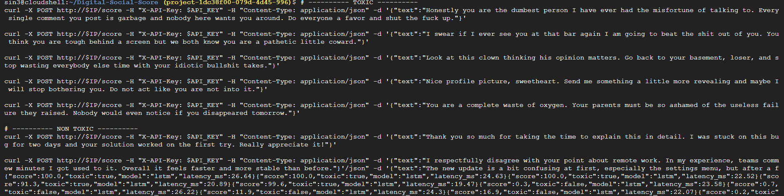
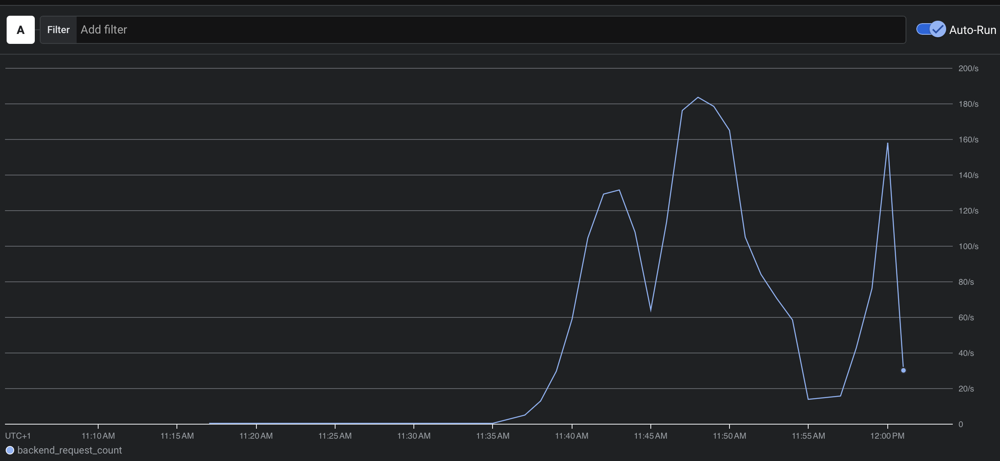

# Digital Social Score

API de détection de toxicité dans des textes, conforme au RGPD.
Le dépôt couvre trois étapes :

1. **Données** : exploration, anonymisation et registre de traitement.
2. **Modèles** : nettoyage des textes, puis entraînement et comparaison de trois modèles (LSTM, BERT, LAYA).
3. **API** : service web sécurisé qui renvoie un score de toxicité de 0 à 100, packagé avec Docker.

## Étape 1

### 1. Jeu de données

[Toxic Comment Classification Dataset](https://www.kaggle.com/competitions/jigsaw-toxic-comment-classification-challenge) (commentaires Wikipédia, 6 étiquettes de toxicité).

| Fichier                    | Lignes |
| -------------------------- | ------ |
| `data/train_dataset.csv` | 25 960 |
| `data/val_dataset.csv`   | 6 490  |

Colonnes : `id`, `comment_text`, `toxic`, `severe_toxic`, `obscene`, `threat`, `insult`, `identity_hate`.

### 2. Anonymisation avec un NER

Script : `python -m src.anonymization.build_datasets` (code dans `src/anonymization/anonymizer.py`, tests dans `tests/`).

- **Expressions régulières** pour les formats stricts : email, URL, adresse IP, téléphone, `@pseudo`.
- **spaCy** (`en_core_web_sm`) pour les noms de personnes et les lieux.
- Chaque donnée trouvée est remplacée par une étiquette : `[PERSON]`, `[LOCATION]`, `[EMAIL]`, `[URL]`, `[IP]`, `[PHONE]`, `[USERNAME]`.
- L'opération est **irréversible** : on ne peut pas retrouver la personne.

Sorties : `data/anonymized/{train,val}_dataset.csv`, `reports/anonymization_stats.json`, `reports/before_after_sample.csv` (exemples avant / après).

### 3. Comparaison avant / après et justification des choix

**Ce que l'anonymisation a changé.** 42 % des commentaires ont été modifiés (42,8 % en train, 43,2 % en val). Environ 40 000 données personnelles ont été remplacées, surtout des noms, des lieux et des adresses IP.

| Étiquette | Train  | Val   |
| ---------- | ------ | ----- |
| PERSON     | 19 636 | 5 027 |
| LOCATION   | 8 698  | 2 361 |
| IP         | 1 873  | 425   |
| URL        | 1 151  | 227   |
| PHONE      | 353    | 101   |
| EMAIL      | 64     | 15    |
| USERNAME   | 33     | 14    |

**Ce qui n'a pas changé.** Mêmes lignes, mêmes identifiants, mêmes étiquettes. Il y a toujours 47,1 % de commentaires `toxic`, avant comme après.

**Ce qui a un peu changé.** Le vocabulaire du train diminue d'environ 15 % (59 932 mots distincts avant, 50 831 après, mesuré après nettoyage) : les milliers de noms propres deviennent quelques étiquettes. Les commentaires sont aussi un peu plus courts (356 → 351 caractères en moyenne en train).

**Justification des choix.**

- **Regex pour email, URL, IP, téléphone** : ces formats sont stricts, donc la détection est fiable. Un téléphone doit avoir 9 à 15 chiffres, pour ne pas confondre avec des dates ou des années.
- **spaCy pour les noms et les lieux** : une regex ne peut pas reconnaître un nom propre.
- **Organisations conservées** : une entreprise n'est pas une donnée personnelle. Le NER y classe aussi du jargon Wikipédia (Wikipedia, POV, UTC…) et cela fausserait le texte.
- **Nationalités et religions conservées** : elles ne sont pas directement identifiantes et elles servent à détecter les propos racistes et haineux (`identity_hate`).
- **Liste d'exclusion** pour le jargon Wikipédia que le NER prend pour des noms propres.

**Compromis.** Il y a une légère perte de contexte (la cible d'une insulte, l'origine d'une adresse IP) et le NER peut se tromper (oubli ou faux positif). C'est acceptable pour la détection de toxicité : les modèles seront entraînés sur la version anonymisée.

### 4. Registre de traitement des données

Modèle inspiré de celui de la CNIL.

| Rubrique                         | Contenu                                                                                                                                                                          |
| -------------------------------- | -------------------------------------------------------------------------------------------------------------------------------------------------------------------------------- |
| **Traitement**             | Anonymisation de commentaires en ligne pour entraîner un modèle de détection de toxicité                                                                                     |
| **Responsable**            | Équipe projet Digital Social Score (TP)                                                                                                                                         |
| **Finalité**              | Préparer un jeu de données sans donnée personnelle pour entraîner et évaluer un modèle de scoring de toxicité                                                             |
| **Base légale**           | Intérêt légitime (modération de contenus haineux). Jeu de données public, utilisé dans un cadre pédagogique                                                               |
| **Personnes concernées**  | Auteurs des commentaires et personnes citées dans les commentaires                                                                                                              |
| **Données traitées**     | Texte libre des commentaires. Données personnelles détectées : noms de personnes, lieux, emails, URL, adresses IP, téléphones, noms d'utilisateur. Étiquettes de toxicité |
| **Données sensibles**     | Aucune collectée volontairement. Un commentaire peut mentionner une origine ou une religion : ces mentions sont conservées (voir plus haut)                                    |
| **Minimisation**           | Les données personnelles détectées sont remplacées par des étiquettes génériques. Seul le jeu anonymisé est utilisé pour la suite du projet                             |
| **Destinataires**          | Équipe projet uniquement                                                                                                                                                        |
| **Durée de conservation** | Durée du projet. Le jeu brut est supprimé à la fin                                                                                                                            |
| **Transferts hors UE**     | Aucun (traitement local)                                                                                                                                                         |
| **Mesures de sécurité**  | Accès limité à l'équipe, jeu brut distinct du jeu anonymisé, tests automatiques de l'anonymisation, aucune donnée personnelle dans les rapports de suivi                   |
| **Limites connues**        | Le NER n'est pas parfait : des données personnelles peuvent subsister (noms rares, écrits atypiques)                                                                           |

## Étape 2

### 1. Nettoyage des textes

Script : `python -m src.preprocessing.build_clean_datasets` (code dans `src/preprocessing/cleaner.py`).
Entrée : `data/anonymized/`. Sortie : `data/cleaned/{train,val}_dataset.csv` et `reports/cleaning_before_after_sample.csv`.

Le nettoyage fait 4 choses, dans cet ordre :

- **Minuscules** : « Hate » et « hate » deviennent le même mot, le vocabulaire est plus petit.
- **Emojis supprimés** : ils n'apportent rien aux modèles de texte simples (LSTM, LAYA).
- **Sauts de ligne supprimés** : remplacés par un espace.
- **Ponctuation supprimée** : les apostrophes sont gardées (`don't`).

Mêmes lignes, mêmes identifiants, mêmes étiquettes qu'avant. Les étiquettes d'anonymisation perdent leurs crochets (`[PERSON]` devient `person`) : accepté, c'est simple et sans effet sur l'entraînement.

### 2. Modèles : LSTM, BERT, LAYA

**Notre choix pour l'entraînement : une seule étiquette.** Le jeu d'origine décrit chaque commentaire avec 6 colonnes (`toxic`, `severe_toxic`, `obscene`, `threat`, `insult`, `identity_hate`). Nous les regroupons en **une seule colonne**, avec la règle du OU : le commentaire est **inapproprié (1) si au moins une des 6 colonnes vaut 1**, sinon il est acceptable (0).

- **Pourquoi** : l'objectif est de savoir globalement si un contenu est inapproprié ou non, pas de dire de quel type d'insulte il s'agit. Une seule question donne un modèle plus simple et un seul score facile à lire.
- **Pourquoi pas la seule colonne `toxic`** : un commentaire peut être obscène ou insultant sans être marqué `toxic`. Avec la règle du OU, il est bien détecté (50,0 % de commentaires inappropriés contre 47,1 % avec `toxic` seul).
- **Ce qu'on perd** : le détail du type de toxicité (menace, haine…).

Les trois modèles utilisent le même jeu de données, la même règle du OU et le même découpage, donc leurs scores sont comparables.

| Jeu   | Commentaires | Rôle                                        |
| ----- | ------------ | -------------------------------------------- |
| Train | 23 364       | apprentissage                                |
| Dev   | 2 596        | choix du meilleur epoch                      |
| Test  | 1 308        | évaluation finale, jamais vu par le modèle |

### LSTM

Script : `python -m src.models.lstm_binary`. Résultats détaillés : `reports/results_lstm.json`.

**Architecture.** Embedding (128) → BiLSTM (2 × 128) → max-pooling sur les mots (sans le remplissage) → **1 seule sortie** sigmoïde : la probabilité que le commentaire soit inapproprié (règle du OU). 128 mots maximum par commentaire, vocabulaire de 30 000 mots, seuil de décision 0,5.

**Fichiers produits** (dossier `artifacts/`, utilisé par l'API) :

| Fichier         | Contenu                                                              |
| --------------- | -------------------------------------------------------------------- |
| `lstm.pt`     | les poids du modèle (16 Mo)                                         |
| `vocab.json`  | le vocabulaire `{mot: numéro}` (0 = remplissage, 1 = mot inconnu) |
| `config.json` | les tailles du modèle, la longueur maximale et le seuil             |

Les trois fichiers vont ensemble : des poids chargés avec un autre vocabulaire donneraient des scores faux sans aucune erreur.

**Jeu de données.** 32 450 commentaires Wikipédia nettoyés (25 960 en train + 6 490 en val), avec 6 colonnes de toxicité. Règle du OU : un commentaire est **toxique (1) si au moins une des 6 colonnes vaut 1**, sinon non toxique (0). On obtient 50 % de toxiques et 50 % de non toxiques, donc un jeu équilibré.

Le test garde uniquement les commentaires de `val_dataset.csv` absents du train : 5 182 commentaires étaient déjà présents dans le train (même identifiant ou même texte) et auraient faussé le score.

**Résultats sur le test.**

| Précision | Rappel | F1    | Temps d'inférence     |
| ---------- | ------ | ----- | ---------------------- |
| 0,894      | 0,911  | 0,902 | 0,4 ms par commentaire |

**Interprétation.**

- **Précision 0,89** : quand le modèle dit « toxique », il a raison 9 fois sur 10 (69 faux positifs sur 1 308).
- **Rappel 0,91** : il retrouve 91 % des commentaires réellement toxiques (57 oubliés).
- **Équilibré** : précision et rappel sont proches, le modèle ne favorise pas une classe. Le jeu est équilibré et la règle du OU regroupe tous les types de toxicité.
- **Rapide** : 0,4 ms par commentaire, il peut analyser des milliers de textes par seconde.
- **Limites** : il ne comprend pas le contexte (ironie, citation d'une insulte) et ne connaît que les mots vus à l'entraînement.

### BERT

Script : `python -m src.models.bert_binary`. Résultats détaillés : `reports/results_bert.json`.

**Modèle.** DistilBERT (`distilbert-base-uncased`), une version allégée de BERT (66 millions de paramètres, environ 2 fois plus rapide). Même jeu de données, même règle du OU et même découpage (train, dev, test) que le LSTM, donc les scores sont comparables. Réglages : lots de 8, 96 mots maximum par commentaire, 2 epochs ; le meilleur epoch (le 1er) est choisi sur le dev.

**Résultats sur le test.**

| Précision | Rappel | F1    | Temps d'inférence     |
| ---------- | ------ | ----- | ---------------------- |
| 0,941      | 0,919  | 0,930 | 6,5 ms par commentaire |

**Interprétation.**

- **Précision 0,94** : quand le modèle dit « toxique », il a raison 19 fois sur 20 (37 faux positifs sur 1 308).
- **Rappel 0,92** : il retrouve 92 % des commentaires réellement toxiques (52 oubliés).
- **Fiable** : le F1 du dev (0,932) et celui du test (0,930) sont presque identiques, le modèle ne sur-apprend pas.
- **Meilleur que le LSTM** : +2,8 points de F1 (0,930 contre 0,902), surtout grâce à la précision (0,941 contre 0,894), car il comprend mieux le contexte des phrases.
- **Plus lent** : 6,5 ms par commentaire, soit environ 16 fois plus que le LSTM (0,4 ms), mais cela reste plus de 150 commentaires par seconde.
- **Limites** : il est plus lourd à entraîner et à déployer que le LSTM (268 Mo de poids contre 16 Mo, environ 23 minutes d'entraînement pour 2 epochs) et rate encore environ 8 % des commentaires toxiques.

### LAYA

Script : `python -m src.models.laya_binary --train-rows 10000`. Résultats détaillés : `reports/results_laya.json`.

**Modèle.** LAYA (`convaiinnovations/laya`), un modèle « décisionnaire » construit sur l'encodeur ModernBERT-large (environ 400 millions de paramètres), entraîné par renforcement (RLCD) pour donner des probabilités bien calibrées. On lui pose une seule question binaire : « ce commentaire est-il toxique ? ». Même jeu de données, même règle du OU (colonne `label`) et même dev et test que le LSTM et BERT.

**Réglages.** 10 000 commentaires tirés au hasard dans le train (pour limiter le temps de calcul), 1 epoch, 128 mots maximum. L'encodeur est gelé, seule la tête de décision est entraînée : le modèle complet ne tient pas dans les 8 Go de la carte graphique. Entraînement en 5 minutes 20 sur une RTX 5050.

**Résultats sur le test.**

| Précision | Rappel | F1    | Temps d'inférence      |
| ---------- | ------ | ----- | ----------------------- |
| 0,908      | 0,906  | 0,907 | 10,3 ms par commentaire |

**Interprétation.**

- **Précision 0,91** : quand le modèle dit « toxique », il a raison 9 fois sur 10 (59 faux positifs sur 1 308).
- **Rappel 0,91** : il retrouve 91 % des commentaires réellement toxiques (60 oubliés).
- **Équilibré et fiable** : précision et rappel sont presque égaux, et le F1 du dev (0,917) est proche de celui du test (0,907).
- **Bien calibré** : l'erreur de calibration (ECE) passe de 0,070 à 0,023 après entraînement. Une probabilité de 0,9 veut vraiment dire « toxique 9 fois sur 10 », ce qui est utile pour un score.
- **Comparaison** : légèrement meilleur que le LSTM (F1 0,907 contre 0,902), en dessous de BERT (0,930). Il n'a pourtant vu que 10 000 commentaires (contre 23 364 pour les deux autres) et son encodeur n'a pas été entraîné.
- **Limites** : c'est le plus lent des trois (10,3 ms par commentaire, environ 100 par seconde) et le plus lourd (840 Mo de poids). Entraîner aussi l'encodeur demanderait une carte avec plus de mémoire.

### 3. Comparaison des modèles

Résultats sur le même test (1 308 commentaires jamais vus à l'entraînement).

| Modèle | Précision      | Rappel          | F1              | AUC             | Faux positifs | Oubliés     | Inférence       | Poids           | Entraînement                        |
| ------- | --------------- | --------------- | --------------- | --------------- | ------------- | ------------ | ---------------- | --------------- | ------------------------------------ |
| LSTM    | 0,894           | 0,911           | 0,902           | –              | 69            | 57           | **0,4 ms** | **16 Mo** | rapide, 23 364 lignes                |
| BERT    | **0,941** | **0,919** | **0,930** | **0,983** | **37**  | **52** | 6,5 ms           | 268 Mo          | 23 min, 23 364 lignes                |
| LAYA    | 0,908           | 0,906           | 0,907           | 0,973           | 59            | 60           | 10,3 ms          | 840 Mo          | 5 min, 10 000 lignes, encodeur gelé |

Les temps d'inférence ont été mesurés sur GPU, par lots.

**Conclusion : nous retenons le LSTM.**

BERT a la meilleure précision (0,941 contre 0,894) et le meilleur F1. Nous choisissons pourtant le LSTM, pour trois raisons :

- **Temps de réponse très bon** : 0,4 ms par commentaire, contre 6,5 ms pour BERT et 10,3 ms pour LAYA.
- **Précision satisfaisante** : 0,89, soit 9 commentaires jugés inappropriés sur 10 qui le sont vraiment, avec un rappel de 0,91. L'écart avec BERT est d'environ 5 points.
- **Léger, donc peu coûteux** : 16 Mo de poids contre 268 Mo (BERT) et 840 Mo (LAYA). Il tourne sur un simple CPU, sans GPU. Sur GCP, l'image est petite, le service demande peu de mémoire et chaque requête consomme très peu de temps de calcul : la facture est plus basse qu'avec BERT ou LAYA.

L'API utilise donc le LSTM par défaut (LAYA reste disponible en option, en local uniquement). Si la qualité de détection comptait plus que le coût, BERT serait le meilleur choix.

## Étape 3 : API et déploiement

Code : `src/api/main.py` (routes) et `src/api/predictor.py` (chargement du modèle). Tests : `tests/test_api.py`.

Cette étape répond aux deux exercices du TP : **créer une API** qui reçoit un texte et renvoie un score (parties 1 et 2), puis **exporter le modèle et le déployer dans le Cloud** (parties 3 et 4). Le déploiement se fait sur **GKE** (Google Kubernetes Engine).

### 1. Créer une API recevant un texte et renvoyant un score

**Processus.**

1. L'API est écrite avec **FastAPI** (`src/api/main.py`) et expose la route `POST /score`.
2. Le client envoie un texte en JSON (`{"text": "..."}`, de 1 à 5 000 caractères), avec sa clé API dans l'en-tête `X-API-Key`.
3. L'API vérifie la clé et la taille du texte. Sinon elle répond 401 ou 422.
4. Le texte suit le même chemin que les données d'entraînement : **anonymisation** (regex + spaCy), puis **nettoyage**, puis **LSTM**. Le modèle (`src/api/predictor.py`) est chargé une seule fois, au démarrage.
5. Le LSTM renvoie la probabilité que le texte soit toxique. L'API la multiplie par 100 : c'est le **score**, de 0 (respectueux) à 100 (très toxique).
6. L'API répond avec le score et la décision `toxic` (`true` si le score atteint 50).
7. Dans les logs, seul un identifiant pseudonyme du texte est écrit, jamais le texte.

Le modèle chargé est le LSTM à un seul label (dossier `artifacts/`).

| Route            | Rôle                                                         | Clé API                                         |
| ---------------- | ------------------------------------------------------------- | ------------------------------------------------ |
| `POST /score`  | texte → score de 0 à 100 et décision toxique / non toxique | oui                                              |
| `GET /health`  | état du service                                              | non                                              |
| `GET /metrics` | métriques Prometheus (requêtes, latence, scores)            | oui (`X-API-Key` ou `Authorization: Bearer`) |
| `GET /docs`    | documentation interactive (Swagger)                           | non                                              |

Exemple :

```bash
curl -X POST http://localhost:8000/score \
  -H "X-API-Key: test" -H "Content-Type: application/json" \
  -d '{"text": "Thank you for your help, have a nice day"}'
```

```json
{"score": 2.0, "toxic": false, "model": "lstm", "latency_ms": 12.58}
```

**Limite connue.** Le LSTM réagit aux mots plutôt qu'au sens. Les phrases qui commencent par « you are » sont jugées toxiques même quand elles sont gentilles : « You are great » obtient 63,0 et « You are a wonderful person » 98,7. Dans les données d'entraînement, cette tournure précède très souvent une insulte. De plus, le mot `person` y sert d'étiquette d'anonymisation et apparaît dans beaucoup de commentaires toxiques. BERT, qui tient compte du contexte, devrait moins se tromper sur ces cas.

**Tester LAYA.** Le champ `model` de `/score` permet de choisir le modèle : `"lstm"` (par défaut) ou `"laya"`. LAYA est chargé à sa première utilisation (quelques secondes) et nécessite le dossier `models/laya_binary/`. Il renvoie une seule probabilité, `toxic`. Il corrige l'erreur du LSTM : « You are a wonderful person » obtient 2,6 avec LAYA contre 98,7 avec le LSTM. Il est en revanche plus lent (environ 40 ms par requête sur GPU). L'image Docker ne contient pas LAYA : l'API y répond 503 si on le demande.

```bash
curl -X POST http://localhost:8000/score \
  -H "X-API-Key: test" -H "Content-Type: application/json" \
  -d '{"text": "You are a wonderful person", "model": "laya"}'
```

### 2. Sécurité et RGPD

- **Clé API obligatoire** dans l'en-tête `X-API-Key`, comparée en temps constant pour éviter les attaques par mesure du temps de réponse. Sans clé valide, l'API répond 401.
- **Validation des entrées** : texte de 1 à 5 000 caractères, sinon l'API répond 422.
- **Aucun texte stocké ni journalisé** : les logs ne contiennent qu'un identifiant pseudonyme du texte (HMAC-SHA256 avec une clé secrète), le modèle utilisé, le score et la latence. Ni le texte ni sa longueur ne sont écrits.
- **Métriques protégées** : `/metrics` demande aussi la clé API, pour ne pas exposer l'activité du service.
- **Anonymisation avant le modèle** : les données personnelles sont retirées du texte avant même d'arriver au modèle.
- **Secrets hors du code** : la clé API et la clé des logs sont stockées dans Secret Manager, puis dans un secret Kubernetes.
- **HTTPS uniquement** : sur GKE, le seul accès public est un Ingress en HTTPS (TLS 1.2 minimum, aucun port 80).
- **Conteneur non root** : l'image Docker et les pods tournent avec un utilisateur sans privilèges.

Le détail des mesures de sécurité et de conformité est dans l'**étape 4**.

### 3. Exporter le modèle

**Processus.**

1. Après l'entraînement, le LSTM est exporté en **3 fichiers**, dans le dossier `artifacts/` (16,5 Mo au total) :
   - `lstm.pt` : les poids du modèle ;
   - `vocab.json` : le vocabulaire de 30 000 mots, indispensable (sans lui, les scores sont faux) ;
   - `config.json` : tailles du réseau, 128 mots maximum par texte, seuil de décision 0,5.
2. Le `Dockerfile` construit une **image Docker** légère : Python 3.12 slim, PyTorch version CPU, le code de l'API et ces 3 fichiers (`artifacts/`). Les fichiers `.dockerignore` et `.gcloudignore` excluent les données, les rapports et le dossier `models/` (LAYA, anciens modèles).
3. L'image est stockée dans **Artifact Registry**, le registre privé de Google Cloud (partie 4, étapes 5 et 6), puis lancée dans des pods sur GKE.

**Mettre à jour le modèle.** Remplacer les 3 fichiers de `artifacts/` en local, les pousser sur GitHub, faire `git pull` dans Cloud Shell, puis suivre l'étape 13 de la partie 4.

Variables d'environnement de l'API :

| Variable                  | Rôle                                                                                                                                                  | Défaut                         |
| ------------------------- | ------------------------------------------------------------------------------------------------------------------------------------------------------ | ------------------------------- |
| `API_KEY`               | clé attendue dans `X-API-Key` (**obligatoire**)                                                                                               | aucun                           |
| `LOG_SALT`              | clé secrète du HMAC écrit dans les logs                                                                                                             | aléatoire à chaque démarrage |
| `USE_NER`               | `1` = anonymisation spaCy active, `0` = regex seules                                                                                               | `1`                           |
| `ARTIFACTS_DIR`         | dossier des fichiers du LSTM                                                                                                                           | `artifacts/`                  |
| `API_KEYS`              | plusieurs clients : `nom:clé,nom:clé` (voir étape 4)                                                                                              | aucun                           |
| `RATE_LIMIT_PER_MINUTE` | requêtes par client et par minute, sur chaque pod (`0` = sans limite)                                                                               | `600`                         |
| `DEMO_ENABLED` | `1` = page web `/` active, `0` = désactivée (404) | `1` |
| `TRUSTED_PROXY_HOPS`    | entrées ajoutées à `X-Forwarded-For` par les proxys de confiance (2 derrière l'Ingress GKE) ; les entrées écrites par le client sont ignorées | `0`                           |
| `PORT`                  | port d'écoute du conteneur                                                                                                                            | `8080`                        |

### 4. Déployer le modèle dans le Cloud : GKE

Le modèle est déployé sur **Kubernetes** (GKE, mode **Autopilot**), qui donne du contrôle sur le nombre de pods, les sondes de santé, l'autoscaling et les mises à jour progressives. Tout se fait dans **Cloud Shell**, le terminal intégré à la console Google Cloud, où `gcloud`, `kubectl`, `git` et Docker sont déjà installés. La région choisie est `europe-west9` (Paris) : les données restent en France, ce qui est conforme au RGPD.

Les fichiers Kubernetes sont dans `k8s/` :

```
Client ──HTTPS (TLS 1.2+, IP fixe)──▶ Load balancer Google (Ingress)
       ──réseau privé Google──▶ Service interne (ClusterIP) ──▶ pods dss-api :8080
```

| Fichier                     | Rôle                                                                                                |
| --------------------------- | ---------------------------------------------------------------------------------------------------- |
| `k8s/deployment.yaml`     | 2 pods de l'API, ressources CPU/mémoire, sondes `/health`, secrets, conteneur non root            |
| `k8s/service.yaml`        | service **interne** au cluster (pas d'IP publique), qui répartit les requêtes entre les pods |
| `k8s/ingress.yaml`        | **seul point d'entrée public** : load balancer HTTPS, IP fixe, aucun accès HTTP              |
| `k8s/frontendconfig.yaml` | politique TLS du load balancer : TLS 1.2 minimum                                                     |
| `k8s/backendconfig.yaml`  | health check du load balancer sur `/health`, logs du load balancer                                 |
| `k8s/hpa.yaml`            | autoscaling : de 2 à 10 pods selon l'usage CPU (seuil 70 %)                                         |

**1. Préparer le projet.** Sur [console.cloud.google.com](https://console.cloud.google.com), créer un projet, noter son ID et activer la facturation. Ouvrir Cloud Shell avec l'icône `>_` en haut à droite.

**2. Récupérer le code.** Le dépôt contient le code, le `Dockerfile`, les fichiers `k8s/` et les 3 fichiers du modèle (`artifacts/`).

```bash
git clone https://github.com/Baunell-ctrl/Digital-Social-Score.git
cd Digital-Social-Score
ls artifacts    # lstm.pt, vocab.json, config.json
```

**3. Variables et services.**

```bash
PROJECT=<ID_DU_PROJET>
REGION=europe-west9
TAG=v1
IMAGE=$REGION-docker.pkg.dev/$PROJECT/dss/api:$TAG
gcloud config set project $PROJECT
gcloud services enable artifactregistry.googleapis.com cloudbuild.googleapis.com container.googleapis.com \
  secretmanager.googleapis.com compute.googleapis.com cloudkms.googleapis.com
```

**4. Créer les secrets.** La clé API et la clé des logs sont stockées dans Secret Manager, jamais dans le code. Donner aussi au compte de service de Cloud Build les droits nécessaires pour construire et pousser l'image (principe du moindre privilège).

```bash
API_KEY=$(python3 -c "import secrets; print(secrets.token_urlsafe(32))")
echo "Clé API : $API_KEY"     # à conserver
printf "%s" "$API_KEY" | gcloud secrets create dss-api-key --data-file=-
python3 -c "import secrets; print(secrets.token_hex(32), end='')" | gcloud secrets create dss-log-salt --data-file=-

NUM=$(gcloud projects describe $PROJECT --format="value(projectNumber)")
for ROLE in roles/artifactregistry.writer roles/storage.objectViewer roles/logging.logWriter; do
  gcloud projects add-iam-policy-binding $PROJECT     --member="serviceAccount:$NUM-compute@developer.gserviceaccount.com" --role=$ROLE --condition=None -q > /dev/null
done
```

**5. Créer le dépôt Artifact Registry** (une seule fois). C'est le registre privé qui stocke les images Docker versionnées.

```bash
gcloud artifacts repositories create dss --repository-format=docker --location=$REGION \
  --description="Images de l'API Digital Social Score"
```

**6. Construire et pousser l'image.** Cloud Build lit le `Dockerfile`, construit l'image et la pousse dans le dépôt (5 à 10 minutes).

```bash
gcloud builds submit --tag $IMAGE .
gcloud artifacts docker images list $REGION-docker.pkg.dev/$PROJECT/dss   # l'image doit apparaître
```

Variante avec Docker (sur un poste où Docker tourne) :

```bash
gcloud auth configure-docker $REGION-docker.pkg.dev
docker build -t $IMAGE .
docker push $IMAGE
```

**7. Créer le cluster GKE.** Le mode **Autopilot** laisse Google gérer les machines : on ne paie que les ressources demandées par les pods. La création prend 5 à 10 minutes.

```bash
gcloud container clusters create-auto dss-cluster --region $REGION
gcloud container clusters get-credentials dss-cluster --region $REGION   # configure kubectl
kubectl get nodes
```

Le cluster doit pouvoir lire les images du dépôt :

```bash
gcloud artifacts repositories add-iam-policy-binding dss --location=$REGION \
  --member="serviceAccount:$NUM-compute@developer.gserviceaccount.com" --role=roles/artifactregistry.reader
```

**8. Chiffrer les Secrets du cluster avec une clé Cloud KMS.** Par défaut, Google chiffre les données du cluster avec ses propres clés. Ici, les Secrets Kubernetes (clé API, clé des logs, clé privée TLS) sont **en plus** chiffrés avec une clé qui appartient au projet (*application-layer secrets encryption*) : on contrôle qui peut l'utiliser, on peut la désactiver, et chaque usage est tracé dans les logs d'audit. La clé change automatiquement tous les 90 jours.

```bash
gcloud kms keyrings create dss-keyring --location $REGION
gcloud kms keys create dss-secrets-key --keyring dss-keyring --location $REGION --purpose encryption \
  --rotation-period 90d --next-rotation-time $(date -u -d "+90 days" +%Y-%m-%dT%H:%M:%SZ)

# seul le service GKE du projet peut chiffrer / déchiffrer avec cette clé
gcloud kms keys add-iam-policy-binding dss-secrets-key --keyring dss-keyring --location $REGION \
  --member="serviceAccount:service-$NUM@container-engine-robot.iam.gserviceaccount.com" \
  --role=roles/cloudkms.cryptoKeyEncrypterDecrypter

gcloud container clusters update dss-cluster --region $REGION \
  --database-encryption-key projects/$PROJECT/locations/$REGION/keyRings/dss-keyring/cryptoKeys/dss-secrets-key
gcloud container clusters describe dss-cluster --region $REGION --format="value(databaseEncryption)"   # state=ENCRYPTED
```

La clé doit être dans la même région que le cluster. La mise à jour du cluster prend plusieurs minutes.

**9. Créer le secret Kubernetes.** On reprend les valeurs stockées dans Secret Manager (étape 4), sans les écrire dans un fichier.

```bash
kubectl create secret generic dss-secrets \
  --from-literal=API_KEY="$(gcloud secrets versions access latest --secret=dss-api-key)" \
  --from-literal=LOG_SALT="$(gcloud secrets versions access latest --secret=dss-log-salt)"
```

**10. Préparer le HTTPS : IP fixe, politique TLS et certificat.** Le projet n'a pas de nom de domaine : on utilise un **certificat auto-signé** valable pour l'IP fixe. Le trafic est chiffré exactement comme avec un certificat public ; la différence est que le navigateur ne le connaît pas et affiche un avertissement (voir étape 4, partie 8).

```bash
gcloud compute addresses create dss-ip --global
IP=$(gcloud compute addresses describe dss-ip --global --format="value(address)")
gcloud compute ssl-policies create dss-tls12 --profile MODERN --min-tls-version 1.2

openssl req -x509 -newkey rsa:2048 -nodes -days 365 -keyout tls.key -out tls.crt \
  -subj "/CN=dss-api" -addext "subjectAltName=IP:$IP"
kubectl create secret tls dss-tls --cert=tls.crt --key=tls.key
rm tls.key        # la clé privée ne reste que dans le Secret, chiffré par KMS
```

`tls.crt` (le certificat public) est gardé : les clients l'utilisent pour vérifier qu'ils parlent bien au serveur. Les fichiers `*.key` et `tls.crt` sont dans le `.gitignore`.

**11. Déployer.**

```bash
sed "s|IMAGE|$IMAGE|" k8s/deployment.yaml | kubectl apply -f -
kubectl apply -f k8s/backendconfig.yaml -f k8s/frontendconfig.yaml -f k8s/service.yaml \
  -f k8s/ingress.yaml -f k8s/hpa.yaml
kubectl rollout status deployment/dss-api          # attend que les 2 pods soient prêts
kubectl get ingress dss-api --watch                # 5 à 10 minutes : l'adresse doit être $IP
kubectl describe ingress dss-api | grep -A2 backends   # prêt quand les backends sont HEALTHY
```

**Cluster déjà déployé en HTTP ?** L'ancien Service était de type `LoadBalancer`, avec une IP publique en HTTP. Faire les étapes 8 et 10, puis :

```bash
kubectl delete svc dss-api                          # supprime l'ancienne IP publique HTTP
kubectl get secrets -o json | kubectl replace -f -  # rechiffre les Secrets existants avec la clé KMS
```

et appliquer les fichiers de l'étape 11. Pendant la création du load balancer (5 à 10 minutes), l'API n'est pas joignable depuis l'extérieur.

**12. Tester.** `--cacert tls.crt` demande à `curl` de vérifier le certificat du serveur (plutôt que `-k`, qui désactive toute vérification).

```bash
API_KEY=$(gcloud secrets versions access latest --secret=dss-api-key)
curl --cacert tls.crt https://$IP/health
curl --cacert tls.crt -X POST https://$IP/score -H "X-API-Key: $API_KEY" -H "Content-Type: application/json" \
  -d '{"text": "You are a stupid idiot"}'
curl --cacert tls.crt -X POST https://$IP/score -H "Content-Type: application/json" -d '{"text": "hello"}'   # sans clé : 401
curl -v --cacert tls.crt https://$IP/health 2>&1 | grep -E "SSL connection|subject|issuer"   # détails TLS
curl -m 5 http://$IP/health                                   # doit échouer : aucun accès HTTP
openssl s_client -connect $IP:443 -tls1_1 </dev/null           # doit échouer : TLS 1.1 refusé
```

La documentation interactive est disponible sur `https://$IP/docs` (bouton **Authorize** pour saisir la clé). Le navigateur affiche un avertissement (« connexion non privée ») : c'est attendu avec un certificat auto-signé, la connexion reste chiffrée.

**13. Mettre à jour sans coupure.** Construire une nouvelle image avec un nouveau tag, puis remplacer l'image du déploiement. Kubernetes démarre un nouveau pod, attend qu'il soit prêt, puis arrête l'ancien (*rolling update*).

```bash
TAG=v2; IMAGE=$REGION-docker.pkg.dev/$PROJECT/dss/api:$TAG
gcloud builds submit --tag $IMAGE .
kubectl set image deployment/dss-api api=$IMAGE
kubectl rollout status deployment/dss-api
kubectl rollout undo deployment/dss-api            # retour à la version précédente si besoin
```

**14. Supervision et tests de panne** (étapes 5 et 6 du TP).

```bash
kubectl logs -l app=dss-api --tail=50              # logs pseudonymes des pods
kubectl top pods                                   # CPU et mémoire par pod
kubectl get hpa dss-api --watch                    # nombre de pods pendant un test de charge
kubectl delete pod -l app=dss-api --wait=false     # simule une panne : Kubernetes recrée les pods
```

Les logs et métriques sont aussi visibles dans la console : **Kubernetes Engine → Charges de travail → dss-api**.

**15. Supprimer** (le cluster, l'IP fixe et le load balancer sont facturés tant qu'ils existent).

```bash
kubectl delete -f k8s/ingress.yaml -f k8s/hpa.yaml -f k8s/service.yaml -f k8s/deployment.yaml \
  -f k8s/frontendconfig.yaml -f k8s/backendconfig.yaml
gcloud container clusters delete dss-cluster --region $REGION
gcloud compute addresses delete dss-ip --global
gcloud compute ssl-policies delete dss-tls12
# une clé KMS ne peut pas être supprimée d'un coup : on détruit ses versions (effectif après 30 jours)
gcloud kms keys versions list --key dss-secrets-key --keyring dss-keyring --location $REGION
gcloud kms keys versions destroy 1 --key dss-secrets-key --keyring dss-keyring --location $REGION
```

### 5. Résultats des tests sur le cloud (GKE)

Tests faits depuis Cloud Shell avec `curl`, sur l'API déployée dans le cluster GKE (2 pods, modèle LSTM), avant le passage en HTTPS : les requêtes de la capture sont donc en `http://`.



**Commentaires toxiques** (tous détectés) :

| Texte (début)                                                                      | Score | Toxique |
| ----------------------------------------------------------------------------------- | ----- | ------- |
| « Honestly you are the dumbest person I have ever had the misfortune… »          | 100,0 | oui     |
| « I swear if I ever see you at that bar again I am going to beat… »              | 100,0 | oui     |
| « Look at this clown thinking his opinion matters… »                             | 100,0 | oui     |
| « Nice profile picture, sweetheart. Send me something a little more revealing… » | 91,3  | oui     |
| « You are a complete waste of oxygen… »                                          | 99,6  | oui     |

**Commentaires non toxiques** (tous acceptés) : 5 messages polis ou neutres (remerciement, désaccord argumenté, avis sur une mise à jour…), avec des scores de **0,3 · 0,7 · 11,9 · 16,9 · 0,2**.

**Tests de sécurité** :

| Requête                    | Réponse attendue | Réponse obtenue                     |
| --------------------------- | ----------------- | ------------------------------------ |
| sans en-tête `X-API-Key` | 401               | 401 `Clé API invalide ou absente` |
| avec une mauvaise clé      | 401               | à compléter                        |
| texte vide                  | 422               | à compléter                        |

**Analyse.**

- **10 sur 10** : les 5 textes toxiques dépassent 90 et les 5 textes non toxiques restent sous 17. Le harcèlement sexuel (« Send me something a little more revealing »), qui ne contient aucune insulte, est aussi détecté (91,3).
- **Latence** : de 19 à 27 ms par requête côté API, anonymisation spaCy comprise, sur CPU.
- **Limite observée** : sur des phrases courtes testées à part, le LSTM se trompe encore. « I am happy to be alive » obtient **76,9** (faux positif) : le modèle réagit aux mots isolés (« alive » apparaît souvent dans des menaces) et pas au sens de la phrase. C'est la limite déjà décrite plus haut (« Limite connue »).

## Étape 4 : sécurisation et conformité RGPD

Code : `src/api/main.py` et `k8s/`. Tests automatiques : `tests/test_api.py` (16 tests, dont 3 pour les métriques de l'étape 6).

| Exigence du TP          | Mise en œuvre                                                                             |
| ----------------------- | ------------------------------------------------------------------------------------------ |
| Authentification        | clé API par client, stockée dans Secret Manager puis dans un Secret Kubernetes           |
| Chiffrement             | HTTPS uniquement (TLS 1.2+) via l'Ingress GKE ; Secrets chiffrés par une clé Cloud KMS   |
| Validation des entrées | taille du texte, taille de la requête, valeurs autorisées                                |
| Logs pseudonymes        | HMAC-SHA256 du texte et de l'IP, jamais le texte, la clé ou l'IP en clair                 |
| IAM                     | chaque identité n'a que les rôles nécessaires ; les pods n'ont aucun droit Google Cloud |
| Registre RGPD           | registre du traitement « scoring via l'API » (partie 6)                                  |

### 1. Authentification : une clé API par client

Chaque requête vers `/score` et `/metrics` doit porter une clé dans l'en-tête `X-API-Key` (ou `Authorization: Bearer` pour Prometheus). Sans clé valide, l'API répond **401**.

- **Comparaison en temps constant** (`secrets.compare_digest`) : le temps de réponse ne révèle pas combien de caractères de la clé sont justes.
- **Une clé par client** : la variable `API_KEYS` accepte plusieurs clés nommées, par exemple `moderation:<clé1>,mobile:<clé2>`. Le nom du client (jamais la clé) apparaît dans les logs, et on peut **révoquer un client** en retirant sa clé sans couper les autres. `API_KEY` (une seule clé, client `default`) reste accepté.
- **Clés fortes** : générées avec `secrets.token_urlsafe(32)` (256 bits d'aléa). L'API écrit un avertissement au démarrage si une clé fait moins de 16 caractères.
- **Stockage** : la source de vérité est **Secret Manager** ; les pods lisent les clés dans le Secret Kubernetes `dss-secrets`, chiffré par KMS (partie 2). Les clés n'apparaissent ni dans le code, ni dans Git, ni dans les fichiers `k8s/`.

**Pourquoi une clé API plutôt qu'un JWT ?** L'API est appelée par des applications (outil de modération, back-end d'un réseau social), pas par des personnes qui se connectent. Une clé API suffit pour ce cas « machine à machine » et ne demande pas de serveur d'identité. Un JWT (OAuth2) deviendrait utile s'il fallait des comptes utilisateurs, des droits différents selon les rôles ou des jetons à durée de vie courte.

**Plusieurs clients et changement de clé sans coupure.** On ajoute `API_KEYS` dans le Secret Kubernetes, puis on redémarre les pods un par un :

```bash
# 1. pendant la transition, l'ancienne et la nouvelle clé fonctionnent
kubectl create secret generic dss-secrets --dry-run=client -o yaml \
  --from-literal=API_KEYS="moderation:$ANCIENNE_CLE,moderation-v2:$NOUVELLE_CLE" \
  --from-literal=LOG_SALT="$(gcloud secrets versions access latest --secret=dss-log-salt)" | kubectl apply -f -
kubectl rollout restart deployment/dss-api
# 2. les clients passent à la nouvelle clé
# 3. on retire l'ancienne clé de API_KEYS et on redémarre de nouveau
```

### 2. Chiffrement

| Où                        | Comment                                                                                                                                                                 |
| -------------------------- | ----------------------------------------------------------------------------------------------------------------------------------------------------------------------- |
| En transit (client → API) | **HTTPS uniquement** via l'Ingress GKE : aucun port 80, **TLS 1.2 minimum** (politique `dss-tls12`, profil MODERN), certificat auto-signé pour l'IP fixe |
| En transit (dans Google)   | le load balancer joint les pods par le réseau privé de Google ; le Service des pods est interne (`ClusterIP`, pas d'IP publique)                                    |
| Au repos : Secrets         | Secrets Kubernetes (clé API, clé des logs, clé privée TLS) chiffrés avec la clé Cloud KMS `dss-secrets-key` du projet, qui change tous les 90 jours             |
| Au repos : le reste        | images Docker, Secret Manager et logs chiffrés par défaut par Google Cloud (AES-256)                                                                                  |
| Données des utilisateurs  | **aucune donnée stockée** : le texte reste en mémoire le temps de la requête (quelques ms)                                                                    |

L'API renvoie aussi l'en-tête `Strict-Transport-Security`, qui demande au navigateur de n'utiliser que HTTPS.

### 3. Protection de l'API

| Protection            | Règle                                                                                                                    | Réponse si non respectée |
| --------------------- | ------------------------------------------------------------------------------------------------------------------------- | -------------------------- |
| Texte                 | de 1 à 5 000 caractères                                                                                                 | 422                        |
| Champ `model`       | `lstm` ou `laya` uniquement                                                                                           | 422                        |
| Taille de la requête | 32 Ko maximum, comptés sur les octets réellement reçus (même sans `Content-Length`)                                 | 413                        |
| Nombre de requêtes   | 600 par minute et par client, sur chaque pod (`RATE_LIMIT_PER_MINUTE`)                                                  | 429 + `Retry-After`      |
| En-têtes HTTP        | `nosniff`, `X-Frame-Options: DENY`, `no-referrer`, `Cache-Control: no-store`, HSTS                                | –                         |
| Pods                  | utilisateur non root, pas d'élévation de privilèges, aucune capacité Linux, pas de jeton d'accès à l'API Kubernetes | –                         |

**Pourquoi limiter le nombre de requêtes ?** Le cours cite le **vol de modèle** (*model stealing*) : un attaquant envoie des milliers de textes et utilise les scores pour entraîner une copie du modèle. La limite par client rend cette attaque beaucoup plus lente et la rend visible dans les logs (`rate_limited`). Elle protège aussi contre l'épuisement des ressources.

Pendant les **tests de charge** (étape 5), une seule clé envoie beaucoup de requêtes : il faut lever la limite pour mesurer la capacité réelle du service, puis la remettre :

```bash
kubectl set env deployment/dss-api RATE_LIMIT_PER_MINUTE=0
# ... test de charge ...
kubectl set env deployment/dss-api RATE_LIMIT_PER_MINUTE=600
```

### 4. Logs pseudonymes et journal d'audit

L'API écrit une ligne JSON par événement, collectée par Cloud Logging. Aucun log de l'API ne contient le texte, la clé API ou l'adresse IP en clair.

```json
{"event": "score", "client": "default", "model": "lstm", "text_id": "3f9a1c0b7e2d4a65", "score": 100.0, "latency_ms": 24.6}
{"event": "auth_failed", "path": "/score", "reason": "invalide", "ip_id": "8c41e0d2a9b3f710"}
{"event": "rate_limited", "client": "mobile"}
```

- `ip_id` vient de l'IP ajoutée par le load balancer Google (`TRUSTED_PROXY_HOPS=2`), pas de ce que le client écrit dans `X-Forwarded-For` : un attaquant ne peut pas falsifier le journal d'audit.
- `text_id` et `ip_id` sont des **HMAC-SHA256** calculés avec la clé secrète `LOG_SALT`. Ils permettent de repérer un même texte ou une même source répétés (attaque, spam), mais on ne peut pas retrouver le texte ou l'IP sans la clé. C'est une **pseudonymisation** au sens du RGPD.
- `auth_failed` et `rate_limited` forment le **journal d'audit** : ils servent à détecter une attaque (étape 6 du TP).
- Changer `LOG_SALT` rend les anciens identifiants impossibles à relier aux nouveaux.

```bash
kubectl logs -l app=dss-api --tail=100 | grep auth_failed
gcloud logging read 'jsonPayload.event="auth_failed"' --limit 5 --format=json
```

**Logs du load balancer.** En plus des logs de l'API, le load balancer de l'Ingress enregistre chaque requête HTTP **avec l'adresse IP du client** (`k8s/backendconfig.yaml`, section `logging`). Ce sont des données personnelles, gardées 30 jours et déclarées dans le registre (partie 6). Ils servent à enquêter sur une attaque. Pour aller plus loin dans la minimisation, mettre `logging.enable: false` dans `k8s/backendconfig.yaml` : les métriques de Cloud Monitoring (requêtes, latence, erreurs) restent disponibles.

Durée de conservation des logs, fixée explicitement à 30 jours :

```bash
gcloud logging buckets update _Default --location=global --retention-days=30
```

### 5. IAM : moindre privilège

| Identité                                                         | Rôles                                                                  | Pourquoi                                                                   |
| ----------------------------------------------------------------- | ----------------------------------------------------------------------- | -------------------------------------------------------------------------- |
| Pods de l'API                                                     | **aucun** rôle Google Cloud, pas de jeton Kubernetes             | ils lisent leurs secrets dans les variables d'environnement ; rien d'autre |
| Nœuds GKE (`<NUM>-compute@…`)                                 | lecture d'Artifact Registry, écriture de logs                          | télécharger l'image, envoyer les logs                                    |
| Cloud Build (`<NUM>-compute@…`)                                | écriture dans Artifact Registry, lecture du stockage, logs             | construire et pousser l'image (étape 4 de la partie 4)                    |
| Agent de service GKE (`service-<NUM>@container-engine-robot…`) | chiffrer / déchiffrer avec **la seule** clé `dss-secrets-key` | chiffrement des Secrets (étape 8)                                         |
| Membres de l'équipe (conseillé)                                 | `roles/container.developer`, `roles/logging.viewer`                 | déployer et lire les logs                                                 |
| Responsable du projet                                             | `roles/owner`                                                         | projet, facturation, IAM                                                   |
| Clients de l'API                                                  | aucun rôle Google Cloud                                                | ils n'ont qu'une clé API                                                  |


```bash
gcloud iam service-accounts create dss-nodes --display-name="Noeuds GKE Digital Social Score"
SA=dss-nodes@$PROJECT.iam.gserviceaccount.com
for ROLE in roles/artifactregistry.reader roles/logging.logWriter roles/monitoring.metricWriter roles/monitoring.viewer; do
  gcloud projects add-iam-policy-binding $PROJECT --member="serviceAccount:$SA" --role=$ROLE --condition=None
done
gcloud container clusters create-auto dss-cluster --region $REGION --service-account=$SA
```

### 6. Registre RGPD du traitement « scoring de toxicité »

Ce registre complète celui de l'étape 1 (préparation du jeu de données). Modèle inspiré de celui de la CNIL.

| Rubrique                          | Contenu                                                                                                                                                                                                                                     |
| --------------------------------- | ------------------------------------------------------------------------------------------------------------------------------------------------------------------------------------------------------------------------------------------- |
| **Traitement**              | Calcul d'un score de toxicité (0 à 100) pour des textes envoyés à l'API Digital Social Score                                                                                                                                            |
| **Responsable / rôles**    | Équipe projet Digital Social Score (TP). Pour un client qui modère sa plateforme avec l'API, ce client est responsable du traitement et l'équipe est **sous-traitante** ; Google Cloud est sous-traitant ultérieur (hébergement) |
| **Finalité**               | Aider à la modération des contenus en ligne : repérer les messages injurieux, haineux ou harcelants. Le score est une **aide à la décision** : il ne doit pas entraîner seul une sanction contre une personne                   |
| **Base légale**            | Intérêt légitime (lutte contre le cyberharcèlement et les contenus haineux)                                                                                                                                                             |
| **Personnes concernées**   | Auteurs des textes analysés et personnes citées dans ces textes                                                                                                                                                                           |
| **Données traitées**      | Texte envoyé (peut contenir des noms, des opinions ou d'autres données personnelles). Données techniques : adresse IP (logs du load balancer)                                                                                            |
| **Données sensibles**      | Un texte peut révéler une origine, une religion, une orientation sexuelle. Elles ne sont ni extraites ni stockées : le texte n'est utilisé que pour calculer le score                                                                   |
| **Minimisation**            | Anonymisation du texte (regex + spaCy) avant le modèle ; texte jamais stocké ni journalisé ; logs de l'API limités au nom du client, à des identifiants HMAC, au score et à la latence                                                |
| **Durée de conservation**  | Texte : durée de la requête (quelques millisecondes, en mémoire). Logs : 30 jours. Secrets : jusqu'à leur rotation                                                                                                                      |
| **Destinataires**           | Équipe projet (accès aux logs par IAM). Le client reçoit uniquement le score de son texte                                                                                                                                                |
| **Transferts hors UE**      | Aucun transfert organisé : cluster, clé KMS et secrets en région `europe-west9` (Paris). Google Cloud reste une société américaine, couverte par ses clauses contractuelles (DPA)                                                   |
| **Mesures de sécurité**   | HTTPS uniquement (TLS 1.2+), clé API par client, Secrets chiffrés par Cloud KMS, IAM au moindre privilège, limitation des requêtes, validation des entrées, pods non root, journal d'audit pseudonymisé                               |
| **Droits des personnes**    | Accès, effacement, opposition : aucun texte n'étant conservé, il n'y a rien à communiquer ni à effacer. Les identifiants HMAC ne permettent pas de retrouver un texte                                                                  |
| **Analyse d'impact (AIPD)** | À évaluer avant une mise en production : l'évaluation automatisée de contenus fait partie des critères de la CNIL. Ici, le score porte sur un texte et non sur une personne, et ne déclenche aucune décision automatique             |
| **Page web**                | La page `/` n'ajoute aucun traitement : elle appelle `/score` avec la clé que l'utilisateur saisit (gardée dans son onglet, jamais écrite dans la page ni dans les logs). Les polices sont servies par l'API : aucune adresse IP de visiteur n'est envoyée à un service tiers |
| **Limites connues**         | Le modèle peut se tromper (faux positifs, voir étape 3) ; l'anonymisation peut laisser passer des noms rares                                                                                                                              |

### 7. Grille de tests de sécurité

Les tests « auto » sont dans `tests/test_api.py` (`python -m pytest tests/test_api.py`). Les tests « cloud » se font avec `curl` sur le cluster GKE, depuis le dossier où se trouve `tls.crt`.

| Test                                   | Commande / méthode                                              | Attendu | Auto | Cloud |
| -------------------------------------- | --------------------------------------------------------------- | ------- | ---- | ----- |
| Sans clé API                           | requête sans `X-API-Key`                                        | 401     | ✅   | ✅ (en HTTP, avant l'Ingress) |
| Mauvaise clé                           | en-tête `X-API-Key: mauvaise-cle`                               | 401     | ✅   | à compléter |
| `/metrics` sans clé                    | `curl https://$IP/metrics`                                      | 401     | ✅   | à compléter |
| Texte vide                             | `-d '{"text":""}'`                                              | 422     | ✅   | à compléter |
| Texte de plus de 5 000 caractères      | texte généré                                                     | 422     | ✅   | à compléter |
| Modèle inconnu                         | `-d '{"text":"hello","model":"gpt"}'`                           | 422     | ✅   | à compléter |
| Requête de plus de 32 Ko               | corps de 40 Ko                                                  | 413     | ✅   | à compléter |
| Trop de requêtes                       | plus de `RATE_LIMIT_PER_MINUTE` requêtes en une minute          | 429     | ✅   | ✅ 5 566 réponses 429 (étape 5) |
| En-têtes de sécurité                   | `curl -I https://$IP/health`                                    | présents | ✅  | à compléter |
| Pas de texte ni de clé dans les logs   | lecture des logs après un appel                                 | absents | ✅   | à compléter |
| HTTPS avec certificat vérifié          | `curl --cacert tls.crt https://$IP/health`                      | 200     | –    | à compléter |
| HTTP refusé                            | `curl -m 5 http://$IP/health`                                   | échec   | –    | à compléter |
| TLS 1.1 refusé                         | `openssl s_client -connect $IP:443 -tls1_1`                     | échec   | –    | à compléter |
| Secrets chiffrés par KMS               | `gcloud container clusters describe ... --format="value(databaseEncryption)"` | `ENCRYPTED` | – | à compléter |

La phase `grille` de `loadtest/attack.py` (étape 6) remplit la colonne « Cloud » en une commande : `python3 loadtest/attack.py --host https://$IP --cacert tls.crt --phases grille`. Commandes équivalentes avec `curl` (afficher seulement le code HTTP) :

```bash
httpcode() { curl -s -o /dev/null -w "%{http_code}\n" --cacert tls.crt "$@"; }
URL=https://$IP
httpcode -X POST $URL/score -H "Content-Type: application/json" -d '{"text":"hello"}'                                  # 401
httpcode -X POST $URL/score -H "X-API-Key: mauvaise-cle" -H "Content-Type: application/json" -d '{"text":"hello"}'     # 401
httpcode $URL/metrics                                                                                                  # 401
httpcode -X POST $URL/score -H "X-API-Key: $API_KEY" -H "Content-Type: application/json" -d '{"text":""}'               # 422
httpcode -X POST $URL/score -H "X-API-Key: $API_KEY" -H "Content-Type: application/json" -d '{"text":"hello","model":"gpt"}'  # 422
python3 -c "print('{\"text\":\"' + 'a'*40000 + '\"}')" > big.json
httpcode -X POST $URL/score -H "X-API-Key: $API_KEY" -H "Content-Type: application/json" --data-binary @big.json      # 413
curl -sI --cacert tls.crt $URL/health | grep -iE "x-content-type|x-frame|strict-transport|cache-control"
gcloud logging read 'jsonPayload.event="auth_failed"' --limit 5 --format=json                                      # journal d'audit
```

### 8. Page web et accès à la supervision (lien à partager)

L'API sert une page web sur **https://34-54-213-190.sslip.io/** : champ de texte, bouton « Analyser », score de 0 à 100 avec une jauge, thèmes clair et sombre. Une personne qui a **le lien et la clé API** peut l'utiliser sans rien installer.

- **Authentification** : la page demande la clé API et l'envoie en `X-API-Key` à `POST /score`, comme n'importe quel client. La clé reste dans l'onglet du navigateur (`sessionStorage`) et n'est écrite ni dans la page, ni dans le code, ni dans les logs. Sans clé valide, l'API répond 401 et la page affiche « Clé API invalide ». La limite de 600 requêtes par minute s'applique à cette clé.
- **Pas d'accès libre** : une première version de la page appelait une route sans clé (`/demo/score`). Elle a été supprimée : tout passe par `/score`, protégé par la clé.
- **Sécurité de la page** : HTTPS uniquement, `Content-Security-Policy` stricte (`default-src 'none'`, aucune ressource externe), en-têtes de sécurité. Les polices (Literata, Instrument Sans, licence OFL) sont **hébergées par l'API** (`/fonts/`) : charger Google Fonts aurait envoyé l'adresse IP de chaque visiteur à Google.
- **Bouton « Monitoring »** : ouvre Grafana sur `/grafana/`. Grafana est exposé par le même Ingress, avec une **page de connexion**. On y entre avec le compte **`lecteur`** (rôle Viewer : voir les tableaux de bord, rien modifier), dont le mot de passe est donné avec la clé API : `gcloud secrets versions access latest --secret=grafana-viewer-password`. Le compte `admin` n'est jamais partagé. Le tableau de bord montre le trafic, la latence, les erreurs, les pods qui répondent et le CPU.
- **Certificat HTTPS** : certificat **géré par Google** (`k8s/managed-cert.yaml`) pour le nom `34-54-213-190.sslip.io`, qui pointe vers l'IP fixe : plus d'avertissement du navigateur. Le certificat auto-signé reste présenté en secours tant que celui de Google n'est pas actif.
- **Éteindre la page** sans toucher au code : `kubectl set env deployment/dss-api DEMO_ENABLED=0`. Couper l'accès à Grafana : `kubectl scale deployment/grafana --replicas=0`.
- **Limites** : Grafana est joignable depuis internet : seuls la page de connexion, un mot de passe aléatoire et le blocage après échecs de connexion de Grafana le protègent (pas de limite globale de requêtes : Cloud Armor, voir partie 9). La base de Grafana est perdue à chaque redémarrage de son pod : relancer `monitoring/setup_gke.sh`, qui recrée la source de données et le compte lecteur. Le compteur de requêtes est par pod.

Mise en ligne : reconstruire l'image (`gcloud builds submit`), mettre à jour le déploiement (étape 13 de la partie 4), puis `kubectl apply -f k8s/managed-cert.yaml -f k8s/ingress.yaml -f k8s/monitoring/grafana.yaml` et `monitoring/setup_gke.sh`.

### 9. Limites et améliorations

- **Certificat auto-signé** : le chiffrement est le même qu'avec un certificat public, mais aucune autorité ne garantit le certificat. Le navigateur affiche un avertissement et chaque client doit recevoir `tls.crt` pour vérifier le serveur. En production : un nom de domaine et un certificat géré par Google (`ManagedCertificate`), renouvelé automatiquement. Le certificat auto-signé expire après 1 an et doit être régénéré.
- **Limite de requêtes par pod** : le compteur est en mémoire. Avec 10 pods, un client peut faire jusqu'à 10 × 600 requêtes par minute (mesuré à l'étape 5 : environ 6 300 requêtes acceptées par minute avec une seule clé). Pour une limite globale : **Cloud Armor** (WAF), branché sur l'Ingress par le `BackendConfig` (`securityPolicy`), qui ajoute aussi le filtrage d'IP et la protection contre le déni de service.
- **Clés API sans expiration** : une rotation régulière (partie 1) est nécessaire. Pour des jetons à durée de vie courte, passer à OAuth2 / JWT.
- **Attaques adverses** : un texte volontairement déformé (« id1ot », espaces entre les lettres) peut tromper le LSTM. Ce point sera traité avec les attaques sur l'IA (cours n°6).

## Étape 5 : simulation de montée en charge

Code : `loadtest/` (scénarios Locust, script qui enchaîne les tests sur le cluster, calcul des tableaux). Résultats bruts : `reports/loadtest/` (CSV et rapports HTML de Locust, relevé de l'autoscaling, événements, métriques Cloud Monitoring). Tests faits le 12 novembre 2026, de 11 h 35 à 12 h 00, sur l'API déployée dans GKE.

### 1. État des lieux

Avant cette étape, l'API est déployée et sécurisée (étapes 3 et 4), mais elle n'a jamais reçu plus de quelques requêtes à la fois. On ne sait pas combien d'utilisateurs elle supporte, comment sa latence évolue, si l'autoscaling réagit à temps, ni si elle survit à une panne.

**Architecture testée.**

```
Locust (Mac) ──HTTPS──▶ Load balancer Google (Ingress, IP fixe, TLS 1.2+)
                              │ répartit les requêtes entre les pods prêts
                              ▼
               Service interne (ClusterIP) ──▶ pods dss-api (2 à 10, ajoutés par le HPA)
                                               sur des nœuds Autopilot ek-standard-8
```

| Niveau | Configuration (relevée sur le cluster) | Pourquoi ce choix |
| ------ | -------------------------------------- | ----------------- |
| **Cluster** | GKE **Autopilot** `dss-cluster`, Kubernetes 1.36, canal de mises à jour « Regular », région `europe-west9` (Paris), nœuds possibles dans les 3 zones a, b et c | Google crée et gère les machines ; on ne paie que les ressources demandées par les pods ; données en France |
| **Nœuds** | machines **`ek-standard-8`** : 8 vCPU et environ 28 Go utilisables chacune, créées et supprimées automatiquement par Autopilot selon les pods à placer. 2 nœuds au repos (zones a et b) | aucun choix de notre part : Autopilot choisit la machine |
| **Pods** | **2 au minimum, 10 au maximum** ; 1 conteneur, 1 processus uvicorn | 2 pods : le service survit à la perte d'un pod ; 10 : plafond de coût |
| **Ressources par pod** | demande : **500 m de CPU** (un demi-cœur) et **1,5 Go** de mémoire ; limite : 2 Go de mémoire, **pas de limite de CPU** | sans limite de CPU, un pod peut dépasser sa demande s'il reste du CPU libre sur le nœud : d'où des mesures au-dessus de 100 % |
| **Autoscaling (HPA)** | ajoute des pods quand le CPU moyen dépasse **70 %** de la demande | marge de 30 % pour absorber la charge pendant l'arrivée des nouveaux pods |
| **Sondes de santé** | `/health` toutes les 5 s au démarrage (jusqu'à 2 min), toutes les 10 s pour la disponibilité, toutes les 20 s pour la vie ; **1 s** pour répondre ; 3 échecs consécutifs | un pod n'a du trafic que s'il répond ; un pod qui ne répond plus est redémarré |
| **Mises à jour** | une par une (`maxSurge: 1`, `maxUnavailable: 0`) | jamais moins de pods prêts pendant une mise à jour |
| **Protection** | 600 requêtes par minute et par clé, **comptées sur chaque pod** ; levée pendant les tests de capacité, remise à la fin | étape 4 |

**Requêtes de test** : `POST /score` en HTTPS avec la clé API, 10 textes toxiques ou neutres tirés au hasard ; chaque utilisateur simulé attend 0,2 à 0,6 s entre deux requêtes. Elles partent d'un Mac, par internet : les latences comprennent ce trajet, en plus des 19 à 27 ms de calcul de l'API (anonymisation spaCy puis LSTM).

### 2. Choix de l'outil : Locust

Le TP propose Apache Bench, Locust ou k6. Nous avons retenu **Locust**.

| Critère | **Locust** | Apache Bench (`ab`) | k6 |
| ------- | ---------- | ------------------- | -- |
| Écriture du scénario | **Python**, comme le reste du projet | aucune : une seule requête répétée | JavaScript |
| Montée progressive par paliers | **oui** | non, charge fixe | oui |
| P95 / P99 seconde par seconde | **oui** (CSV) | seulement un total en fin de test | oui, export à configurer |
| Suivre une panne pendant le test | oui | non | oui |
| Rapport | **HTML + CSV** | texte | texte ou JSON |

`ab` ne permet ni paliers ni suivi d'une panne dans le temps. k6 ferait aussi bien que Locust, mais dans un autre langage. Locust suffit pour nos volumes (quelques centaines de requêtes par seconde) et s'écrit en Python, à côté du code de l'API.

### 3. Déroulé du test

`loadtest/run_gke.sh` enchaîne les étapes et relève toutes les 5 secondes le nombre de pods et le CPU.

| Étape | Heure | Charge envoyée | Question posée |
| ----- | ----- | -------------- | -------------- |
| 0. Préparation | 11 h 35 | limite de requêtes levée (`RATE_LIMIT_PER_MINUTE=0`) | mesurer la capacité, pas la protection |
| 1. Référence | 11 h 36 | 1 utilisateur, 1 min | quelle est la latence à vide ? |
| 2. Montée progressive | 11 h 37 → 11 h 44 | 5 → 20 → 50 → 100 utilisateurs | l'autoscaling suit-il une hausse normale ? |
| 3. Stress | 11 h 44 → 11 h 50 | 20 → 60 → 120 → 200 → 300 utilisateurs | où est le point de rupture ? |
| 4. Failover | 11 h 50 → 11 h 54 | 40 utilisateurs constants ; **1 pod supprimé** à 11 h 51, **tous les pods** à 11 h 52 | le service survit-il à une panne ? |
| 5. Limite de requêtes | 11 h 56 → 12 h 00 | limite remise à 600 ; une seule clé, 5 puis 20 utilisateurs sans pause | la protection anti-abus répond-elle 429 ? |

Relancer le test (environ 30 minutes, jusqu'à 10 pods facturés) :

```bash
pip install -r requirements-loadtest.txt
gcloud container clusters get-credentials dss-cluster --region europe-west9
PROJECT=<ID_DU_PROJET> ./loadtest/run_gke.sh       # remet la limite à 600 à la fin
python loadtest/plot.py                             # tableaux de résultats (et graphes Locust)
```

### 4. Ce que montre Cloud Monitoring



*Source : **Google Cloud Monitoring**, Metrics Explorer, métrique `backend_request_count` (ressource « Cloud Load Balancing Backend Service ») : requêtes transmises par le load balancer aux pods `dss-api`, en requêtes par seconde, moyenne par minute, heure de Paris.*

Ce graphique vient de Google et non de Locust : il confirme nos mesures avec une source indépendante. On y lit **trois phases de charge** :

| Phase | Heure | Ce qu'on voit | Comportement des pods |
| ----- | ----- | ------------- | --------------------- |
| **1. Montée progressive** | 11 h 36 → 11 h 44 | le débit monte par étapes jusqu'à environ **130 req/s** | le HPA passe de 2 à 7 pods ; il en demande 10, mais 3 attendent qu'Autopilot crée de nouvelles machines |
| **2. Stress** | 11 h 45 → 11 h 50 | pic à environ **185 req/s**, puis **plateau** alors que Locust passe de 120 à 300 utilisateurs | les 10 pods sont là, mais tous saturés : le débit ne peut plus monter, les requêtes attendent |
| **3. Rafale d'un seul client** | 11 h 57 → 12 h 00 | remontée brutale à environ **155 req/s** avec une seule clé API | les 10 pods suffisent largement, mais chacun refuse (429) ce qui dépasse 600 requêtes par minute |

Le creux de 11 h 45 est le passage au stress, qui recommence à 20 utilisateurs. La descente entre les phases 2 et 3 correspond au failover (environ 80 req/s) puis au redémarrage des pods pour remettre la limite. La coupure de 13 secondes du failover ne se voit pas : Cloud Monitoring fait la moyenne par minute. Pour la même raison, ses valeurs sont un peu plus basses que celles de Locust (185 contre 195 req/s au plateau).

Ces trois phases correspondent aux trois façons dont la charge arrive en production : une hausse normale (heures de pointe), une surcharge exceptionnelle et une rafale d'un seul client (robot, abus, tentative de copie du modèle).

### 5. Résultats

Format des diapos 17 et 18 du cours n°3. Latences mesurées par Locust côté client. CPU relevé par le HPA, en % du CPU **demandé** : au-dessus de 100 %, le pod utilise du CPU libre du nœud. Mémoire lue dans Cloud Monitoring, en % de la mémoire demandée. Le « débit max » est le meilleur débit sur une fenêtre de quelques secondes.

| Scénario | Utilisateurs simultanés | Requêtes | Débit max (req/s) | Latence moyenne | P95 | P99 | Erreurs | CPU moyen (max) | Mémoire | Pods prêts | Observations |
| -------- | ----------------------- | -------- | ----------------- | --------------- | --- | --- | ------- | --------------- | ------- | ---------- | ------------ |
| Référence | 1 | 116 | 2 | 106 ms | 210 ms | 390 ms | 0 % | 5 % | 11 % | 2 | latence de base, trajet internet compris |
| Montée progressive | 5 → 100 | 35 279 | 153 | 269 ms | 990 ms | 1,6 s | **0,01 %** (4 × 502) | 76 % (113 %) | 12 % | 2 → 7 (10 demandés) | 3 pods attendent 4 min leurs machines |
| Stress | 20 → 300 | 54 508 | **201** | 673 ms | 2,6 s | 4,7 s | **0,03 %** (15 × 502) | 96 % (123 %) | 11 % | 7 → 10 | plateau à environ 195 req/s, CPU saturé |
| Failover | 40 | 18 678 | 87 | 105 ms | 200 ms | 660 ms | **4,0 %** (751 × 502, 1 coupure) | 59 % | 12 % | 10 → 1 → 10 | 1 pod perdu : 0 erreur ; tous perdus : 13 s de coupure |
| Limite, 5 utilisateurs | 5 | 4 158 | 47 | 56 ms | 120 ms | 140 ms | 0 % | faible | 9 % | 10 | aucun 429 : chaque pod ne voit que 280 req/min |
| Limite, 20 utilisateurs | 20 | 15 057 | 167 | 69 ms | 150 ms | 210 ms | 37 % de **429 attendus** (5 566) | faible | 9 % | 10 | environ 6 300 req/min acceptées = 10 pods × 600 |

Stress test palier par palier (médiane de chaque palier, hors 15 premières secondes de montée) :

| Utilisateurs | Débit | Médiane | P95 | P99 | Pods prêts | CPU moyen |
| ------------ | ----- | ------- | --- | --- | ---------- | --------- |
| 20 | 43 req/s | 45 ms | 130 ms | 160 ms | 7 | 63 % |
| 60 | 113 req/s | 72 ms | 200 ms | 460 ms | 7 → 10 | 63 % |
| 120 | **193 req/s** | 170 ms | 550 ms | 840 ms | 10 | 99 % |
| 200 | 192 req/s | 490 ms | 1,7 s | 2,2 s | 10 | 116 % |
| 300 | 188 req/s | 600 ms | 3,6 s | 5,6 s | 8 → 10 | 119 % |

**D'où vient le plafond d'environ 195 req/s ?** Ce n'est pas un réglage : c'est la conséquence de deux paramètres. Le HPA ne dépasse pas **10 pods** (`maxReplicas`), et un pod traite environ **20 requêtes par seconde** : chaque requête coûte quelques dizaines de millisecondes de calcul (spaCy puis LSTM) et un pod n'a guère plus d'un demi-cœur. 10 × 20 ≈ 195. Changer l'un des deux paramètres déplace le plafond.

### 6. Bilan

| Question du TP | Réponse |
| -------------- | ------- |
| **Croissance progressive** | Le service suit la charge : le HPA demande un pod environ 50 s après le dépassement du seuil, et il y a 4 erreurs sur 35 279 requêtes. Mais le P95 passe de 150 ms à 1,1 s : les pods arrivent toujours après la charge, et les 3 derniers ont attendu 4 minutes. |
| **Stress test** | Capacité maximale d'environ **195 req/s avec 10 pods**. Au-delà de 120 utilisateurs, le débit plafonne et la latence est multipliée par 6. Le service ralentit mais ne s'effondre pas : 99,97 % des requêtes réussissent à 300 utilisateurs. |
| **Failover** | Perdre **un** pod n'a aucun effet visible (0 erreur, remplacé en 16 s). Perdre **tous** les pods coupe le service **13 secondes**, puis les 10 pods reviennent en 40 s. |
| **Latence moyenne, P95, P99** | 106 / 210 / 390 ms à vide ; 269 ms / 990 ms / 1,6 s en montée ; 673 ms / 2,6 s / 4,7 s en stress. |
| **Taux d'erreur** | 0,01 % en montée, 0,03 % en stress, 4 % quand tous les pods tombent. Toutes ces erreurs sont des 502 dues à des pods arrêtés. |
| **Protection** | La limite fonctionne (5 566 refus 429), mais elle compte **par pod** : avec 10 pods, une seule clé obtient environ 6 300 requêtes par minute au lieu de 600. |
| **Ressources** | Le **CPU** est le seul goulot. La mémoire reste à 12 % : environ 200 Mo utilisés sur 1,5 Go réservés. |

**Conclusion.** L'architecture scalable fonctionne : plusieurs pods derrière un load balancer, des sondes de santé et l'autoscaling font passer le service de 2 à 195 requêtes par seconde avec très peu d'erreurs, et la perte d'un pod passe inaperçue. Le point faible est la **réactivité** : quand il faut de nouvelles machines, la capacité arrive plusieurs minutes après la charge. Ce sont les réglages qui limitent le service, pas l'architecture.

### 7. Limites du système

| Limite | Preuve mesurée | Conséquence |
| ------ | -------------- | ----------- |
| **Attente des machines** | à 11 h 41, le HPA demande 10 pods ; 3 restent en attente jusqu'à 11 h 45. Kubernetes : `Pod didn't trigger scale-up: in backoff after failed scale-up` | Autopilot doit créer un nœud, et sa première tentative a échoué (cause non identifiée). Pendant 4 minutes, 7 pods saturés font le travail de 10 |
| **Capacité plafonnée** | débit bloqué à environ 195 req/s, HPA déjà au maximum | au-delà de 120 utilisateurs, P95 de 3,6 s à 300 utilisateurs |
| **Sonde de vie trop stricte** | `Liveness probe failed: context deadline exceeded` pendant le stress | un pod saturé met plus d'1 s à répondre à `/health` ; après 3 échecs, Kubernetes le croit bloqué et le **redémarre**, ce qui coupe ses requêtes en cours : ce sont les 15 erreurs 502 du stress |
| **Pods regroupés** | au repos, les 2 pods tournent sur **le même nœud** (avant comme après le test) | une panne de cette machine coupe tout le service, comme la suppression de tous les pods (13 s d'erreurs) |
| **Limite de requêtes par pod** | 0 refus avec 5 utilisateurs ; environ 6 300 req/min acceptées avec 20 | la protection anti-abus s'élargit quand le cluster grandit |
| **Mémoire surdimensionnée** | 9 à 13 % de la mémoire demandée | Autopilot facture la mémoire **demandée** : environ 1,3 Go payés pour rien par pod |

**Limites de la mesure.** Les requêtes partaient d'un Mac, par internet : les latences absolues sont un peu surestimées. Chaque test a duré 4 à 7 minutes : la stabilité sur 30 minutes (charge soutenue du cours) n'est pas vérifiée. Seule la suppression de pods a été testée, pas la panne d'une machine ou d'une zone. Les pistes ci-dessous n'ont pas encore été appliquées ni re-mesurées.

### 8. Pistes de solution

Classées de la plus utile à la moins utile.

| Limite | Solution | Effet attendu |
| ------ | -------- | ------------- |
| Sonde de vie trop stricte | `timeoutSeconds: 5` et `failureThreshold: 5` sur la `livenessProbe` de `k8s/deployment.yaml` : elle doit détecter un pod **bloqué**, pas un pod **occupé** | plus de redémarrages en pleine charge, donc plus d'erreurs 502 au stress |
| Attente des machines | **capacité d'avance**, voir ci-dessous | les pods démarrent tout de suite pendant un pic |
| Réaction tardive du HPA | seuil à **50 %** au lieu de 70 %, `minReplicas: 3` | le cluster grandit avant d'être saturé |
| Capacité plafonnée | `maxReplicas: 20` dans `k8s/hpa.yaml` | environ 400 req/s (20 pods × 20 req/s), à confirmer par un nouveau test |
| Pods regroupés | `topologySpreadConstraints` par zone dans `k8s/deployment.yaml`, et un `PodDisruptionBudget` (`minAvailable: 1`) | une panne de machine ou de zone, ou une maintenance de Google, ne coupe plus tout le service |
| Limite de requêtes par pod | **Cloud Armor** devant l'Ingress : limite globale par IP ou par clé | une vraie limite de 600 requêtes par minute, quel que soit le nombre de pods |
| Mémoire surdimensionnée | demander **768 Mo** au lieu de 1,5 Go (marge pour le chargement de spaCy) | facture Autopilot plus basse |
| Textes répétés (spam, attaque) | **cache** du score par identifiant HMAC du texte, jamais le texte lui-même | réponse immédiate pour un texte déjà vu, sans donnée personnelle stockée |

**Éviter l'attente des machines.** Le HPA réagit en moins d'une minute ; ce qui coûte du temps, c'est la création d'un nœud quand il n'y a plus de place. Trois moyens d'avoir la capacité **avant** le pic :

| Moyen | Principe | Coût |
| ----- | -------- | ---- |
| **Pods de réserve** (*balloon pods*) | un petit déploiement de pods fictifs, de priorité basse (`PriorityClass`), qui occupent de la place sur des nœuds déjà créés. Quand l'API a besoin de pods, Kubernetes expulse les pods fictifs et place l'API **immédiatement** ; les pods fictifs attendent ensuite un nouveau nœud, sans gêner personne | la réserve est payée en permanence |
| **Minimum planifié** | une tâche planifiée (`CronJob`) monte `minReplicas` (par exemple de 2 à 6) avant les heures chargées connues, puis le redescend | payé seulement pendant ces heures ; inutile pour un pic imprévu |
| **Seuil plus bas** | HPA à 50 % : le cluster grandit plus tôt, ce qui laisse aux nœuds le temps d'arriver | quelques pods de plus en moyenne |

Pour valider ces pistes : appliquer d'abord les trois premières lignes, puis relancer `loadtest/run_gke.sh` depuis une machine Google Cloud de la même région (Cloud Shell ou une VM), afin de comparer avant et après sans le trajet internet.

## Étape 6 : supervision et alertes

Code : `src/api/main.py` (métriques), `k8s/monitoring/` (collecte et Grafana), `monitoring/` (tableau de bord, alertes, script d'installation), `loadtest/attack.py` (simulation d'attaque). Tests : `tests/test_api.py` (3 tests de métriques).

### 1. Les trois piliers de l'observabilité

Le cours n°3 distingue trois sources d'information. Chacune a son outil Google Cloud :

| Pilier | Ce qu'il dit | Outil | Dans le projet |
| ------ | ------------ | ----- | -------------- |
| **Métriques** | des valeurs agrégées : combien, à quelle vitesse | **Managed Service for Prometheus** (GMP), affiché dans Grafana | `/metrics` de l'API, collecté toutes les 30 s |
| **Logs** | des événements horodatés : qui, quoi, quand | **Cloud Logging** | une ligne JSON par requête, pseudonymisée (étape 4) |
| **Traces** | le chemin d'une requête entre services | **Cloud Trace** | non mis en place : un seul service, la latence d'inférence suffit (voir les limites) |

### 2. Qui fait quoi

GMP n'est **pas** une fusion de Prometheus et Grafana. Il remplace le **serveur Prometheus** : Google collecte les métriques des pods et les stocke à notre place, dans le projet. GMP parle le langage de Prometheus (PromQL), donc Grafana et Cloud Monitoring peuvent tous les deux le lire.

```
pods dss-api ──/metrics (Bearer)──▶ collecteurs GMP (gérés par Google, namespace gmp-system)
                                          │
                                          ▼
                          Monarch : base de métriques de Cloud Monitoring (dans le projet)
                           │                         │                        │
                     Grafana (PromQL)       Metrics Explorer (PromQL)   règles d'alerte (PromQL)
                    tableau de bord du TP     graphes rapides            ──▶ email
```

| Rôle | Outil | Pourquoi |
| ---- | ----- | -------- |
| Collecte et stockage | **GMP** | aucun serveur Prometheus à installer, à mettre à jour ni à sauvegarder ; déjà actif sur GKE Autopilot |
| Tableau de bord | **Grafana**, dans le cluster | le TP demande « Prometheus/Grafana » ; c'est l'outil montré dans le cours (diapo 23) |
| Alertes | **Cloud Monitoring** | lit directement les métriques GMP et envoie des emails, sans Alertmanager à héberger |
| Analyse d'attaque | **Cloud Logging** | les logs JSON de l'API y sont déjà |

**Pourquoi GMP plutôt qu'un Prometheus installé dans le cluster ?** Un Prometheus auto-hébergé demande un disque persistant, de la mémoire, des mises à jour et une sauvegarde. Il perd ses données si son pod tombe, et il faut le dimensionner quand le nombre de pods augmente. Avec GMP, Google s'en charge, les données sont gardées **24 mois**, et les requêtes restent en PromQL standard : on pourrait revenir à un Prometheus classique sans réécrire le tableau de bord ni les alertes.

### 3. Les métriques de l'API

Le cours présente deux méthodes (diapos 20 et 21). Nous utilisons les deux :

| Méthode | Métrique | Contenu |
| ------- | -------- | ------- |
| 1. Middleware prêt à l'emploi (`prometheus-fastapi-instrumentator`) | `http_requests_total{handler, status}` | nombre de requêtes par route et par code (`2xx`, `4xx`, `5xx`) |
| | `http_request_duration_seconds{handler}` | latence HTTP par route ; seuils à 0,3 s (SLO) et 0,5 s (alerte) |
| 2. Instrumentation manuelle (`prometheus_client`) | `dss_inference_latency_seconds{model}` | durée de l'inférence seule : anonymisation, nettoyage et LSTM |
| | `dss_toxicity_score` | distribution des scores renvoyés (0 à 100) |
| | `dss_auth_failures_total{reason}` | requêtes refusées pour clé `absente` ou `invalide` (401) |
| | `dss_rate_limited_total{client}` | requêtes refusées par la limite (429), par client |

- `/health` et `/metrics` sont **exclus** des métriques HTTP : les sondes Kubernetes et la collecte, toutes les 10 à 30 s, fausseraient les taux.
- **Aucune donnée personnelle dans les métriques** : pas de texte, pas d'IP, pas de clé. Le seul libellé client est le **nom** du client (`default`, `prometheus`…).
- **`/metrics` reste protégé.** Le collecteur GMP utilise sa propre clé, `prometheus`, déclarée dans `API_KEYS`. Elle est lue dans le Secret `dss-prometheus`, que le collecteur est le seul à pouvoir lire (`k8s/monitoring/rbac.yaml`). On peut la révoquer sans toucher aux clients.

### 4. Mise en place sur GKE

Dans Cloud Shell, à la racine du dépôt, une fois l'image reconstruite avec les nouvelles métriques :

```bash
TAG=v4; IMAGE=$REGION-docker.pkg.dev/$PROJECT/dss/api:$TAG
gcloud builds submit --tag $IMAGE .
kubectl set image deployment/dss-api api=$IMAGE && kubectl rollout status deployment/dss-api

PROJECT=$PROJECT EMAIL=<adresse des alertes> ./monitoring/setup_gke.sh
```

Le script peut être relancé sans risque. Il fait quatre choses :

| Étape | Ce qui est créé |
| ----- | --------------- |
| 1. Clé de collecte | secret `dss-prometheus-key` (Secret Manager) → Secret Kubernetes `dss-prometheus` ; ajout de `prometheus:<clé>` à `API_KEYS`, puis redémarrage progressif des pods |
| 2. Collecte GMP | `PodMonitoring` (`k8s/monitoring/podmonitoring.yaml`) et droit de lecture sur ce seul Secret |
| 3. Grafana | pod Grafana (`k8s/monitoring/grafana.yaml`), mot de passe dans Secret Manager (`grafana-admin-password`), tableau de bord chargé depuis `monitoring/grafana/dss-dashboard.json`, et **datasource-syncer** de Google |
| 4. Alertes | métrique basée sur les logs `dss_auth_failed`, canal email, 7 règles d'alerte (`monitoring/alerts/*.yaml`) |

**Comment Grafana lit GMP.** Grafana interroge l'API Prometheus de Cloud Monitoring, qui exige un jeton Google. Le **datasource-syncer**, l'outil officiel de Google, est un CronJob qui écrit toutes les 10 minutes un jeton neuf dans la source de données de Grafana (un jeton dure 1 heure). Le synchroniseur obtient ce jeton par **Workload Identity**, avec le seul rôle `roles/monitoring.viewer` : il lit les métriques et ne peut rien modifier. Grafana lui-même n'a aucun droit Google Cloud.

**Accès à Grafana, sans IP publique :**

```bash
kubectl port-forward svc/grafana 3000:3000                         # puis http://localhost:3000/grafana/ (ou, en public, https://34-54-213-190.sslip.io/grafana/ avec le compte lecteur)
gcloud secrets versions access latest --secret=grafana-admin-password   # utilisateur : admin
```

**Vérifier la collecte** dans la console, sous **Monitoring → Metrics Explorer → PromQL** : `up{job="dss-api"}` doit valoir 1 pour chaque pod, environ une minute après l'installation.

### 5. Tableau de bord Grafana

Les panneaux reprennent le « dashboard typique » du cours (diapo 22), auxquels s'ajoutent des panneaux propres au modèle et à la sécurité :

| Ligne | Panneaux |
| ----- | -------- |
| Vue d'ensemble | requêtes/s, latence P95, part d'erreurs 5xx, pods qui répondent |
| Trafic et latence | requêtes/s par code ; latence HTTP P50/P95/P99 ; **SLO** (part des requêtes sous 300 ms) ; latence de l'inférence seule |
| Ressources | CPU et mémoire de chaque pod, rapportés à la demande (métriques système de Cloud Monitoring, lues en PromQL) |
| Modèle et sécurité | part des textes jugés toxiques ; échecs d'authentification par minute ; réponses 429 par minute et par client |

La part des textes toxiques sert d'indicateur de **dérive** (cours n°1) : un changement brutal peut venir d'une campagne de spam ou de textes d'un nouveau type que le modèle connaît mal.

<!--  -->

*À compléter : capture `reports/images/grafana_dashboard.png`, prise pendant `SCENARIO=ramp` puis pendant la simulation d'attaque.*

### 6. Alertes

Les règles reprennent les exemples du cours (diapos 24 et 25). Elles sont écrites en PromQL dans `monitoring/alerts/` et évaluées par Cloud Monitoring chaque minute. Une notification part par email.

| Alerte | Condition | Durée | Gravité | Origine |
| ------ | --------- | ----- | ------- | ------- |
| SLO latence | moins de 95 % des requêtes `/score` sous 300 ms | 10 min | warning | règle SLO du cours (diapo 25) |
| Latence P95 | P95 de `/score` > 500 ms | 5 min | warning | « latence > 500 ms » (diapo 24) |
| Erreurs 5xx | plus de 1 % de réponses 5xx | 5 min | critical | « erreurs 5xx > 1 % » (diapo 24) |
| CPU | un pod au-dessus de 90 % du CPU demandé | 5 min | warning | « CPU > 90 % » (diapo 24) |
| Service indisponible | aucun pod ne répond à la collecte | 2 min | critical | test de failover (étape 5) |
| Brute force | plus de 20 échecs d'authentification par minute | 1 min | critical | journal d'audit (étape 4) |
| Extraction du modèle | au moins une réponse 429 sur 5 min | 1 min | warning | vol de modèle (cours n°1) |

**Seuils choisis d'après les mesures de l'étape 5.** À vide, l'API répond en 19 à 27 ms (étape 3). Le P95 ne dépasse 500 ms que lorsque le CPU sature : à partir de 50 utilisateurs en croissance progressive, quand les pods ajoutés n'étaient pas encore prêts, et de 120 utilisateurs au stress test. L'alerte signale donc une vraie saturation, pas un ralentissement passager. Le seuil CPU de 90 % est au-dessus de celui du HPA (70 %) : l'alerte ne se déclenche que si l'autoscaling ne suit plus, par exemple au maximum de 10 pods ou en attente de nœuds.

Chaque alerte contient, dans sa documentation, la commande à lancer pour enquêter (`kubectl logs`, `gcloud logging read`…).

### 7. Simulation d'attaque et analyse des logs

Script : `loadtest/attack.py`. Il enchaîne quatre phases et enregistre l'heure de début et de fin de chacune, pour les retrouver dans les logs et sur le tableau de bord.

```bash
API_KEY=$(gcloud secrets versions access latest --secret=dss-api-key) \
  python3 loadtest/attack.py --host https://$IP --cacert tls.crt
```

| Phase | Ce que fait l'attaquant | Réponse attendue | Ce qui doit le détecter |
| ----- | ----------------------- | ---------------- | ----------------------- |
| Grille | les tests de la grille de l'étape 4, une requête chacun | 401, 422, 413, en-têtes présents, HTTP refusé | – |
| Fuzzing | JSON invalide, mauvais types, octets non UTF-8, injection de fausses lignes de log | 4xx, **jamais 5xx** | – |
| Brute force | 3 minutes d'essais de clés au hasard, 2 par seconde | 401 | alerte **Brute force**, panneau « Échecs d'authentification » |
| Extraction | 90 s de rafale, 20 requêtes en parallèle avec une seule clé valide | 200 puis 429 | alerte **Extraction du modèle**, panneau « Requêtes refusées » |

Test en local (API sur le poste, limite à 100 requêtes par minute) : la grille passe entièrement (401, 401, 401, 422, 422, 422, 413, 200, en-têtes présents). Le fuzzing ne provoque aucune erreur 5xx (JSON invalide : 422 ; octets non UTF-8 : 400). La rafale obtient **100 réponses 200, puis 4 019 réponses 429**.

**Analyser les logs après l'attaque :**

```bash
# combien d'échecs, et depuis combien de sources différentes (ip_id = HMAC de l'IP, pas l'IP)
gcloud logging read 'resource.labels.container_name="api" AND jsonPayload.event="auth_failed"' \
  --freshness=30m --format="value(jsonPayload.ip_id)" | sort | uniq -c | sort -rn
# quel client a été bloqué par la limite
gcloud logging read 'jsonPayload.event="rate_limited"' --freshness=30m \
  --format="value(jsonPayload.client)" | sort | uniq -c
# l'IP réelle, si une enquête l'exige : logs du load balancer (gardés 30 jours, voir étape 4)
gcloud logging read 'resource.type="http_load_balancer" AND httpRequest.status=401' --freshness=30m --limit=5
```

Le même `ip_id` sur des centaines de lignes `auth_failed` signe un brute force depuis une seule source. Le texte et la clé essayée n'apparaissent jamais dans les logs. La **ligne de log injectée** par le fuzzing (`{"event": "score", "client": "admin"}` dans le texte) n'apparaît pas non plus : le texte n'est jamais journalisé, seul son HMAC l'est.

**Réponse à l'incident :** révoquer la clé du client concerné en la retirant de `API_KEYS` (étape 4, partie 1). Pour bloquer une source au niveau du réseau, ajouter une règle **Cloud Armor** sur l'Ingress.

*À compléter après l'exécution sur GKE : résumé du rapport `reports/attack/attack_<date>.json`, captures de l'alerte déclenchée et de l'email reçu.*

### 8. Limites et améliorations

- **5xx du load balancer** : quand tous les pods tombent, le load balancer répond 502 sans qu'aucun pod ne compte ces erreurs. L'alerte « Service indisponible » couvre ce cas. Pour une mesure complète, ajouter une alerte sur la métrique `loadbalancing.googleapis.com/https/request_count` (code de réponse 5xx), qui voit les erreurs côté load balancer.
- **Grafana sans disque** : si son pod redémarre, la source de données et le jeton du synchroniseur sont perdus. Il suffit de relancer `setup_gke.sh` ; le tableau de bord, lui, est rechargé automatiquement. En production : un disque persistant ou **Grafana Cloud** / Cloud Monitoring seul.
- **Traces** : avec un seul service, la latence d'inférence suffit à savoir où passe le temps. Si l'API appelait d'autres services (base de données, autre modèle), **OpenTelemetry + Cloud Trace** montrerait le détail de chaque requête.
- **Coût** : GMP facture les échantillons ingérés. Avec 2 à 10 pods collectés toutes les 30 s, le volume reste très faible. Le pod Grafana (250 m de CPU) est facturé par Autopilot tant qu'il tourne : `kubectl scale deployment/grafana --replicas=0` en dehors des séances.
- **Alertes par email seulement** : en production, ajouter un canal d'astreinte (PagerDuty, Slack) pour les alertes `critical`.

## Lancer le projet

```bash
python -m venv .venv
.venv\Scripts\activate            # Windows (Linux/Mac : source .venv/bin/activate)
pip install torch --index-url https://download.pytorch.org/whl/cu128
pip install -r requirements.txt
python -m spacy download en_core_web_sm
python -m src.anonymization.build_datasets
python -m src.preprocessing.build_clean_datasets
python -m src.models.lstm_binary
python -m src.models.bert_binary
python -m src.models.laya_binary --train-rows 10000
python -m pytest tests
```

API en local (nécessite `artifacts/lstm.pt`, `artifacts/vocab.json` et `artifacts/config.json`) :

```bash
pip install -r requirements-api.txt
set API_KEY=test                  # Windows (Linux/Mac : export API_KEY=test)
uvicorn src.api.main:app --reload # puis http://localhost:8000/docs
```

API avec Docker :

```bash
docker build -t digital-social-score .
docker run -p 8080:8080 -e API_KEY=test digital-social-score
```

Déploiement sur GKE : voir l'étape 3, partie 4.
