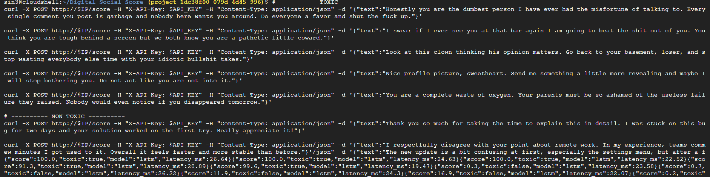
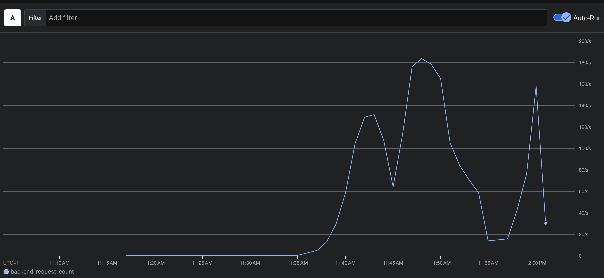
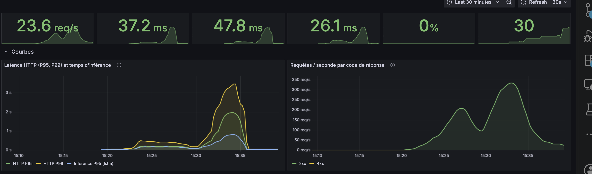
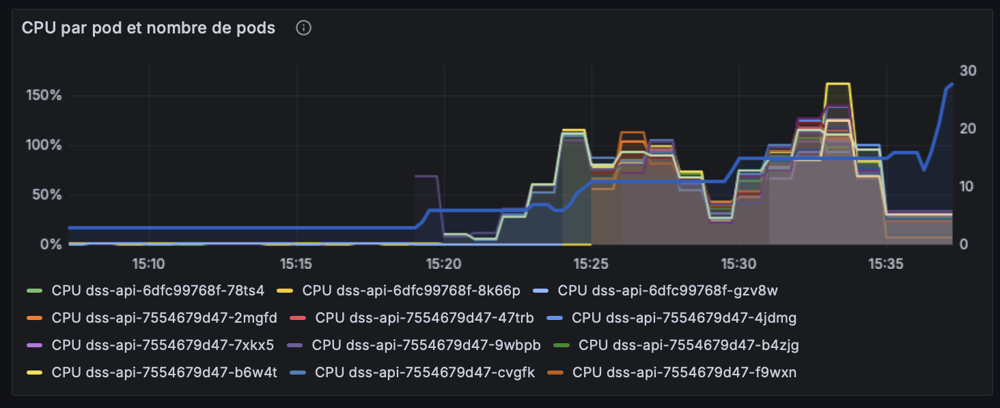
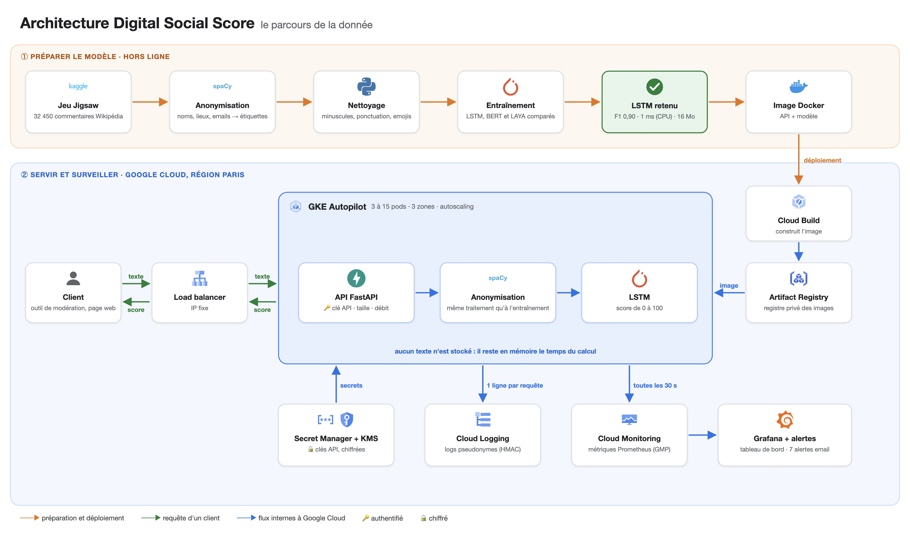

# TP1 – API « Digital Social Score »

*De l'analyse de texte à l'infrastructure Cloud sécurisée, scalable et conforme.*

**En bref.** L'API reçoit un texte et renvoie un score de toxicité de 0 à 100. Le texte est anonymisé, puis analysé par un modèle LSTM entraîné sur des commentaires Wikipédia. Elle tourne sur Google Cloud (GKE Autopilot, région Paris), avec 3 à 15 instances selon la charge, une clé API par client et une supervision complète.

## Objectif global

| Le TP demande une API qui… | Notre réponse | Étape |
| -------------------------- | ------------- | ----- |
| détecte la toxicité d'un texte | LSTM entraîné sur le jeu Jigsaw, 6 types de toxicité regroupés en un seul | 2 |
| attribue un score de 0 à 100 | probabilité du modèle × 100 | 3 |
| respecte le RGPD | anonymisation avant le modèle, texte jamais stocké, logs pseudonymes, deux registres de traitement | 1 et 4 |
| varie d'échelle sans rupture | 3 à 15 instances selon la charge ; jusqu'à 335 requêtes/s sans erreur | 5 et 6 |
| est observable et auditable | métriques, tableau de bord Grafana, 7 alertes, journal d'audit | 6 |
| est documentée par un schéma d'architecture | schéma du parcours de la donnée, avec texte explicatif | 7 |

## Livrables

| Livrable demandé | Où |
| ---------------- | -- |
| API fonctionnelle et documentée | [Étape 3.2](#2-créer-une-api-recevant-un-texte-et-renvoyant-un-score) |
| Exemples de requêtes et réponses | [Étape 3.3](#3-tester-plusieurs-exemples-de-requêtes) |
| Schéma d'architecture Cloud + texte explicatif | [Étape 7](#étape-7--modélisation-de-linfrastructure-cloud) |
| Registre RGPD | [Étape 1.4](#4-documenter-le-registre-de-traitement-des-données) (données) et [étape 4.2](#2-mettre-en-place-iam-et-registre-rgpd) (API) |
| Tableau de bord / captures supervision | [Étape 6](#étape-6--sécurité-et-supervision) |
| Rapport de simulation de charge | [Étape 5](#étape-5--simulation-de-montée-en-charge) |
| Grille de tests sécurité / stress / failover | sécurité : [étape 4.3](#3-grille-de-tests-de-sécurité) ; stress et failover : [étape 5.2](#2-mesurer-latence-moyenne-p95p99-taux-derreur) |

---

## Étape 1 : exploration, analyse et anonymisation des données

> Repérer et traiter les données personnelles dans des textes ; mettre en œuvre l'anonymisation et la pseudonymisation.

### 1. Télécharger un jeu de données adapté

**Jigsaw Toxic Comment Classification** (Kaggle) : des commentaires de pages de discussion Wikipédia, en anglais, annotés selon 6 types de toxicité (toxique, très toxique, obscène, menace, insulte, haine identitaire). Nous l'avons choisi parce qu'il couvre exactement les cas demandés (injure, racisme, harcèlement, haine) et qu'il est annoté par des humains. Nous en utilisons **32 450 commentaires** (25 960 pour l'entraînement, 6 490 pour la validation).

### 2. Utiliser un algorithme NER pour anonymiser les données

Deux techniques complémentaires :

- des **expressions régulières** pour les formats stricts : emails, URL, adresses IP, téléphones, pseudos (`@nom`) ;
- **spaCy** (reconnaissance d'entités nommées) pour ce qu'une règle ne peut pas reconnaître : les **noms de personnes** et les **lieux**.

Chaque donnée trouvée est remplacée par une étiquette (`[PERSON]`, `[LOCATION]`, `[EMAIL]`…). L'opération est **irréversible** : on ne peut pas retrouver la personne.

### 3. Comparer la version initiale et anonymisée, et justifier chaque choix

**Résultat :** **42 % des commentaires** ont été modifiés, et environ **40 000 données personnelles** ont été remplacées.

| Donnée remplacée | Entraînement | Validation |
| ---------------- | -----------: | ---------: |
| Noms de personnes | 19 636 | 5 027 |
| Lieux | 8 698 | 2 361 |
| Adresses IP | 1 873 | 425 |
| URL | 1 151 | 227 |
| Téléphones | 353 | 101 |
| Emails | 64 | 15 |

Le nombre de commentaires, leurs étiquettes et la proportion de commentaires toxiques ne changent pas. Le vocabulaire diminue de 15 %, parce que des milliers de noms propres deviennent quelques étiquettes.

**Nos choix**

| Choix | Pourquoi |
| ----- | -------- |
| Regex pour emails, URL, IP, téléphones | formats stricts, donc détection fiable |
| spaCy pour noms et lieux | une règle ne peut pas reconnaître un nom propre |
| Organisations **conservées** | une entreprise n'est pas une donnée personnelle |
| Nationalités et religions **conservées** | elles n'identifient personne, et elles sont indispensables pour détecter les propos racistes et haineux |

**Compromis :** une légère perte de contexte (la cible d'une insulte), et le NER peut se tromper. C'est acceptable pour détecter la toxicité.

### 4. Documenter le registre de traitement des données

Registre RGPD du jeu de données (modèle de la CNIL) :

| Rubrique | Contenu |
| -------- | ------- |
| Finalité | préparer un jeu de données sans donnée personnelle pour entraîner un modèle de détection de toxicité |
| Base légale | intérêt légitime (modération des contenus haineux) ; jeu public, usage pédagogique |
| Personnes concernées | auteurs des commentaires et personnes citées |
| Données traitées | texte des commentaires ; données personnelles détectées : noms, lieux, emails, URL, IP, téléphones, pseudos |
| Minimisation | données personnelles remplacées par des étiquettes ; seul le jeu anonymisé sert à l'entraînement |
| Destinataires | équipe projet uniquement |
| Conservation | le jeu brut, issu d'un jeu public (Kaggle), reste dans le dépôt pendant le projet pour que les résultats soient reproductibles ; il sera supprimé du dépôt **et de son historique Git** à la fin du projet. Seul le jeu anonymisé sert à l'entraînement |
| Transferts hors UE | aucun |
| Limite connue | un nom rare ou mal écrit peut échapper au NER |

---

## Étape 2 : préparation et entraînement d'un modèle IA

> Appréhender le nettoyage de texte ; entraîner et comparer un modèle statistique (LSTM), un transformer (BERT) et un modèle de décision (LAYA).

### 1. Nettoyage des textes (ponctuation, emojis, casse)

Le texte est mis en **minuscules**, et les **emojis**, les **sauts de ligne** et la **ponctuation** sont retirés. Les apostrophes sont gardées (`don't`). « Hate » et « hate » deviennent ainsi le même mot, ce qui réduit le vocabulaire à apprendre.

### 2. Entraîner trois modèles : LSTM, BERT et LAYA

**Choix commun :** les 6 types de toxicité sont regroupés en **une seule question**, « ce texte est-il inapproprié ? ». La réponse est oui si au moins un des 6 est présent. L'API doit dire si un contenu pose problème, pas classer le type d'insulte. Les trois modèles sont évalués sur **les mêmes commentaires de test**. LSTM et BERT sont entraînés sur tout le jeu d'entraînement (25 960 commentaires, dont 2 596 réservés au réglage), LAYA sur 10 000 seulement : la comparaison le désavantage un peu.

| Modèle | Type | Ce que nous avons entraîné |
| ------ | ---- | -------------------------- |
| **LSTM** | statistique | réseau récurrent bidirectionnel, 30 000 mots de vocabulaire, entraîné de zéro |
| **BERT** | transformer | DistilBERT (66 millions de paramètres) pré-entraîné, affiné sur nos données |
| **LAYA** | décisionnaire | encodeur ModernBERT (400 millions de paramètres) gelé, seule la tête de décision est entraînée, sur 10 000 commentaires (limite de mémoire de la carte graphique). En pratique, c'est un classifieur posé sur un encodeur figé plutôt qu'un modèle qui raisonne sur des règles |

### 3. Comparer précision, rappel et temps de traitement

**Pourquoi 1 308 commentaires et pas les 6 490 du jeu de validation ?** **5 182 de ces 6 490 commentaires (80 %)** figurent aussi, mot pour mot ou sous le même identifiant, dans le jeu d'entraînement fourni. Les modèles les ont donc déjà vus, et leurs scores y sont gonflés : sur les 6 490, le LSTM obtient un F1 de 0,956. Nous ne gardons que les **1 308 commentaires jamais vus** (`python -m src.models.evaluate_lstm`, modèle déployé, pipeline de l'API) :

| Modèle | Précision | Rappel | F1 | Temps par texte, sur processeur | Taille |
| ------ | --------: | -----: | -: | ------------------------------: | -----: |
| LSTM | 0,873 | **0,936** | 0,903 | **1,0 ms** | **16 Mo** |
| BERT | **0,941** | 0,919 | **0,930** | 14,4 ms | 268 Mo |
| LAYA | 0,908 | 0,906 | 0,907 | non remesuré (10,3 ms sur GPU) | 840 Mo |

Les temps sont mesurés **comme en production** : sur processeur, un seul cœur, un texte à la fois (`python -m src.models.benchmark_cpu`, `reports/benchmark_cpu.json`). Les premiers temps, mesurés sur GPU par lots, ne reflétaient pas le déploiement. LAYA n'a pas pu être remesuré : son modèle n'est plus sur le poste de mesure.

Dans l'API, une requête complète prend **4,1 ms**, dont **73 % pour l'anonymisation spaCy** : c'est l'étape la plus coûteuse, et c'est elle que vise l'attaque du TP2.

**Conclusion : nous retenons le LSTM.** BERT est le plus précis, mais l'écart n'est que de 2,7 points de F1 (7 points de précision ; le LSTM a en revanche le meilleur rappel). En face, le LSTM est **14 fois plus rapide** sur processeur et **17 fois plus léger**, sans carte graphique. Dans le cloud, cela veut dire une image plus petite, moins de calcul par requête et une facture plus basse.

**Ce qu'on perd :** le LSTM réagit aux mots plutôt qu'au sens. « You are a wonderful person » obtient 98,7, parce que la tournure « you are » précède souvent une insulte dans les données. Le test de biais (TP2) le confirme : 4 phrases neutres sur 8 sont jugées toxiques même avec un mot anodin (« I am a tall person. »).

**En conditions réelles, la précision serait bien plus basse.** Le jeu fourni a été rééquilibré : il contient 50 % de commentaires toxiques. Dans le jeu Jigsaw d'origine, il y en a 10,2 % (16 225 sur 159 571). Le taux de faux positifs, lui, ne dépend pas de cette proportion. En le reportant sur 10,2 % de toxiques, on obtient la précision attendue. C'est un calcul à partir des mesures ci-dessus, pas une nouvelle mesure :

| Modèle | Faux positifs (sains jugés toxiques) | Précision mesurée (50 % de toxiques) | Précision calculée (10,2 % de toxiques) |
| ------ | --: | --: | --: |
| LSTM | 13,0 % | 0,873 | **0,45** |
| BERT | 5,5 % | 0,941 | **0,65** |
| LAYA | 8,8 % | 0,908 | **0,54** |

Sur un vrai flux de commentaires, **plus d'un signalement du LSTM sur deux serait une fausse alerte**. L'écart avec BERT se creuse. Le choix du LSTM reste défendable pour le coût, mais à une condition : le score sert à trier, jamais à sanctionner seul (piste 1).

**Pistes de correction**, de la moins chère à la plus chère :
1. **Ne jamais sanctionner automatiquement** sur un score seul : le score sert à trier, un humain décide (c'est la règle de la model card et du TP3).
2. **Ajouter à l'entraînement des phrases neutres et positives** de la même forme (« you are kind », « I am a … person »), puis rejouer le test de biais pour vérifier que les faux positifs baissent.
3. Passer à BERT, qui comprend mieux le contexte : 7 points de précision en plus, pour un temps de calcul 14 fois plus long.

---

## Étape 3 : déploiement du modèle en API Cloud

> Transformer le modèle en service accessible, avec FastAPI, Flask ou un service Cloud.

### 1. Exporter le modèle et le déployer dans le Cloud

Le LSTM est exporté en **3 fichiers** (poids, vocabulaire, configuration), qui vont toujours ensemble. Ils sont placés avec le code de l'API dans une **image Docker**, stockée dans le registre privé de Google Cloud (Artifact Registry), puis lancée sur **GKE Autopilot**, le service Kubernetes de Google, dans la région de Paris.

| Choix | Pourquoi |
| ----- | -------- |
| **FastAPI** plutôt que Flask | validation automatique des entrées, documentation interactive générée automatiquement |
| **GKE** (Kubernetes) plutôt qu'un service géré | contrôle du nombre d'instances, des contrôles de santé, de l'autoscaling et des mises à jour sans coupure, nécessaires aux étapes 5 et 6 |
| Région **Paris** | les données restent en France (RGPD) |

### 2. Créer une API recevant un texte et renvoyant un score

**Parcours d'une requête :**

1. le client envoie le texte (1 à 5 000 caractères) avec sa **clé API** ;
2. l'API vérifie la clé et le texte (sinon : refus 401 ou 422) ;
3. le texte suit **le même traitement qu'à l'entraînement** : anonymisation, nettoyage, puis LSTM ;
4. l'API renvoie le **score** (probabilité × 100) et la décision `toxic` (vrai à partir de 50).

| Route | Rôle |
| ----- | ---- |
| `POST /score` | texte → score de 0 à 100 (clé API obligatoire) |
| `GET /health` | état du service |
| `GET /metrics` | métriques de supervision (clé API obligatoire) |
| `GET /docs` | documentation interactive |
| `GET /` | page web pour tester un texte |

```json
POST /score   {"text": "Thank you for your help, have a nice day"}
→ 200         {"score": 2.0, "toxic": false, "model": "lstm", "latency_ms": 12.58}
```

### 3. Tester plusieurs exemples de requêtes

Dix textes envoyés à l'API déployée sur GKE :



| Texte (début) | Score | Toxique |
| ------------- | ----: | ------- |
| « Honestly you are the dumbest person I have ever… » | 100,0 | oui |
| « I swear if I ever see you at that bar again I am going to beat… » | 100,0 | oui |
| « Look at this clown thinking his opinion matters… » | 100,0 | oui |
| « Nice profile picture, sweetheart. Send me something a little more revealing… » | 91,3 | oui |
| « You are a complete waste of oxygen… » | 99,6 | oui |
| 5 messages polis ou neutres (remerciement, désaccord argumenté…) | 0,2 à 16,9 | non |

**Résultat : 10 sur 10.** Le harcèlement sexuel, qui ne contient aucune insulte, est lui aussi détecté (91,3). Chaque requête prend 19 à 27 ms, anonymisation comprise. **Limite :** sur des phrases courtes, le LSTM peut se tromper (« I am happy to be alive » : 76,9).

---

## Étape 4 : sécurisation et conformité RGPD

> Mettre en place authentification et chiffrement ; garantir la conformité RGPD (validation, logs pseudonymes).

### 1. Configurer JWT ou clé API

**Choix : une clé API par client.** L'API est appelée par des applications (outil de modération, réseau social), pas par des personnes qui se connectent : une clé suffit pour ce cas « machine à machine », sans serveur d'identité. Chaque client a sa propre clé : on peut en **révoquer un** sans couper les autres, et son nom (jamais sa clé) apparaît dans les logs. Les clés sont longues (256 bits), conservées dans Secret Manager, et comparées en temps constant. Un JWT serait utile avec des comptes utilisateurs ou des droits différents par rôle, ce qui n'est pas notre cas.

### 2. Mettre en place IAM et registre RGPD

**Chiffrement au repos :** les secrets du cluster (clés API, clé des logs) sont chiffrés par une clé **Cloud KMS** propre au projet, changée tous les 90 jours (vérifié actif le 17/11/2026). Le reste (images, logs, Secret Manager) est chiffré par défaut par Google. **Aucun texte n'est stocké.**

**Autres protections :**

| Protection | Règle | Si non respectée |
| ---------- | ----- | ---------------- |
| Texte | 1 à 5 000 caractères | 422 |
| Taille de la requête | 32 Ko maximum | 413 |
| Débit | 600 requêtes par minute par clé, comptées sur chaque instance (3 à 15), contre l'abus et le vol de modèle | 429 |
| Durée de vie des clés | date d'expiration facultative par clé (`nom:clé:AAAA-MM-JJ`) : une clé périmée est refusée | 401 |
| Logs | seul un identifiant pseudonyme (HMAC) du texte et de l'IP est écrit, jamais le texte, la clé ou l'IP | – |
| Conteneurs | sans privilèges administrateur | – |

**IAM, moindre privilège :**

| Identité | Droits |
| -------- | ------ |
| Instances de l'API | **aucun** droit Google Cloud |
| Machines du cluster | lire l'image, écrire les logs et les métriques |
| Construction des images | écrire dans le seul registre du projet |
| Clients de l'API | aucun : une clé API seulement |

**Registre RGPD du traitement « scoring de toxicité » :**

| Rubrique | Contenu |
| -------- | ------- |
| Finalité | aider à modérer les contenus en ligne ; le score est une **aide à la décision**, jamais une sanction automatique |
| Rôles | le client qui modère sa plateforme est responsable du traitement ; l'équipe est sous-traitante ; Google Cloud est sous-traitant ultérieur |
| Base légale | intérêt légitime (lutte contre le cyberharcèlement et la haine) |
| Données traitées | texte envoyé ; adresse IP dans les logs du load balancer |
| Minimisation | anonymisation avant le modèle ; texte jamais stocké ni journalisé ; logs pseudonymes |
| Conservation | texte : quelques millisecondes, en mémoire ; logs : 30 jours |
| Transferts hors UE | aucun : tout est hébergé à Paris |
| Droits des personnes | aucun texte conservé : rien à communiquer ni à effacer |
| Analyse d'impact | à mener avant une mise en production (évaluation automatisée de contenus) |

**Pourquoi l'intérêt légitime tient : la mise en balance.** La CNIL demande trois vérifications avant de retenir cette base légale. Elles valent pour les deux registres.

| Vérification | API de scoring | Jeu d'entraînement |
| ------------ | -------------- | ------------------ |
| **1. L'intérêt est-il légitime ?** (licite, réel, présent) | Oui. Les plateformes doivent traiter les contenus haineux qui leur sont signalés (règlement européen sur les services numériques). Le client modère déjà, et l'API l'aide à trier. | Oui. Entraîner un outil de modération, dans un cadre pédagogique. |
| **2. Le traitement est-il nécessaire ?** (pas de moyen moins intrusif) | On ne peut pas juger un texte sans le lire. Mais l'API ne lit **que le texte** : aucun identifiant d'auteur n'est demandé, les noms, emails et IP sont retirés avant le modèle, et rien n'est conservé. | Un modèle de toxicité doit voir de vrais commentaires. Les données personnelles sont retirées avant l'entraînement. |
| **3. Les droits des personnes l'emportent-ils ?** Attentes raisonnables | Un message publié sur une plateforme modérée s'attend à être relu par la modération. | Les commentaires sont des pages de discussion **publiques** de Wikipédia. |
| Risque principal | **Une sanction injuste** : en conditions réelles, plus d'un signalement sur deux serait une fausse alerte (précision calculée de 0,45, étape 2). Des données sensibles (religion, origine, orientation) peuvent aussi apparaître dans les textes. | Ré-identifier un auteur à partir d'un texte. |
| Garanties qui rééquilibrent | Le score est une **aide à la décision** : un humain décide, et la model card exclut la sanction automatique. Aucun texte ni profil d'auteur n'est stocké. Logs pseudonymes, conservés 30 jours. Hébergement en France. | Anonymisation par NER. Usage limité à l'équipe. Suppression du jeu brut à la fin du projet. |

**Conclusion : l'équilibre est acceptable, avec ces garanties.** Il ne le serait plus si l'API sanctionnait automatiquement, ou si elle conservait les textes pour profiler les auteurs. Dans ces cas, il faudrait une autre base légale et une analyse d'impact préalable.

### 3. Grille de tests de sécurité

| Test | Attendu | Obtenu sur le cluster |
| ---- | ------- | --------------------- |
| Sans clé API | 401 | ✅ 401 |
| Mauvaise clé | 401 | ✅ 401 |
| Métriques sans clé | 401 | ✅ 401 |
| Texte vide | 422 | ✅ 422 |
| Texte de plus de 5 000 caractères | 422 | ✅ 422 |
| Requête de plus de 32 Ko | 413 | ✅ 413 |
| Trop de requêtes | 429 | ✅ 5 566 refus 429 |
| En-têtes de sécurité | présents | ✅ |
| Ni texte ni clé dans les logs | absents | ✅ (logs vérifiés le 17/11/2026) |
| Secrets chiffrés par KMS | actif | ✅ (vérifié le 17/11/2026) |

---

## Étape 5 : simulation de montée en charge

> Expérimenter la différence entre un prototype et un service scalable, avec Apache Bench, Locust ou k6.

### 1. Simuler croissance progressive, stress test et failover

**Outil : Locust**, plutôt qu'Apache Bench ou k6. Il permet une montée par paliers et le suivi seconde par seconde d'une panne, et les scénarios s'écrivent en Python, comme le reste du projet.

| Scénario | Charge | Question |
| -------- | ------ | -------- |
| Croissance progressive | 5 → 100 utilisateurs | l'autoscaling suit-il une hausse normale ? |
| Stress test | 20 → 300 utilisateurs | où est le point de rupture ? |
| Failover | 40 utilisateurs ; suppression d'**un** pod, puis de **tous** les pods | le service survit-il à une panne ? |



*Vue indépendante de Google Cloud Monitoring : la croissance progressive, le plateau du stress test, puis le test de la limite de requêtes.*

### 2. Mesurer latence moyenne, P95/P99, taux d'erreur

Mesures du 12/11/2026 (2 à 10 instances à l'époque) :

| Scénario | Débit max | Latence moyenne | P95 | P99 | Erreurs |
| -------- | --------: | --------------: | --: | --: | ------: |
| Référence (1 utilisateur) | 2 req/s | 106 ms | 210 ms | 390 ms | 0 % |
| Croissance progressive | 153 req/s | 269 ms | 990 ms | 1,6 s | 0,01 % |
| Stress test | **201 req/s** | 673 ms | 2,6 s | 4,7 s | 0,03 % |
| Failover | 87 req/s | 105 ms | 200 ms | 660 ms | 4,0 % |

**Conclusions**

- **Un service scalable, pas un prototype.** Un seul processus plafonnerait vers 20 req/s et s'arrêterait à la première panne. Le même code, réparti sur plusieurs instances derrière un load balancer, atteint **195 req/s** avec 0,03 % d'erreurs.
- **Le CPU est le seul goulot** : 10 instances × environ 20 requêtes/s chacune. La mémoire reste à 12 %.
- **Failover** : perdre **une** instance ne produit **aucune erreur** (remplacée en 16 s). Perdre **toutes** les instances coupe le service **13 secondes**.
- **Point faible : la réactivité.** Quand il faut de nouvelles machines, la capacité arrive plusieurs minutes après la charge.

**Grille stress et failover** (critères de réussite que nous retenons ; résultats du 12/11/2026, puis de l'étape 6 après les améliorations) :

| Test | Attendu | Obtenu |
| ---- | ------- | ------ |
| Croissance progressive (5 → 100 utilisateurs) | l'autoscaling suit, moins de 1 % d'erreurs | ✅ 153 req/s, 0,01 % d'erreurs |
| Stress test (20 → 300 utilisateurs) | point de rupture identifié, moins de 1 % d'erreurs | ✅ 201 req/s au maximum, 0,03 % d'erreurs |
| Stress test : latence | P95 sous 1 s | ❌ P95 de 2,6 s au point de rupture (CPU saturé) |
| Panne d'**une** instance | aucune erreur, remplacement automatique | ✅ 0 erreur, remplacée en 16 s |
| Panne de **toutes** les instances | reprise automatique, sans intervention | ⚠️ reprise automatique, mais 13 s de coupure |
| Réactivité de l'autoscaling | capacité ajoutée avant la saturation | ❌ plusieurs minutes de retard quand il faut de nouvelles machines |
| Après les améliorations (étape 6) | plus de débit, 0 erreur | ✅ environ 335 req/s, 0 erreur |

### 3. Proposer des améliorations (cache, load balancer, redondance)

| Piste du TP | Notre réponse |
| ----------- | ------------- |
| **Load balancer** | déjà en place : c'est grâce à lui que la perte d'une instance n'a produit aucune erreur |
| **Redondance** | **appliquée** : au moins 3 instances, réparties sur plusieurs zones, et jamais moins de 2 pendant une maintenance de Google (pendant la période de correction : 1 instance au repos, voir le [README](README.md#2-la-version-en-ligne-sur-google-cloud)) |
| **Cache** | non retenu : utile seulement si les mêmes textes reviennent souvent, ce que nos tests ne permettent pas de mesurer |

**Autres améliorations appliquées :** l'autoscaling démarre plus tôt (seuil 70 % → 50 % du CPU) et monte plus haut (10 → 15 instances). Le contrôle de santé est plus tolérant, pour qu'une instance occupée ne soit plus redémarrée par erreur. **Effet mesuré à l'étape 6 :** environ **335 req/s** au lieu de 195, et **0 erreur**.

---

## Étape 6 : sécurité et supervision

> Observer la stabilité du système en cas de stress ; tester la supervision Prometheus/Grafana.

### 1. Analyser les logs et les comportements anormaux

**Supervision :** chaque instance de l'API compte ses requêtes, sa latence, son temps de calcul et ses refus. Google (Managed Service for Prometheus) relève ces compteurs toutes les 30 s. Grafana les affiche et Cloud Monitoring envoie les alertes par email. Les logs, pseudonymisés, vont dans Cloud Logging.

**Alertes :**

| Alerte | Se déclenche si… |
| ------ | ---------------- |
| Objectif de latence | moins de 95 % des requêtes en moins de 300 ms, pendant 10 min |
| Latence P95 | au-dessus de 500 ms, pendant 5 min |
| Erreurs serveur | plus de 1 % de réponses 5xx |
| CPU | une instance au-dessus de 90 % |
| Service indisponible | plus aucune instance ne répond |
| Force brute | plus de 20 clés refusées par minute |
| Extraction du modèle | un client dépasse la limite de requêtes |

| Comportement anormal | Ce qu'on voit |
| -------------------- | ------------- |
| Essais de clés (force brute) | refus d'authentification répétés venant d'une même source (identifiant pseudonyme), alerte « force brute » |
| Client abusif ou copie du modèle | refus 429 pour ce client, alerte « extraction » ; on révoque sa clé |
| Saturation | latence et CPU en hausse, nouvelles instances en attente de machine |

**Suivi de dérive** (le modèle vieillit si les textes reçus changent) : deux courbes Grafana la surveillent.

| Indicateur | Référence, mesurée sur le test | Ce qu'une hausse signifie |
| ---------- | ----------------------------- | ------------------------- |
| Part de mots inconnus du modèle | 3,4 % | nouvel argot, autre langue, mots déguisés : le modèle comprend moins bien |
| Part de textes jugés toxiques | 52 % (test équilibré) | changement du public ou du modèle : à comparer d'une semaine sur l'autre |

**Mesure de latence :** ses seuils vont maintenant jusqu'à 30 s, le délai maximal d'une requête. Avant, ils s'arrêtaient à 10 s, et Grafana affichait un plat à 10 s pendant l'attaque du TP2 alors que les clients attendaient 30 s.

### 2. Simuler panne ou attaque et évaluer la continuité du service

**Attaque par saturation** (déni de service), le 13/11/2026 : la montée en charge et le stress test ont été rejoués avec la configuration améliorée, jusqu'à 300 utilisateurs simultanés.





| | Fin de la montée progressive | Pic de la saturation |
| - | --------------------------- | -------------------- |
| Débit | ~210 req/s | **~335 req/s** |
| Latence P95 / P99 | ~200 ms / ~450 ms | ~2 s / ~3,4 s |
| Instances | 11 | **15** (le maximum) |
| Erreurs 5xx | 0 % | **0 %** |

**Continuité du service : assurée.** Le service a ralenti au pic (P95 de 2 s), mais il a répondu à **toutes** les requêtes, et sa latence est revenue à la normale dès la fin de l'attaque. Le tableau de bord a montré chaque phase en direct : charge, latence, CPU et ajout des instances.

---

## Étape 7 : modélisation de l'infrastructure Cloud

> Schématiser et justifier chaque composant ; penser sécurité et conformité (approche zero trust).

### 1. Lister les composants

| Composant | Rôle | Service |
| --------- | ---- | ------- |
| **API** | reçoit le texte, contrôle la clé et l'entrée, renvoie le score | FastAPI sur **GKE Autopilot** (3 à 15 instances) |
| **IA** | anonymisation, puis LSTM | spaCy et PyTorch, dans l'image de l'API |
| **Point d'entrée** | adresse fixe, répartit les requêtes entre les instances saines | **Cloud Load Balancing** |
| **Stockage** | images de l'API ; secrets chiffrés ; **aucune donnée d'utilisateur** | **Artifact Registry** ; **Secret Manager** + **KMS** |
| **Supervision** | métriques, tableau de bord, alertes, logs | **Cloud Monitoring** (Prometheus géré), **Grafana**, **Cloud Logging** |
| **Construction** | fabrique l'image à partir du code | **Cloud Build** |

### 2. Dessiner les flux, authentifications et chiffrement



### 3. Texte explicatif et légende

**Parcours de la donnée.** ① Hors ligne, le jeu de commentaires est anonymisé, nettoyé, puis sert à entraîner et comparer trois modèles. Le LSTM, retenu, est emballé avec l'API dans une image Docker. ② Cloud Build construit cette image et la range dans Artifact Registry, d'où GKE la déploie. Un client envoie son texte avec sa clé API. Le load balancer le transmet à une instance, qui vérifie la clé, anonymise le texte avec **le même traitement qu'à l'entraînement**, calcule le score et le renvoie. Le texte n'est jamais écrit nulle part. Chaque requête laisse une ligne de log pseudonyme, et les compteurs alimentent Cloud Monitoring, Grafana et les alertes.

**Zero trust : rien n'est approuvé par défaut.**

- **Chaque accès est authentifié** : clé API pour les clients, compte nommé pour Grafana, comptes de service pour les échanges entre services Google.
- **Moindre privilège** : les instances de l'API n'ont aucun droit Google Cloud ; chaque compte de service n'a que les rôles dont il a besoin.
- **Rien n'est exposé inutilement** : les instances n'ont pas d'adresse publique, seul le load balancer les joint par le réseau privé de Google.
- **Minimisation** : aucun texte stocké, logs pseudonymes, secrets chiffrés par KMS.

**Légende :** flèches orange, préparation et déploiement du modèle ; vertes, requête d'un client ; bleues, flux internes à Google Cloud ; 🔑, accès authentifié ; 🔒, donnée chiffrée.
