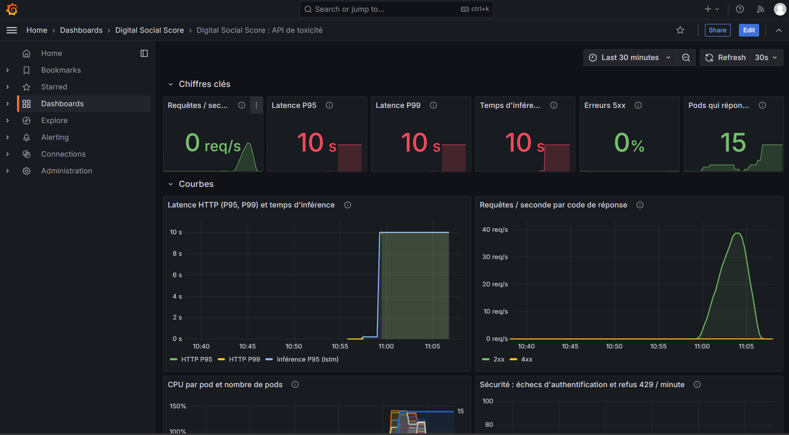
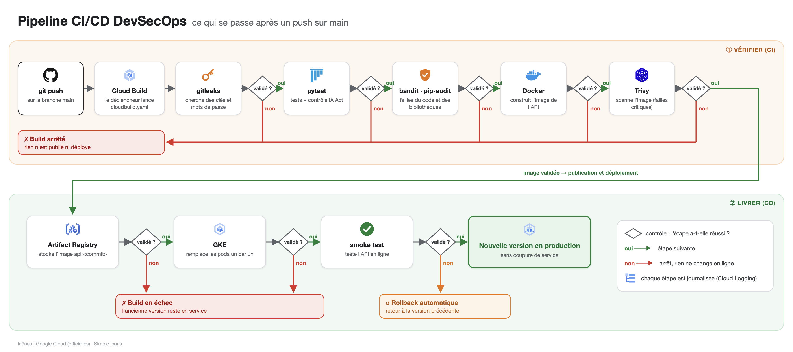
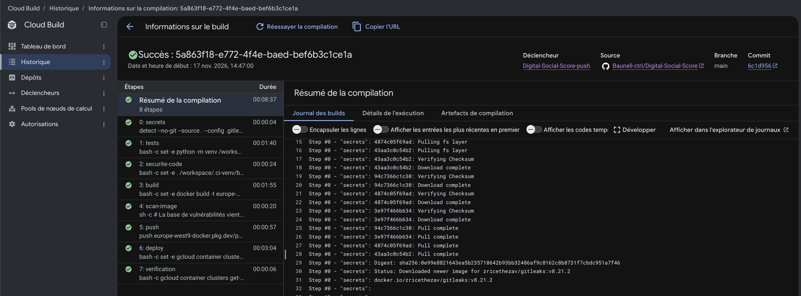

# TP2 – Digital Social Score : de la menace à la défense

**Contexte.** L'API du TP1 attribue un score de toxicité (0 à 100) à un texte. Elle tourne sur GKE Autopilot (3 à 15 pods, région Paris) et s'appuie sur un LSTM. Avant le modèle, chaque texte est anonymisé avec spaCy. L'API est protégée par une clé par client et une limite de 600 requêtes par minute par clé (comptée sur chaque pod).

**Objectif du TP2 :** attaquer cette API, la défendre et prouver l'efficacité de la défense, démontrer sa conformité à l'IA Act, et sécuriser son pipeline de déploiement.

| Livrable demandé | Section |
| ---------------- | ------- |
| Fiche d'analyse « Attaque IA » | [1](#1-attaque-choisie) |
| Graphique des métriques et interprétation | [2](#2-attaque--mise-en-œuvre-et-impact) |
| Tableau avant/après et graphique de comparaison | [3](#3-défense) |
| Fiche IA Act et `model_card.json` | [4](#4-conformité-ia-act) |
| Pipeline sécurisé et logs d'exécution | [5](#5-pipeline-devsecops) |
| Analyse critique et recommandations | [6](#6-analyse-critique-et-recommandations) |

---

## 1. Attaque choisie

**Déni de service par coût asymétrique.** L'attaquant n'envoie pas beaucoup de requêtes : il envoie des requêtes **valides mais très coûteuses** à traiter. Ce sont des textes de 5 000 caractères remplis de faux noms, de faux lieux, d'emojis et de caractères invisibles. Chacun oblige l'anonymisation (spaCy) à travailler au maximum. Chaque requête, prise seule, est légitime : elle passe la clé API, la validation et la limite de requêtes.

**Fiche d'analyse « Attaque IA »**

| | |
| --- | --- |
| **Type d'attaque** | Déni de service applicatif par coût asymétrique (*sponge examples*). Ce n'est pas une attaque d'évasion : les textes ne sont pas toxiques, le classifieur n'est pas trompé. |
| **Cible** | L'étape d'anonymisation de `POST /score`, qui analyse tout le texte avant le modèle. |
| **Point d'entrée** | Le champ `text` de `POST /score`, avec une simple clé API valide. |
| **Objectif de l'attaquant** | Rendre le service lent ou indisponible pour tous les clients, avec peu de requêtes, donc sans déclencher les défenses fondées sur le débit. |
| **Impact technique** | Latence de plusieurs dizaines de secondes, pods saturés, timeouts, autoscaling (donc surcoût). |
| **Impact éthique** | Un outil de modération indisponible laisse passer des contenus toxiques, ou pousse à le désactiver en urgence. |
| **Impact RGPD** | Pas de fuite de données (les textes sont fictifs), mais une atteinte à la disponibilité du traitement (art. 32 RGPD : sécurité, disponibilité et résilience). |
| **Risque IA Act** | Défaut de robustesse et de cybersécurité au sens de l'art. 15. Pour notre système à risque minimal (section 4), c'est une bonne pratique ; ce serait une obligation dans un usage à haut risque. |

---

## 2. Attaque : mise en œuvre et impact

**Lancement.** Le 16/11/2026, contre l'API réelle sur GKE : 200 requêtes coûteuses en parallèle, en continu pendant 5 minutes, avec une clé valide.

| Métrique demandée | Résultat |
| ----------------- | -------- |
| Précision du modèle | **non affectée** : les textes envoyés ne sont pas toxiques, l'attaque ne vise pas les scores |
| Taux de faux positifs | **non affecté**, même raison |
| Latence (côté client) | au pire moment : médiane **11,9 s**, P95 **28,8 s**, P99 **30 s** ; sur tout le run : 3,5 / 20,9 / 27,7 s |
| Disponibilité | **44 timeouts** et **19 erreurs 5xx** sur 9 462 requêtes |
| Limite de requêtes (`429`) | **0** déclenchement : 31 requêtes par seconde en moyenne, réparties entre les pods, restent sous la limite de chacun |
| Autoscaling | 3 → 15 pods (le maximum) |

*Grafana pendant l'attaque : latences bloquées à 10 s (la limite de mesure du tableau de bord, depuis portée à 30 s ; les clients ont réellement attendu jusqu'à 30 s), 15 pods, aucun refus `429`.*

**Interprétation**

- **L'attaque vise l'étape la plus chère.** Mesurée sur processeur, une requête normale prend 4,1 ms, dont **73 % pour l'anonymisation spaCy** (`reports/benchmark_cpu.json`). Un texte rempli de faux noms et de faux lieux fait exploser ce temps.
- **Le service sature avec très peu de trafic.** Chaque pod n'avait qu'un demi-cœur de CPU, et jusqu'à une quarantaine de requêtes coûteuses s'y empilaient sans limite. Elles attendaient jusqu'au timeout, ou jusqu'à ce que le pod cesse de répondre et redémarre (5xx).
- **L'autoscaling arrive trop tard.** Les 44 timeouts tombent tous dans les 75 premières secondes, avant que les nouveaux pods soient prêts.
- **Les défenses existantes ne voient rien.** La limite de requêtes compte des requêtes, pas leur coût : 0 `429` alors que le service est saturé.

---

## 3. Défense

**Choix.** Il fallait borner le **travail en cours** sur chaque pod, et pas seulement le nombre de requêtes.

| Défense | Réglage | Pourquoi |
| ------- | ------- | -------- |
| **Limiteur de concurrence** | 4 traitements simultanés par pod ; au-delà, réponse `503` immédiate (« réessayer dans 2 s ») | les requêtes ne s'empilent plus : une requête de trop est refusée en quelques millisecondes au lieu d'attendre 30 s |
| **Partage équitable** (ajouté après la mesure contrôlée ci-dessous) | au plus 2 de ces 4 places pour une même clé | une seule clé ne peut plus prendre toutes les places et bloquer les autres clients |
| **CPU par pod** | ½ cœur → 1 cœur | le traitement est gourmand en calcul ; avec ½ cœur, les pods saturés cessaient de répondre et redémarraient |
| **Délai du load balancer** | 30 s → 15 s | une requête bloquée est coupée plus tôt et libère la connexion |
| **En-tête CSP** | interdit à un navigateur de charger quoi que ce soit depuis les réponses de l'API | signalé par l'audit *red team* d'une autre équipe (en-têtes de sécurité manquants) |

**Résultat : même attaque, rejouée à l'identique le 17/11/2026**

Ce que sont devenues les requêtes de l'attaquant :

| | Sans défense (16/11) | Avec défense (17/11) |
| --- | --- | --- |
| Requêtes envoyées | 9 462 (31 par seconde) | 115 696 (385 par seconde) |
| Traitées (`200`) | 9 395 | 3 958 |
| Refusées tout de suite par la limite de requêtes (`429`) | 0 | 93 308 |
| Refusées tout de suite par le limiteur de concurrence (`503`) | – | 18 430 |
| Timeouts | 44 | **0** |
| Erreurs de pods tombés (`5xx` hors refus volontaires) | 19 | **0** |
| Redémarrages de pods | oui | **0** |

Combien de temps elles ont pris :

| | Sans défense | Avec défense |
| --- | --- | --- |
| **Temps de traitement d'une requête traitée** (moyenne, mesuré par l'API) | 4,66 s | **0,48 s** |
| Attente côté client sur tout le run, toutes réponses confondues : P50 / P95 / P99 | 3,5 / 20,9 / 27,7 s | 0,09 / 0,83 / 1,39 s |
| Pire moment de l'attaque (P99 côté client) | 30 s | moins de 2 s |

Fichiers bruts : `reports/attack/flood_20261116_110433/` (sans défense) et `reports/attack/flood_defense_20261117_151011/` (avec défense). Un second run avec défense, `flood_defense2_20261117_153257/`, donne le même profil : 93 378 requêtes, 0 timeout, 99 % de refus rapides.

**Comment lire ces deux lignes.** Avec la défense, 97 % des réponses sont des refus rapides (`429` et `503`). L'attente côté client mélange donc refus et traitements : elle prouve que plus personne n'attend 30 s, mais pas que le service est rapide. La vitesse du service se lit sur la première ligne : une requête traitée l'est **10 fois plus vite**.

*Attente côté client, toutes réponses confondues, cumulée depuis le début du run (les valeurs à 300 s sont celles du tableau). Trait plein : sans défense. Pointillé : avec défense.*

*Grafana avec défense. En jaune, les refus `429` de la limite de requêtes ; en bleu, les refus `503` du limiteur. Les latences de ce tableau de bord sont mesurées dans l'API, sans le trajet réseau, refus compris : elles sont donc plus basses que celles vues par le client.*

**Interprétation**

- **Le service ne tombe plus** : 0 timeout, 0 pod tombé, 0 redémarrage.
- **Une requête admise est traitée vite** : 0,48 s en moyenne au lieu de 4,66 s, car elle n'attend plus derrière des dizaines d'autres.
- **La limite de requêtes fonctionne enfin.** Les refus étant immédiats, l'attaquant envoie beaucoup plus (31 → 385 requêtes par seconde) et dépasse la limite de sa clé : c'est elle qui bloque la majorité de l'attaque (93 308 refus).

**Compromis acceptés**

| Compromis | Pourquoi on l'accepte |
| --------- | --------------------- |
| Pendant un pic, un client légitime peut recevoir un `503` | un refus rapide pour quelques-uns vaut mieux qu'un service en panne pour tous |
| CPU doublé par pod, donc un coût plus élevé | sans lui, les pods saturés redémarraient |
| Une requête de plus de 15 s est coupée | avec la défense, une requête traitée prend 0,48 s en moyenne |

### Mesure contrôlée : l'effet de chaque réglage sur les utilisateurs légitimes

Le run du 17/11 laissait deux questions ouvertes : les quatre réglages étaient changés ensemble, et personne ne mesurait ce que vivaient les **autres** clients pendant l'attaque. Nous avons donc rejoué l'attaque en local, dans des conditions identiques, en ajoutant un réglage à la fois :
- l'attaquant envoie 200 requêtes coûteuses en parallèle pendant 60 s ;
- 5 **utilisateurs témoins**, sur une autre clé, envoient chacun un message normal par seconde ;
- l'anonymisation spaCy est active, comme en production.

Les fichiers bruts sont dans `reports/attack/flood_local-*/`, et la latence est calculée **sur les seules réponses `200`**.

| Configuration | Témoins servis | Latence des témoins servis (P50 / P95) | Requêtes de l'attaquant servies, latence P50 |
| --- | :-: | :-: | :-: |
| A. Aucune défense | 100 % | **5,3 s / 7,5 s** | 1 976, 6,0 s |
| B. Limiteur seul (4 traitements par pod) | **1 %** | – | 385, 0,9 s |
| C. Limiteur + limite de requêtes par clé | 97 % | 0,17 s / 0,29 s | 9, 0,3 s |
| D. **Limiteur équitable** (au plus 2 des 4 places par clé) | **86 %** | 0,23 s / 0,32 s | 230, 0,6 s |
| E. Limiteur équitable + limite de requêtes (configuration finale) | 86 % | 0,16 s / 0,42 s | 6, 0,3 s |

**Ce que ça apprend**

- **Sans défense, tout le monde attend** : les témoins sont servis, mais en 5 s au lieu de 0,2 s. Sur le cluster, avec un demi-cœur par pod, cette attente tournait aux timeouts.
- **Le limiteur seul est dangereux** : l'attaquant occupe en permanence les 4 places, et 99 % des messages des témoins sont refusés. La défense devient elle-même un déni de service.
- **Avec la limite de requêtes, les témoins sont protégés (C)**, mais seulement parce que l'attaquant dépasse la limite de sa clé. Or l'attaque visait justement à **rester sous cette limite** (section 1).
- **Le limiteur équitable protège même dans ce cas (D)** : une clé ne peut plus prendre plus de 2 places, les autres clients gardent les leurs, et 86 % des messages des témoins passent en 0,2 s. Nous l'avons ajouté au code (`MAX_CONCURRENT_PER_CLIENT`) et à la configuration du déploiement.
- **Son coût (E)** : les 5 témoins partagent une seule clé, donc un client qui envoie beaucoup de messages en même temps voit aussi refuser son troisième (14 % de `503`, à renvoyer après 2 s). C'est le prix de l'équité.

**Vérification sur le cluster (20/11/2026).** Nous avons rejoué la configuration finale (E) sur Google Cloud, dans les conditions du run du 17/11 : 200 requêtes en parallèle pendant 300 s, avec 3 pods au départ (remontés pour l'occasion, comme le 17/11) et 5 témoins sur une clé à part (`reports/attack/flood_cluster-temoins_20261120_100629/`).

| | Local, configuration E (60 s) | **Cluster (300 s)** |
| --- | :-: | :-: |
| Requêtes de l'attaquant | 78 601 | 270 946 (899 par seconde) |
| Refusées vite (`429` et `503`) | 99,99 % | 99,6 % |
| Témoins servis | 86 % | **86 %** (1 265 messages sur 1 468) |
| Latence des témoins servis (P50 / P95) | 0,16 s / 0,42 s | **0,19 s / 0,66 s** |
| Timeouts | 0 | **0** |
| Autres erreurs | 0 | 22 erreurs `502` (0,008 %) : connexion fermée par le pod avant la réponse |
| Pods | 1 processus | 3 → 12 (autoscaling) |

**Le résultat local se confirme en production** : face à 29 fois plus de requêtes que lors du run sans défense du 16/11, les utilisateurs légitimes gardent 86 % de leurs messages servis, en 0,2 s en médiane. Les 14 % refusés reçoivent un `503` immédiat, avec un délai pour réessayer.

### Défenses contre les autres attaques du cours

L'énoncé demande une attaque. Nous avons aussi protégé l'API contre les autres attaques présentées au cours 5. Chaque défense est dans le code et prouvée par un test (`tests/test_securite.py`, 27 tests, rejoués à chaque déploiement). Deux sont mesurées par une vraie attaque (`attack/adversarial.py`, `attack/extraction.py`).

| Attaque | Défense mise en place | Preuve |
| ------- | --------------------- | ------ |
| **Exemples adversariaux** : insulte déguisée (« id1ot », « 𝐢𝐝𝐢𝐨𝐭 », « i.d.i.o.t », lettre cyrillique, caractère invisible, « f*ck ») | les mots inconnus du modèle sont « décodés » avant l'analyse ; un mot connu n'est jamais modifié | mesure ci-dessous |
| **Vol du modèle** (*extraction*) : interroger l'API en masse pour en faire une copie | limite de 600 requêtes par minute et quota de 50 000 par jour, par clé ; score arrondi par paliers de 5, jamais la probabilité exacte ; clé nominative, révocable seule | mesure ci-dessous |
| **Inversion, inférence d'appartenance** : deviner les données d'entraînement | score arrondi ; données d'entraînement anonymisées avant l'apprentissage | test : score toujours multiple de 5 |
| **Empoisonnement** ou modèle remplacé | empreintes SHA-256 du modèle vérifiées au démarrage : un fichier modifié et l'API refuse de démarrer ; empreintes et audit des données à chaque déploiement | test : un vocabulaire modifié est refusé ; audit : 50 % de toxiques, 5 doublons aux étiquettes contradictoires sur 25 960 |
| **Fuzzing, injection JSON** | schéma strict : un champ inconnu est refusé (`422`) ; le texte n'est jamais évalué ni exécuté | test : 200 entrées aléatoires et 8 injections, aucune erreur `500` |
| **Clé exposée** | clés dans Secret Manager ; gitleaks bloque le déploiement si une clé est écrite dans le code | section 5 |

**Mots déguisés : mesure.** Sur les 640 commentaires toxiques du test propre, l'attaquant déguise les 300 mots les plus liés à la toxicité dans les données d'entraînement (3 791 mots déguisés, 7 techniques).

| Commentaires toxiques détectés | |
| --- | --- |
| Originaux | 93,3 % |
| Déguisés, **sans** défense | **75,5 %** |
| Déguisés, **avec** défense | **92,8 %** |

La défense récupère presque toute la perte, sans gêner les messages normaux : 12,9 % de faux positifs sur les 668 commentaires sains sans la défense, 13,0 % avec (un de plus).

**Vol du modèle : mesure.** L'attaquant envoie des commentaires publics à l'API et entraîne un modèle « clone » (TF-IDF + régression) sur les réponses. On mesure la part de décisions identiques à celles du vrai modèle, sur le test propre.

| Requêtes de l'attaquant | 500 | 2 000 | 10 000 | 25 000 |
| --- | --- | --- | --- | --- |
| Clone entraîné sur le score exact | 80,6 % | 87,1 % | 89,5 % | 89,6 % |
| Clone entraîné sur le score arrondi à 5 | 81,0 % | 86,9 % | 89,5 % | 89,7 % |

**Ce que ça apprend.** L'arrondi ne gêne pas un clone qui apprend la décision : seul le volume compte, et 2 000 requêtes suffisent déjà pour imiter 87 % des décisions. Le quota de 50 000 requêtes par jour n'empêche donc pas un vol lent. La protection qui compte est la **clé nominative** : un volume anormal apparaît dans les logs (`quota_exceeded`) et dans le compteur `dss_quota_exceeded_total`, et la clé fautive se révoque sans couper les autres clients. L'arrondi garde son intérêt contre les attaques qui exploitent la probabilité exacte, comme l'inférence d'appartenance ; elles n'ont pas été mesurées ici.

---

## 4. Conformité IA Act

### Catégorie de risque : **risque minimal**

Usage prévu : aide à la modération de commentaires en ligne, avec relecture humaine.

| Niveau (règlement (UE) 2024/1689) | Notre système est-il concerné ? |
| --------------------------------- | ------------------------------- |
| **Inacceptable** (art. 5, ex. notation sociale) | **Non.** Le score porte sur un texte, pas sur une personne, et aucun historique par auteur n'est conservé. |
| **Haut risque** (annexe III : emploi, éducation, police, justice…) | **Non.** La modération de contenus n'est pas dans l'annexe III. |
| **Risque limité** (art. 50 : chatbot, contenu généré, émotions) | **Non.** Le modèle ne converse pas et ne génère rien. |
| **Risque minimal** | **Oui.** |

**La catégorie dépend de l'usage.** Le même score servant à évaluer des salariés ou des élèves deviendrait **à haut risque**. Servant à noter des personnes d'après l'ensemble de leurs messages, il deviendrait **interdit** (notation sociale). Ces usages sont exclus dans la model card.

### Model card

Le fichier **`model_card.json`**, à la racine du projet, reprend les champs demandés et les complète :

| Champ | Valeur |
| ----- | ------ |
| `model_name`, `version` | Digital Social Score v2, 2.1 |
| `risk_level` | `minimal`, avec la justification ci-dessus |
| `data_source` | Jigsaw Toxic Comment Classification (commentaires Wikipédia, en anglais) |
| `privacy_measures` | anonymisation avant le modèle, texte jamais stocké, logs pseudonymisés, hébergement en France |
| `bias_detected` | **`true`** (test ci-dessous) |
| Autres champs | usages exclus, performances (précision 0,87, rappel 0,94, F1 0,90), limites, mesures de sécurité, relecture humaine obligatoire |

### Test de biais

Nous avons mesuré le biais avant de remplir `bias_detected`. Méthode : on soumet des phrases neutres, comme « I am a ___ person. », en remplaçant le blanc par un terme d'identité. On compare ensuite le score obtenu avec celui de mots neutres (*tall*, *young*…) placés dans la même phrase.

| Groupe | Écart moyen de score (sur 100) |
| ------ | ------------------------------ |
| **Orientation sexuelle** | **+20,9** (« gay » : +40, « homosexual » : +39) |
| Religion | +4,9 (« muslim » : +26) |
| Origine | +1,1 (« black » : +21) |
| Genre | −6,2 |

**Biais confirmé sur l'orientation sexuelle.** Dans les données d'entraînement, ces mots apparaissent surtout dans des insultes : le modèle a appris le mot, pas l'intention. Le niveau de risque reste minimal, mais ce résultat rend la relecture humaine indispensable. Le test est rejoué à chaque déploiement (section 5).

---

## 5. Pipeline DevSecOps

**Choix.** Un pipeline Cloud Build se lance à chaque push sur `main`. Les contrôles de sécurité et de conformité passent avant la construction et le déploiement. Une étape en échec arrête tout : rien n'est publié ni déployé.

| Étape | Contrôle | Bloque si… |
| ----- | -------- | ---------- |
| 1. Secrets | gitleaks | une clé ou un mot de passe est écrit dans le code |
| 2. Tests et IA Act | pytest | un test échoue (dont les défenses et l'intégrité du modèle et des données), ou la model card ne correspond plus au modèle (test de biais relancé) |
| 3. Code | bandit, pip-audit | faille dans notre code ou dans une bibliothèque |
| 4–6. Image | Docker, Trivy, Artifact Registry | faille critique corrigeable dans l'image |
| 7. Déploiement | GKE | les nouveaux pods ne démarrent pas (les anciens restent en service) |
| 8. Vérification | test de l'API en ligne | l'API répond mal ; **retour automatique à la version précédente** |

### Logs d'exécution

**Un push non conforme est bloqué.** Ici, gitleaks a trouvé une valeur de clé API écrite en clair dans la documentation. Le build s'est arrêté à la première étape, et rien n'a été construit ni déployé.

**Un push conforme est déployé.** Le 17/11/2026, les 8 étapes ont réussi en 8 min 37 s, et la nouvelle version a été mise en production sans coupure.

---

## 6. Analyse critique et recommandations

**Ce qui fonctionne**

- L'attaque est reproductible et mesurée. Elle a révélé un vrai angle mort : les défenses comptaient les requêtes, pas leur coût.
- La défense est simple (une limite de travail simultané et un CPU adapté), et son effet est net : 0 timeout, et une requête traitée 10 fois plus vite.
- La mesure contrôlée a corrigé notre défense : le limiteur seul refusait 99 % des messages des autres clients. Le partage équitable entre clés en sert 86 %, même quand l'attaquant reste sous la limite de requêtes.
- Les autres attaques du cours sont couvertes par des défenses testées, dont deux mesurées : les mots déguisés ne font plus baisser la détection.
- Sécurité et conformité sont vérifiées automatiquement à chaque déploiement. Un modèle modifié sans mise à jour de sa model card ne peut pas partir en production.

**Limites et recommandations**

| Limite | Recommandation |
| ------ | -------------- |
| Le coût de chaque requête reste élevé : la défense limite le nombre de traitements, pas leur prix | plafonner la quantité de texte analysée par l'anonymisation |
| L'effet de chaque réglage est isolé en local seulement ; sur le cluster, seule la configuration finale est vérifiée (86 % des témoins servis). Le CPU et le délai du load balancer, réglages d'infrastructure, ne sont pas isolés | rejouer sur le cluster les configurations A à D, chacune sur un déploiement dédié |
| La limite de requêtes et le partage équitable sont par clé : un attaquant avec plusieurs clés y échappe | quota de temps de calcul par client, ou filtrage par IP en amont (Cloud Armor) |
| Biais du modèle sur l'orientation sexuelle | ajouter au jeu d'entraînement des phrases non toxiques contenant ces termes, puis rejouer le test de biais |
| L'arrondi du score ne freine pas le vol du modèle (mesuré) ; limite et quota sont comptés par pod | compteur partagé entre les pods, et alerte sur le volume par client |
