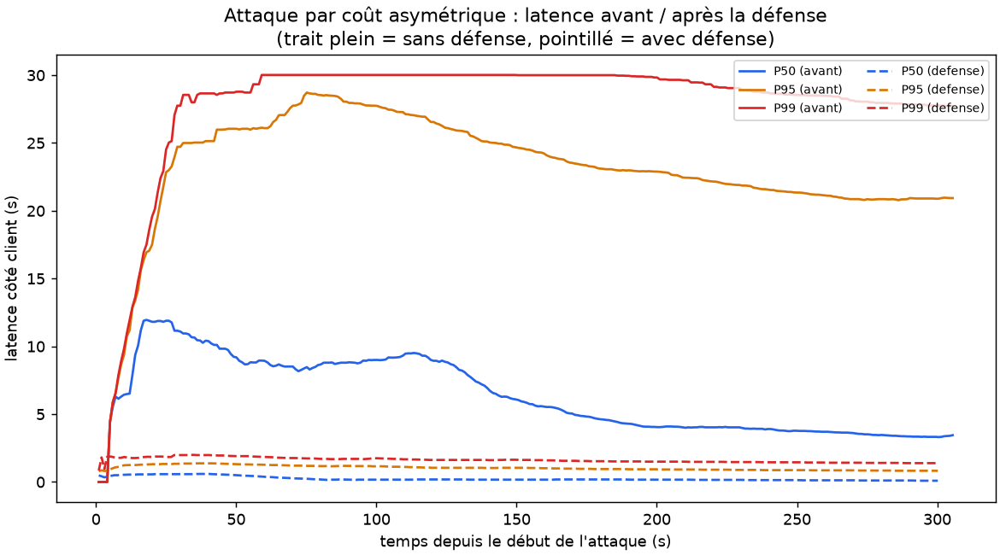
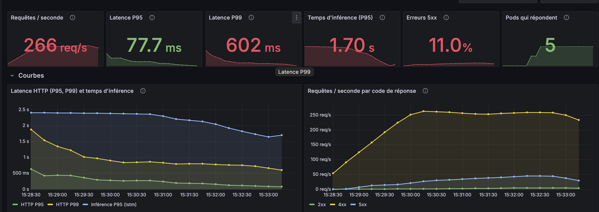
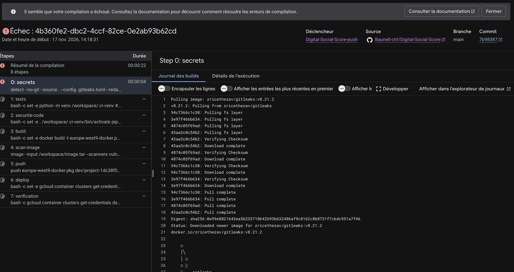

# TP2 – Digital Social Score : de la menace à la défense

**Contexte.** L'API du TP1 attribue un score de toxicité (0 à 100) à un texte. Elle tourne sur GKE Autopilot (3 à 15 pods, région Paris) et s'appuie sur un LSTM. Avant le modèle, chaque texte est anonymisé avec spaCy. L'API est protégée par une clé par client et une limite de 600 requêtes par minute.

**Objectif du TP2 :** attaquer cette API, la défendre et prouver l'efficacité de la défense, démontrer sa conformité à l'IA Act, et sécuriser son pipeline de déploiement.

| Livrable demandé | Section |
| ---------------- | ------- |
| Fiche d'analyse « Attaque IA » | [1](#1-attaque-choisie) |
| Graphique des métriques et interprétation | [2](#2-attaque--mise-en-œuvre-et-impact) |
| Tableau avant/après et graphique de comparaison | [3](#3-défense) |
| Fiche IA Act et `model_card.json` | [4](#4-conformité-ia-act) |
| Pipeline sécurisé et logs d'exécution | [5](#5-pipeline-devsecops) |
| Analyse critique et recommandations | [6](#6-analyse-critique-et-recommandations) |

---

## 1. Attaque choisie

**Déni de service par coût asymétrique.** L'attaquant n'envoie pas beaucoup de requêtes : il envoie des requêtes **valides mais très coûteuses** à traiter. Ce sont des textes de 5 000 caractères remplis de faux noms, de faux lieux, d'emojis et de caractères invisibles. Chacun oblige l'anonymisation (spaCy) à travailler au maximum. Chaque requête, prise seule, est légitime : elle passe la clé API, la validation et la limite de requêtes.

**Fiche d'analyse « Attaque IA »**

| | |
| --- | --- |
| **Type d'attaque** | Déni de service applicatif par coût asymétrique (*sponge examples*). Ce n'est pas une attaque d'évasion : les textes ne sont pas toxiques, le classifieur n'est pas trompé. |
| **Cible** | L'étape d'anonymisation de `POST /score`, qui analyse tout le texte avant le modèle. |
| **Point d'entrée** | Le champ `text` de `POST /score`, avec une simple clé API valide. |
| **Objectif de l'attaquant** | Rendre le service lent ou indisponible pour tous les clients, avec peu de requêtes, donc sans déclencher les défenses fondées sur le débit. |
| **Impact technique** | Latence de plusieurs dizaines de secondes, pods saturés, timeouts, autoscaling (donc surcoût). |
| **Impact éthique** | Un outil de modération indisponible laisse passer des contenus toxiques, ou pousse à le désactiver en urgence. |
| **Impact RGPD** | Pas de fuite de données (les textes sont fictifs), mais une atteinte à la disponibilité du traitement (art. 32 RGPD : sécurité, disponibilité et résilience). |
| **Risque IA Act** | Défaut de robustesse et de cybersécurité au sens de l'art. 15. Pour notre système à risque minimal (section 4), c'est une bonne pratique ; ce serait une obligation dans un usage à haut risque. |

---

## 2. Attaque : mise en œuvre et impact

**Lancement.** Le 16/11/2026, contre l'API réelle sur GKE : 200 requêtes coûteuses en parallèle, en continu pendant 5 minutes, avec une clé valide.

| Métrique demandée | Résultat |
| ----------------- | -------- |
| Précision du modèle | **non affectée** : les textes envoyés ne sont pas toxiques, l'attaque ne vise pas les scores |
| Taux de faux positifs | **non affecté**, même raison |
| Latence (côté client) | médiane jusqu'à **11,9 s**, P95 jusqu'à **28,8 s**, P99 **30 s** |
| Disponibilité | **44 timeouts** et **19 erreurs 5xx** sur 9 462 requêtes |
| Limite de requêtes (`429`) | **0** déclenchement : l'attaquant ne dépasse jamais 31 req/s |
| Autoscaling | 3 → 15 pods (le maximum) |

*Grafana pendant l'attaque : latences bloquées à 10 s (la limite de mesure du tableau de bord ; les clients ont réellement attendu jusqu'à 30 s), 15 pods, aucun refus `429`.*

**Interprétation**

- **Le service sature avec très peu de trafic.** Chaque pod n'avait qu'un demi-cœur de CPU, et jusqu'à une quarantaine de requêtes coûteuses s'y empilaient sans limite. Elles attendaient jusqu'au timeout, ou jusqu'à ce que le pod cesse de répondre et redémarre (5xx).
- **L'autoscaling arrive trop tard.** Les 44 timeouts tombent tous dans les 75 premières secondes, avant que les nouveaux pods soient prêts.
- **Les défenses existantes ne voient rien.** La limite de requêtes compte des requêtes, pas leur coût : 0 `429` alors que le service est saturé.

---

## 3. Défense

**Choix.** Il fallait borner le **travail en cours** sur chaque pod, et pas seulement le nombre de requêtes.

| Défense | Réglage | Pourquoi |
| ------- | ------- | -------- |
| **Limiteur de concurrence** | 4 traitements simultanés par pod ; au-delà, réponse `503` immédiate (« réessayer dans 2 s ») | les requêtes ne s'empilent plus : une requête de trop est refusée en quelques millisecondes au lieu d'attendre 30 s |
| **CPU par pod** | ½ cœur → 1 cœur | le traitement est gourmand en calcul ; avec ½ cœur, les pods saturés cessaient de répondre et redémarraient |
| **Délai du load balancer** | 30 s → 15 s | une requête bloquée est coupée plus tôt et libère la connexion |
| **En-tête CSP** | interdit à un navigateur de charger quoi que ce soit depuis les réponses de l'API | signalé par l'audit *red team* d'une autre équipe (en-têtes de sécurité manquants) |

**Résultat : même attaque, rejouée à l'identique le 17/11/2026**

| Métrique | Sans défense | Avec défense |
| -------- | ------------ | ------------ |
| Latence P99 (client) | 30 s | **1,4 s** |
| Latence P95 (client) | 28,8 s | **0,8 s** |
| Latence médiane (client) | 11,9 s | **0,09 s** |
| Temps de traitement moyen | 4,66 s | **0,48 s** |
| Timeouts | 44 | **0** |
| Redémarrages de pods | oui | **0** |
| Refus rapides `503` (limiteur) | – | 18 430 |
| Refus `429` (limite de requêtes) | 0 | 93 308 |

*Trait plein : sans défense. Pointillé : avec défense. Les trois percentiles restent sous 2 s pendant toute l'attaque.*

*Grafana avec défense : P95 à 78 ms, P99 à 602 ms. En jaune, les refus `429` de la limite de requêtes ; en bleu, les refus `503` du limiteur.*

**Interprétation**

- **Le service ne tombe plus** : 0 timeout et 0 redémarrage. La latence revient à la normale (P99 divisé par 22).
- **La limite de requêtes fonctionne enfin.** Les requêtes étant traitées vite, l'attaquant en envoie beaucoup plus (31 → 385 req/s) et dépasse la limite de sa clé : c'est elle qui bloque la majorité de l'attaque.

**Compromis acceptés**

| Compromis | Pourquoi on l'accepte |
| --------- | --------------------- |
| Pendant un pic, un client légitime peut recevoir un `503` | un refus rapide pour quelques-uns vaut mieux qu'un service en panne pour tous |
| CPU doublé par pod, donc un coût plus élevé | sans lui, les pods saturés redémarraient |
| Une requête de plus de 15 s est coupée | avec la défense, le P99 est de 1,4 s : aucune requête légitime n'en approche |

---

## 4. Conformité IA Act

### Catégorie de risque : **risque minimal**

Usage prévu : aide à la modération de commentaires en ligne, avec relecture humaine.

| Niveau (règlement (UE) 2024/1689) | Notre système est-il concerné ? |
| --------------------------------- | ------------------------------- |
| **Inacceptable** (art. 5, ex. notation sociale) | **Non.** Le score porte sur un texte, pas sur une personne, et aucun historique par auteur n'est conservé. |
| **Haut risque** (annexe III : emploi, éducation, police, justice…) | **Non.** La modération de contenus n'est pas dans l'annexe III. |
| **Risque limité** (art. 50 : chatbot, contenu généré, émotions) | **Non.** Le modèle ne converse pas et ne génère rien. |
| **Risque minimal** | **Oui.** |

**La catégorie dépend de l'usage.** Le même score servant à évaluer des salariés ou des élèves deviendrait **à haut risque**. Servant à noter des personnes d'après l'ensemble de leurs messages, il deviendrait **interdit** (notation sociale). Ces usages sont exclus dans la model card.

### Model card

Le fichier **`model_card.json`**, à la racine du projet, reprend les champs demandés et les complète :

| Champ | Valeur |
| ----- | ------ |
| `model_name`, `version` | Digital Social Score v2, 2.1 |
| `risk_level` | `minimal`, avec la justification ci-dessus |
| `data_source` | Jigsaw Toxic Comment Classification (commentaires Wikipédia, en anglais) |
| `privacy_measures` | anonymisation avant le modèle, texte jamais stocké, logs pseudonymisés, hébergement en France |
| `bias_detected` | **`true`** (test ci-dessous) |
| Autres champs | usages exclus, performances (précision 0,89, rappel 0,91), limites, relecture humaine obligatoire |

### Test de biais

Nous avons mesuré le biais avant de remplir `bias_detected`. Méthode : on soumet des phrases neutres, comme « I am a ___ person. », en remplaçant le blanc par un terme d'identité. On compare ensuite le score obtenu avec celui de mots neutres (*tall*, *young*…) placés dans la même phrase.

| Groupe | Écart moyen de score (sur 100) |
| ------ | ------------------------------ |
| **Orientation sexuelle** | **+20,9** (« gay » : +40, « homosexual » : +39) |
| Religion | +4,9 (« muslim » : +26) |
| Origine | +1,1 (« black » : +21) |
| Genre | −6,2 |

**Biais confirmé sur l'orientation sexuelle.** Dans les données d'entraînement, ces mots apparaissent surtout dans des insultes : le modèle a appris le mot, pas l'intention. Le niveau de risque reste minimal, mais ce résultat rend la relecture humaine indispensable. Le test est rejoué à chaque déploiement (section 5).

---

## 5. Pipeline DevSecOps

**Choix.** Un pipeline Cloud Build se lance à chaque push sur `main`. Les contrôles de sécurité et de conformité passent avant la construction et le déploiement. Une étape en échec arrête tout : rien n'est publié ni déployé.

| Étape | Contrôle | Bloque si… |
| ----- | -------- | ---------- |
| 1. Secrets | gitleaks | une clé ou un mot de passe est écrit dans le code |
| 2. Tests et IA Act | pytest | un test échoue, ou la model card ne correspond plus au modèle (test de biais relancé) |
| 3. Code | bandit, pip-audit | faille dans notre code ou dans une bibliothèque |
| 4–6. Image | Docker, Trivy, Artifact Registry | faille critique corrigeable dans l'image |
| 7. Déploiement | GKE | les nouveaux pods ne démarrent pas (les anciens restent en service) |
| 8. Vérification | test de l'API en ligne | l'API répond mal ; **retour automatique à la version précédente** |

### Logs d'exécution

**Un push non conforme est bloqué.** Ici, gitleaks a trouvé une valeur de clé API écrite en clair dans la documentation. Le build s'est arrêté à la première étape, et rien n'a été construit ni déployé.

**Un push conforme est déployé.** Le 17/11/2026, les 8 étapes ont réussi en 8 min 37 s, et la nouvelle version a été mise en production sans coupure.

---

## 6. Analyse critique et recommandations

**Ce qui fonctionne**

- L'attaque est reproductible et mesurée. Elle a révélé un vrai angle mort : les défenses comptaient les requêtes, pas leur coût.
- La défense est simple (une limite de travail simultané et un CPU adapté), et son effet est net : 0 timeout, P99 de 30 s à 1,4 s.
- Sécurité et conformité sont vérifiées automatiquement à chaque déploiement. Un modèle modifié sans mise à jour de sa model card ne peut pas partir en production.

**Limites et recommandations**

| Limite | Recommandation |
| ------ | -------------- |
| Le coût de chaque requête reste élevé : la défense limite le nombre de traitements, pas leur prix | plafonner la quantité de texte analysée par l'anonymisation |
| L'effet de la défense sur les clients légitimes pendant l'attaque n'a pas été mesuré | rejouer l'attaque avec des utilisateurs témoins et compter leurs `503` |
| La limite de requêtes est par clé : un attaquant avec plusieurs clés y échappe | quota de temps de calcul par client, ou filtrage par IP en amont (Cloud Armor) |
| Biais du modèle sur l'orientation sexuelle | ajouter au jeu d'entraînement des phrases non toxiques contenant ces termes, puis rejouer le test de biais |
| Grafana plafonne la latence à 10 s, alors que les clients attendaient 30 s | étendre les bornes de mesure de latence au-delà de 10 s |
| L'API est servie en HTTP, sans chiffrement (choix du TP1) | TLS avant tout usage réel |
