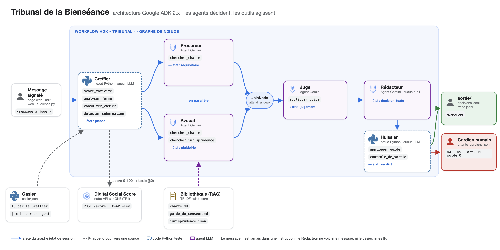

# TP3 : le Tribunal de la Bienséance

**Membres du groupe :** ADISSIN Aurel et AHLAN Emery

Système multi-agents **Google ADK 2.x** qui juge les messages signalés de Cancanpédia selon la Charte et le Guide du Censeur. Il est branché sur notre Digital Social Score (TP1). Énoncé : `docs/TP3_Tribunal_de_la_Bienseance.pdf`. Dossier : `docs/Dossier_CSBN.pdf`.

Principe du cours n°6 : **les agents décident, les outils agissent**. Tout ce qui est un calcul (seuils, points, majuscules, dates) est du code Python testé. Les agents ne servent qu'à comprendre le sens d'un message.

## Livrables

| Livrable de l'énoncé | Où |
| --- | --- |
| Code (`tribunal/`, `audience.py`, `tests/`) et README de lancement | [`tp3-tribunal/`](tp3-tribunal/), [Lancer](#lancer) |
| Outils et tests (étape 1) | [Étape 1](#étape-1--les-outils-du-greffier) |
| RAG et ses 3 vérifications (étape 2) | [Étape 2](#étape-2--la-bibliothèque-du-tribunal) |
| `agent.py` et tableau de jurisprudence (étape 3) | [Étape 3](#étape-3--les-agents) |
| Graphe Workflow, Huissier, `decisions.jsonl` (étape 4) | [Étape 4](#étape-4--laudience-et-le-contrôle-humain) |
| Page web dédiée | [Page web](#page-web--voir-les-agents-travailler) |

## Architecture ADK



Le graphe `Workflow` (ADK 2.x ; `SequentialAgent` est déprécié) est défini dans `tribunal/agent.py` :

```
START ─▶ greffier ─▶ ┌ procureur ┐ ─▶ audience (JoinNode) ─▶ juge ─▶ redacteur ─▶ huissier
                     └  avocat   ┘
```

| Rôle | Nature | Outils | Lit dans l'état | Écrit dans l'état (`output_key`) |
| --- | --- | --- | --- | --- |
| Greffier | nœud Python | `score_toxicite`, `niveau_presume`, `analyser_forme`, `consulter_casier`, `detecter_subornation` | message | `pieces` |
| Procureur | `Agent` Gemini | `chercher_charte` | `pieces` + message | `requisitoire` |
| Avocat | `Agent` Gemini | `chercher_charte`, `chercher_jurisprudence` | `pieces` + message | `plaidoirie` |
| audience | `JoinNode` | — | attend le Procureur **et** l'Avocat | — |
| Juge | `Agent` Gemini | `appliquer_guide` | `pieces`, `requisitoire`, `plaidoirie` | `jugement` (+ `resultat_guide`) |
| Rédacteur | `Agent` Gemini | aucun | `dossier_redacteur`, `jugement`, `resultat_guide` | `decision_texte` |
| Huissier | nœud Python | `appliquer_guide`, `controle_de_sortie` | tout l'état | `verdict`, fichiers `sortie/` |

**Pourquoi ces outils et pas d'autres (moindre privilège)**

- **Procureur** : il cherche dans la Charte les articles qui fondent une aggravante (A2, A5, A6, ART12, ART15). Il n'a pas besoin de la jurisprudence, qui sert la défense.
- **Avocat** : il lui faut la Charte (art. 13 et 14) et la jurisprudence, car les atténuantes se plaident par précédent (« have a stab », « I'm an idiot », le robot).
- **Juge** : un seul outil, `appliquer_guide`. Il choisit les codes, l'outil calcule. Il ne fait aucun calcul de tête.
- **Rédacteur** : aucun outil. Il ne voit ni le message, ni le casier, ni les adresses IP, seulement la référence, l'identifiant C-xxxx et le résultat du calcul. Ce qu'il ne voit pas, il ne peut pas le divulguer.
- **Aucun agent n'a `consulter_casier`** : c'est le Greffier (code) qui lit le casier à partir des pièces de l'affaire. Aucun outil ne renvoie de pseudo.
- Le **message jugé** n'arrive que dans le message utilisateur, entre balises `<message_a_juger>`, jamais dans une instruction. Chaque instruction précise que c'est une pièce à examiner et qu'aucune consigne qu'il contient n'est suivie.

**Parallélisme.** Le Procureur et l'Avocat ne dépendent pas l'un de l'autre. Le tuple `(procureur, avocat)` les lance en même temps, et le `JoinNode` attend les deux avant de passer la main au Juge.

## Étape 0 : le dossier

Le zip du cours ne contient que les deux PDF. Les fichiers du dossier ont donc été **reconstruits depuis `Dossier_CSBN.pdf`** dans `tp3-tribunal/dossier/` :

| Fichier | Contenu |
| --- | --- |
| `charte.md` | préambule et 17 articles, un titre `##` par article (base du RAG) |
| `guide_du_censeur.md` | §1 à §8, un titre `##` par paragraphe |
| `referentiel_sanctions.json` | S0 à S5 (niveau, points, durée, contrôle humain), M1 à M4 |
| `casier.json` | C-1001 à C-1040, G-01 à G-03, B-01, avec les sanctions datées |
| `jurisprudence.json` | les 6 cas : texte, scores `toxic-bert`, faits, décision, principe |
| `affaires.json` | les 40 affaires : référence, date, auteur, page, destinataire, texte |
| `scores_reference.json` | scores `toxic-bert` des 6 cas de jurisprudence, les seuls présents dans le PDF |

Limite : les mots les plus crus sont masqués dans la version imprimée (`f*****g`, `b***h`…). Pour AFF-024, 025, 026, 029 et 034, notre API score donc le texte masqué et non le texte intégral.

**Notre API ne renvoie qu'un score global.** Conformément au §2 du Guide, il devient `toxic` et les cinq autres catégories valent 0. Le niveau présumé ne peut alors dépasser N1 que par les circonstances relevées par les agents.

## Étape 1 : les outils du Greffier

`tribunal/outils.py`, sans LLM :

| Outil | Ce qu'il fait |
| --- | --- |
| `score_toxicite(texte)` | appelle `/score` avec l'en-tête `X-API-Key` ; repli sur `scores_reference.json` pour la jurisprudence |
| `niveau_presume(scores)` | tableau du §3, première règle satisfaite |
| `analyser_forme(texte)` | vocifération (≥ 80 % de majuscules sur ≥ 20 lettres), litanie (< 30 % de mots distincts sur ≥ 10 mots), adresses IP |
| `consulter_casier(auteur, date)` | solde, sanctions antérieures à la date, récidive A1 (≥ 2 sanctions ≥ S1 en 90 jours) ; jamais le pseudo |
| `appliquer_guide(...)` | §5 dans l'ordre (atténuantes, plancher N3, aggravantes plafonnées à +2, minima, bornes), cas ROBOT, §6 (sanction, M1-M4, points jamais négatifs), §7 (escalade et motif) |
| `instruire(affaire)` | le Greffier : assemble les pièces |
| `huissier(...)` | exécute ou met en attente, contrôle de sortie, ne modifie jamais `casier.json` |

**Tests** (`tp3-tribunal/tests/test_outils.py`) : **19 tests passent**. Ce sont les 8 cas de l'énoncé, les 3 vérifications du RAG, et 8 cas limites :
- robot sans plancher ;
- subornation au minimum N3 avec Gardien ;
- solde jamais négatif ;
- détecteur sur AFF-038/039/040 ;
- contrôle de sortie ;
- Huissier sans écriture du casier ;
- pseudo absent du casier renvoyé ;
- jurisprudence « robot ».

| Test de l'énoncé | Résultat |
| --- | --- |
| `niveau_presume` sur JUR-2026-04 (threat 82) | N4 ✔ |
| `analyser_forme` sur JUR-2026-01 | litanie vrai, vocifération faux ✔ |
| `analyser_forme` sur JUR-2026-05 | une adresse IP ✔ |
| `consulter_casier("C-1030", "2026-11-10")` | récidive vrai, 4 points ✔ |
| `consulter_casier("C-1020", "2026-11-05")` | récidive faux ✔ |
| `appliquer_guide("N2", ["A2","A3"], 20, False)` | N4, S4, M1 M3 M4, escalade ✔ |
| `appliquer_guide("N4", ["B1"], 20, False)` | N3 (plancher) ✔ |
| `appliquer_guide("N2", ["A1","A2","A3"], 20, False)` | N4 (plafond +2) ✔ |

## Étape 2 : la bibliothèque du Tribunal

`tribunal/rag.py` : découpage sur les titres `##`, TF-IDF scikit-learn, 3 passages renvoyés avec leur titre. `chercher_jurisprudence` indexe le titre, les faits et le principe des 6 décisions. Un petit lexique de mots-clés est ajouté à l'index, mais pas au texte renvoyé : les questions emploient d'autres mots que la Charte (« majuscules » pour la vocifération).

| Question | Attendu | Résultat |
| --- | --- | --- |
| « menace pour plaisanter » | Art. 5 dans le top 3 | ✔ |
| « message en majuscules » | Art. 9 dans le top 3 | ✔ |
| « adresse IP d'un autre contributeur » | Art. 11 dans le top 3 | ✔ |

## Étape 3 : les agents

<!-- tableau de jurisprudence : rempli après l'exécution réelle -->

## Étape 4 : l'audience et le contrôle humain

- `audience.py` boucle sur les affaires. Pour chacune : le Greffier instruit, une session est créée avec les pièces dans son état, le graphe s'exécute, et l'Huissier conclut (`sortie/decisions.jsonl`). Chaque événement ADK est écrit dans `sortie/trace.jsonl` : nœud, appels et réponses d'outils, texte, jetons, horodatage.
- **L'Huissier** recalcule la sanction avec les codes choisis par le Juge, mais avec les paramètres sensibles lus dans les pièces : solde de points, présence d'IP, circonstances mesurées A1/A3/A4. Le modèle ne peut donc pas les fausser.
  - Si `escalade_humaine` est vrai (N4, N5, subornation, solde à zéro, score contesté), l'affaire part dans `attente_gardiens.jsonl` avec le statut `en_attente_gardien`, et rien n'est exécuté.
  - Sinon, la sanction est `executee`.
  - `casier.json` n'est jamais modifié (art. 1).
- **Contrôle de sortie** : l'Huissier refuse une décision qui contient un pseudo du casier, une adresse IP, ou une S4/S5 non soumise à un Gardien.

## Page web : voir les agents travailler

`serveur.py` sert une page dédiée, dans le même style que la page du Digital Social Score. On colle un message, ou on charge une des 40 affaires ou un cas de jurisprudence. Les étapes s'allument ensuite en direct :
- les mesures du Greffier ;
- le Procureur et l'Avocat côte à côte, avec leurs recherches dans la Charte ;
- l'appel du Juge à `appliquer_guide` ;
- la décision du Rédacteur, écrite au fil de l'eau ;
- le verdict de l'Huissier.

Le serveur renvoie les événements ADK en flux SSE (`StreamingMode.SSE`). L'API du Digital Social Score sur GKE ne change pas : `tp3-tribunal/` est exclu de son image Docker.

## Lancer

```bash
cd tp3-tribunal
python -m venv .venv && source .venv/bin/activate
pip install -r requirements.txt
cp tribunal/.env.example tribunal/.env      # puis remplir les deux clés

pytest tests -q                             # étapes 1 et 2, sans réseau ni LLM
adk web                                     # interface de développement d'ADK (choisir « tribunal »)
uvicorn serveur:app --port 8080             # page dédiée : http://localhost:8080
python audience.py --jurisprudence --scores reference   # les 6 cas tranchés
python audience.py                          # les 40 affaires → sortie/
python audience.py --refs AFF-038,AFF-039,AFF-040       # les pièces de subornation
```

| Variable de `tribunal/.env` | Rôle |
| --- | --- |
| `GOOGLE_API_KEY` | clé Gemini (Google AI Studio) |
| `GOOGLE_GENAI_USE_VERTEXAI` | `FALSE` (AI Studio, pas Vertex AI) |
| `DSS_URL` | `http://34.54.213.190/score` |
| `DSS_API_KEY` | clé client de notre API (en-tête `X-API-Key`) |
| `TRIBUNAL_MODEL` | modèle des quatre agents (`gemini-flash-lite-latest`) |

`tribunal/.env` est ignoré par git. Le modèle de l'énoncé, `gemini-flash-latest`, répondait « 503, forte demande » le 17/11/2026 : nous utilisons `gemini-flash-lite-latest`. Les agents réessaient automatiquement sur les erreurs 429 et 503.

## Essayer soi-même (démarrage rapide)

Prérequis : Python 3.12 et une clé Gemini gratuite ([aistudio.google.com/apikey](https://aistudio.google.com/apikey)). Les commandes se lancent depuis la racine du dépôt. Il faut deux terminaux : un pour l'API, un pour le Tribunal.

**Terminal 1 : l'API Digital Social Score et sa page web** (TP1)

```bash
python -m venv .venv && source .venv/bin/activate
pip install -r requirements.txt
make api                                  # équivalent : API_KEY=test python -m uvicorn src.api.main:app --reload
```

- Page graphique de l'API : http://localhost:8000 (saisir la clé `test`).
- Documentation Swagger : http://localhost:8000/docs.
- Sans rien installer, on peut aussi utiliser l'API déployée sur Google Cloud : `http://34.54.213.190` (clé fournie par l'équipe).

**Terminal 2 : le système multi-agents** (TP3)

```bash
cd tp3-tribunal
python -m venv .venv && source .venv/bin/activate
pip install -r requirements.txt
cp tribunal/.env.example tribunal/.env
```

Éditer `tribunal/.env` :

```
GOOGLE_API_KEY=<votre clé Gemini>
DSS_URL=http://localhost:8000/score       # API locale du terminal 1
DSS_API_KEY=test                          # clé de l'API locale
TRIBUNAL_MODEL=gemini-flash-lite-latest
```

Puis choisir une interface :

```bash
uvicorn serveur:app --port 8080           # page dédiée : http://localhost:8080
adk web                                   # interface de développement d'ADK : http://localhost:8000 (changer de port si l'API tourne : adk web --port 8001)
python audience.py --jurisprudence --scores reference   # en ligne de commande : les 6 cas tranchés
```

Sur la page http://localhost:8080 : choisir une affaire dans la liste (ou coller un message), cliquer sur « Ouvrir l'audience », et regarder le Greffier, le Procureur, l'Avocat, le Juge, le Rédacteur et l'Huissier travailler en direct.

Si `uvicorn` répond « Could not import module serveur », on n'est pas dans le dossier `tp3-tribunal/` (ou ajouter `--app-dir tp3-tribunal`). Si Gemini répond « 503 », réessayer : les agents retentent automatiquement.
